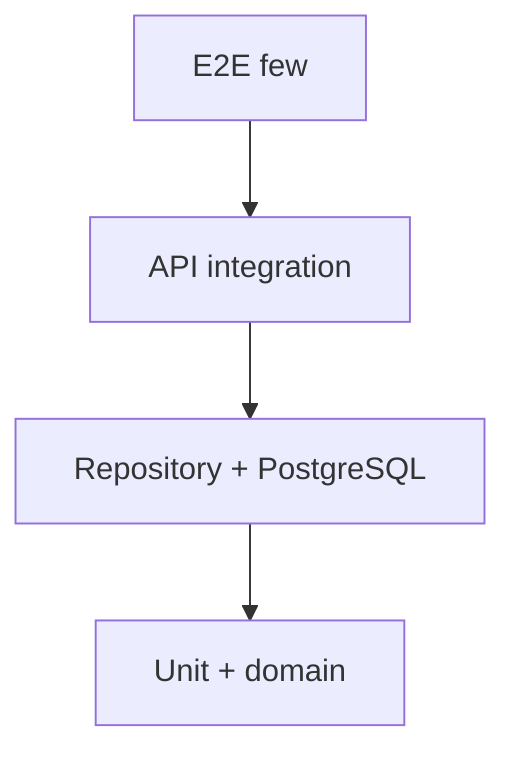

# Test Strategy

**Canonical testing architecture:** [TESTING-ARCHITECTURE.md](../03-architecture/testing/TESTING-ARCHITECTURE.md) — **prefer** that document for tooling inventory, CI AS-IS, and module strategy.

## AS-IS summary (2026-11-18)

| Fact | Evidence |
|------|----------|
| Test classes | **18** under `src/test/java` (unit, `@DataJpaTest`, `@SpringBootTest`, HTTP integration) |
| CI | `.github/workflows/backend-ci.yml` — `mvn -B clean test` + Postgres 16 service |
| Context smoke | `RealEstateApplicationTests` |
| Registry M1 | PostgreSQL acceptance suite (see Language Registry M1 status) |
| B2.1 WIP | `AdvertManagerTest`, `AdvertCreationHttpIntegrationTest` |
| Gaps | ArchUnit, JaCoCo, Testcontainers, MockMvc, public catalog tests, RFC 9457 contract tests |

Prior statement “only `contextLoads`” is **superseded** by the inventory above.

## Target pyramid (TO-BE)

**Figure RE-FIG-TEST-001** — Target test pyramid (qualitative).

See [TESTING-ARCHITECTURE.md](../03-architecture/testing/TESTING-ARCHITECTURE.md) §2 for AS-IS mapping.

## Layer policy (TO-BE)

| Layer | Scope | PostgreSQL needed |
|-------|-------|-------------------|
| Domain unit | Value objects, policies | No |
| Application | Use case with mocks | No |
| Repository | `@DataJpaTest` or full PG | **Yes** for Flyway/SQL fidelity |
| API | HTTP client or MockMvc + security | **Yes** for realistic integration |
| Security | JWT filter + authorization | Mixed |
| Contract | OpenAPI vs responses | **FUTURE** |
| E2E | Critical journeys | **FUTURE** |

## RealEstate examples (TO-BE)

| TEST ID | Scenario | FR |
|---------|----------|-----|
| TEST-AUTH-01 | Login returns JWT | FR-AUTH-002 |
| TEST-ADV-01 | Active list returns only active | FR-ADV-002 |
| TEST-TOUR-01 | Create tour request | FR-TOUR-001 |
| TEST-SEC-01 | Anonymous cannot delete user | NFR-SEC-001 |

## Coverage policy (PROPOSAL — not enforced)

- Domain + application: explicit tests on critical rules — **no** enforced % threshold AS-IS
- Controllers: contract tests for documented endpoints — **TO-BE**

## Test data

`com.github.javafaker` is on `pom.xml` — **not used** in source/tests as of 2026-11-18 inspection. Prefer deterministic fixtures; `@Transactional` rollback where applicable.

## Change history

| Version | Date | Summary |
|---------|------|---------|
| 0.1.0 | 2026-11-13 | Initial strategy; contextLoads gap |
| 0.2.0 | 2026-11-18 | Link TESTING-ARCHITECTURE; refresh AS-IS inventory (Group 9) |