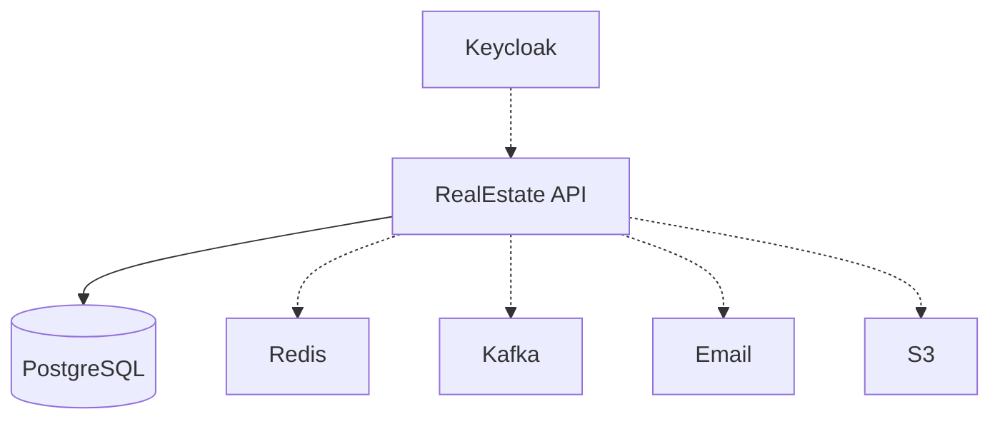

# Integration Catalogue

Classification: **Initial** = needed for current LEGACY parity; **Planned milestone**; **Optional future**.

| ID | Integration | Class | Pattern | Milestone | Notes |
|----|-------------|-------|---------|-----------|-------|
| INT-OAuth | OAuth2 / OIDC | Planned | Authorization Code + JWT | M3 | Replace/customize login |
| INT-KC | Keycloak | Planned | OIDC provider | M3 | Identity broker |
| INT-Redis | Redis | Optional | Cache + rate limit | M2 | Public read API |
| INT-Kafka | Apache Kafka | Optional | Domain events | M4 | Decouple notifications |
| INT-WS | WebSocket/STOMP | Optional | Push notifications | M4 | Chat enhancements |
| INT-gRPC | gRPC | Optional | Internal only if split | M5+ | Not now |
| INT-SignalR | SignalR interop | Optional | Bridge to .NET clients | M5+ | README LEGACY |
| INT-Email | SMTP/SendGrid | Initial | Adapter | M1 | Activation exceptions exist |
| INT-S3 | Object storage | Planned | S3-compatible | M2 | AWS block commented in yaml |
| INT-ExtData | External listing providers | Optional | Anti-corruption layer | M5+ | — |

**Figure RE-FIG-INT-001** — Integration landscape (dashed = not implemented).

Each integration requires: failure behavior, monitoring, security review before implementation (out of scope for docs-only phase).
