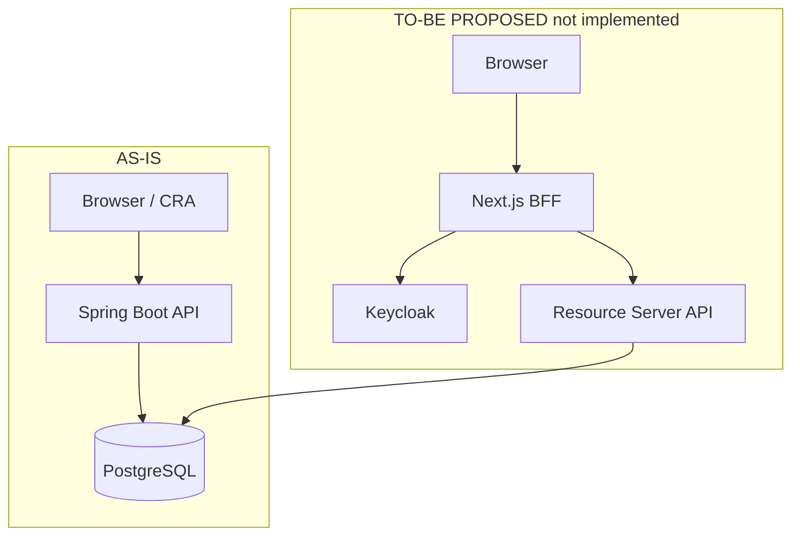
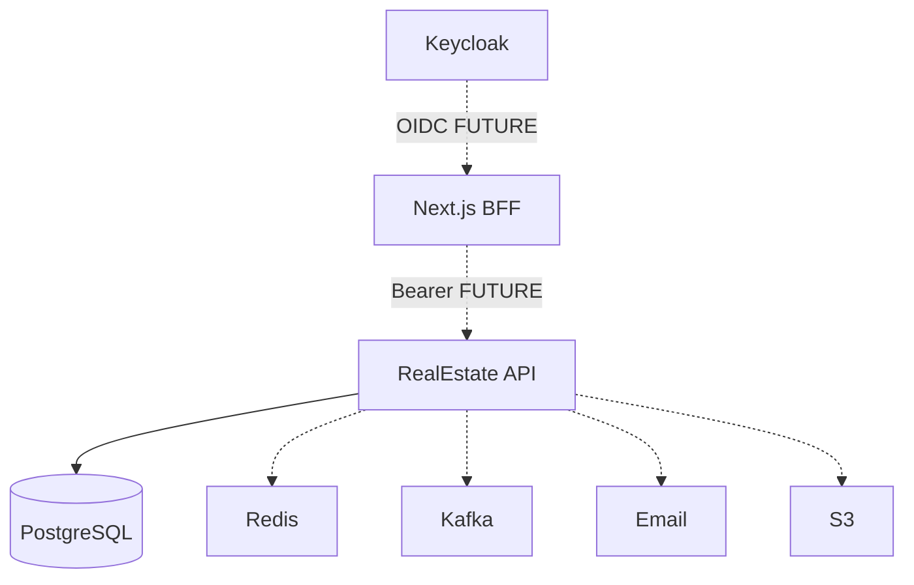

# Integration Catalogue

**Runtime deployment status:** [INFRASTRUCTURE-DEPLOYMENT-ARCHITECTURE.md](../03-architecture/infrastructure/INFRASTRUCTURE-DEPLOYMENT-ARCHITECTURE.md).

Classification: **Initial** = needed for current LEGACY parity; **Planned milestone**; **Optional future**.

| ID | Integration | Class | Pattern | Milestone | Notes |
|----|-------------|-------|---------|-----------|-------|
| INT-OAuth | OAuth2 / OIDC protocol | Planned | Authorization Code + PKCE | M3 | **Not implemented** |
| INT-KC | **Keycloak** (IdP / Authorization Server) | Planned | OIDC; login, tokens, credentials | M3 | **Not implemented** — see [SECURITY-ARCHITECTURE.md](../03-architecture/security/SECURITY-ARCHITECTURE.md) |
| INT-BFF | **Next.js BFF** (OAuth confidential client) | **PROPOSED** | Server-side token custody; cookie session | M3 | **Not implemented** — [ADR-003](../03-architecture/ADR/ADR-003-auth-token-bff-reconciliation.md) |
| INT-RS | Spring **OAuth2 Resource Server** (API) | Planned | JWT validation via JWK | M3 | Replaces custom `JWTUtils` filter — **Not implemented** |
| INT-Redis | Redis | Planned | Distributed infra (see splits below) | M2 | **Not deployed** — [CACHING-PERFORMANCE-ARCHITECTURE.md](../03-architecture/performance/CACHING-PERFORMANCE-ARCHITECTURE.md) |
| INT-Redis-Cache | Spring Cache → Redis | Planned | Application cache (cache-aside) | M2 | Not Spring Cache AS-IS |
| INT-Redis-RL | Redis + Bucket4j | Planned | IP/token rate limiting | M2 | **Not** `@Cacheable`; ADR-002 allows non-Redis fallback |
| INT-Kafka | Apache Kafka | Optional | Domain events | M4 | Decouple notifications |
| INT-WS | WebSocket/STOMP | Optional | Push notifications | M4 | Chat enhancements |
| INT-gRPC | gRPC | Optional | Internal only if split | M5+ | Not now |
| INT-SignalR | SignalR interop | Optional | Bridge to .NET clients | M5+ | README LEGACY |
| INT-Email | SMTP/SendGrid | Initial | Adapter | M1 | Activation exceptions exist |
| INT-S3 | Object storage (AWS S3 prod target) | Planned | S3 API | M2 | **Not deployed** |
| INT-MINIO | MinIO | Planned | S3-compatible dev/local | M2 | **Not deployed** — see [FILE-STORAGE-ARCHITECTURE.md](../03-architecture/storage/FILE-STORAGE-ARCHITECTURE.md) |
| INT-ExtData | External listing providers | Optional | Anti-corruption layer | M5+ | — |

### Authentication integration roles (TO-BE — not implemented)

| Layer | Technology | Responsibility |
|-------|------------|----------------|
| Protocol | OAuth 2.0 / OpenID Connect | Authorization Code + PKCE |
| IdP implementation | **Keycloak** | Login, credentials, MFA, token issue/refresh, IdP sessions |
| Web client edge | **Next.js BFF** (**PROPOSED**) | OIDC client; HttpOnly browser session; Bearer to API |
| API | **Spring Resource Server** | JWT signature/`iss`/`exp`/`aud`; no password store post-migration |

**AS-IS:** Custom JWT (`JWTUtils`, `JWTAuthenticationFilter`, application `password_hash`) — no Keycloak, no BFF.

**Figure RE-FIG-INT-002** — AS-IS vs PROPOSED auth integration topology.

**Caption:** Dashed conceptual future path; Keycloak and BFF are not deployed in current codebase.

**Explanation:** Distinguish **protocol** (OIDC), **IdP product** (Keycloak), **client** (BFF), and **resource server** (API).

**Figure RE-FIG-INT-001** — Integration landscape (dashed = not implemented).

Each integration requires: failure behavior, monitoring, security review before implementation.

## Change history

| Version | Date | Summary |
|---------|------|---------|
| 0.1.0 | 2026-11-13 | Initial catalogue |
| 0.2.0 | 2026-11-18 | Keycloak, BFF, Resource Server roles; not implemented |
| 0.2.1 | 2026-11-18 | MinIO dev + S3 prod; link FILE-STORAGE-ARCHITECTURE |
| 0.2.2 | 2026-11-18 | Redis cache vs Bucket4j rate limit; CACHING-PERFORMANCE-ARCHITECTURE |
| 0.2.3 | 2026-11-18 | Link INFRASTRUCTURE-DEPLOYMENT-ARCHITECTURE |