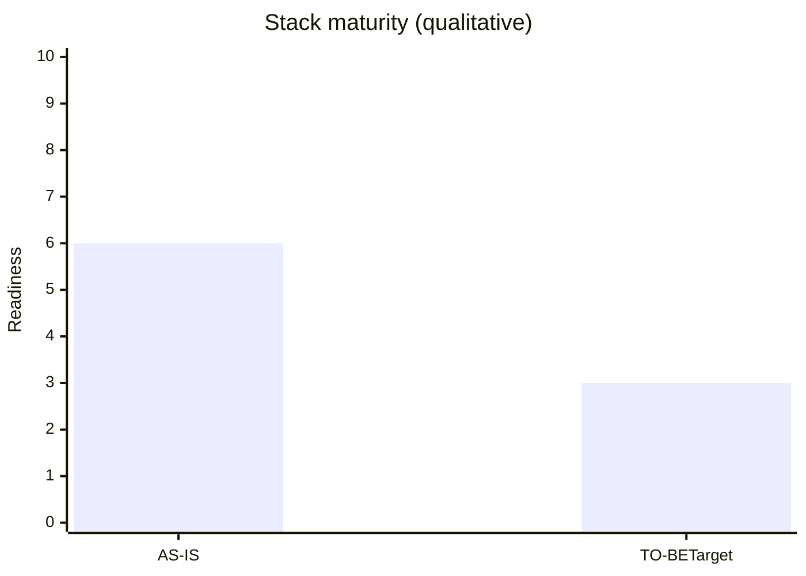

# Technology Baseline

**No upgrade authorized by this documentation task** — matrix for future migration planning only.

## AS-IS stack (verified)

**Authority:** `pom.xml` at repo root (Spring Boot parent **4.1.2** as of 2026-11-18 inspection). **Drift:** [docs/README.md](../README.md) AS-IS snapshot table aligned with this doc (v0.2.1); root showcase `README.md` lists Boot 4.1.2. Untracked `effective-pom-3516` (if present) reflects an older **3.5.16** effective POM — not current runtime. **Deployment detail:** [INFRASTRUCTURE-DEPLOYMENT-ARCHITECTURE.md](../03-architecture/infrastructure/INFRASTRUCTURE-DEPLOYMENT-ARCHITECTURE.md).

| Component | Version | Source |
|-----------|---------|--------|
| Java | 17 | `pom.xml` |
| Spring Boot | **4.1.2** (parent) | `pom.xml` |
| Spring Security / Hibernate / Framework | Boot **4.1.2** BOM-managed | `pom.xml` |
| PostgreSQL driver | Runtime | `pom.xml` |
| MapStruct | 1.6.3 | `pom.xml` |
| jjwt | **0.12.7** | `pom.xml` |
| springdoc | **3.2.0** (`springdoc-openapi-starter-webmvc-ui`) | `pom.xml` |
| Flyway | `spring-boot-starter-flyway` + `flyway-database-postgresql`; **V1–V3** | `pom.xml`; [PERSISTENCE-ARCHITECTURE.md](../03-architecture/database/PERSISTENCE-ARCHITECTURE.md) |
| Object storage | **Not** in runtime AS-IS | TO-BE MinIO / AWS S3 — [FILE-STORAGE-ARCHITECTURE.md](../03-architecture/storage/FILE-STORAGE-ARCHITECTURE.md) |
| Redis / Spring Cache | **Not** in `pom.xml` | [CACHING-PERFORMANCE-ARCHITECTURE.md](../03-architecture/performance/CACHING-PERFORMANCE-ARCHITECTURE.md) |
| Testcontainers / ArchUnit / JaCoCo | **Not** in `pom.xml` | [TESTING-ARCHITECTURE.md](../03-architecture/testing/TESTING-ARCHITECTURE.md) |
| Maven Wrapper | **`mvnw` / `mvnw.cmd` present** | repo root |
| CI | GitHub Actions `backend-ci.yml` | `mvn -B clean test` + Postgres 16 service |
| Docker app image | **None** | Compose: Postgres only — INFRA doc §4 |
| Actuator | `spring-boot-starter-actuator` | exposure **TBD** in yaml |

## TO-BE target directions (official compatibility — SRC-015)

Verified from Spring Boot **system requirements** documentation (4.0.x / 4.1.x line):

| Component | Target direction | Compatibility note |
|-----------|------------------|-------------------|
| Java | **25 LTS** (org target) | Boot 4.x supports Java 17 through **25** (4.0); 4.1.x docs mention up to **27** — confirm at migration time |
| Spring Boot | **4.x** current supported line | Requires Spring Framework **7.x** |
| Spring Framework | **7.0.x+** | Paired with Boot 4 |
| Spring Security | **7.0.x** line with Boot 4 | Not 4.x — **do not assume** |
| Hibernate ORM | Boot 4 managed (**7.x** generation per Boot 4 release notes) | Verify during upgrade spike |
| PostgreSQL | Current supported driver via Boot BOM | — |
| Flyway module-scoped migrations | Per-module folders/naming **TBD** | TO-BE |
| MapStruct | Upgrade to current compatible with Java 25 | TO-BE spike |
| Testcontainers | 2.x with Boot 4 | TO-BE |
| OpenAPI | springdoc version compatible with Boot 4 | TBD vendor matrix |

References (external):

- [Spring Boot system requirements](https://docs.spring.io/spring-boot/system-requirements.html)
- [Spring Boot 4.0 release](https://github.com/spring-projects/spring-boot/releases/tag/v4.0.0)

## Comparison chart

**Figure RE-FIG-TECH-001** — AS-IS production familiarity vs TO-BE migration readiness (qualitative draft).

## Frontend cross-reference (read-only)

**Canonical:** [FRONTEND-ARCHITECTURE.md](../03-architecture/frontend/FRONTEND-ARCHITECTURE.md).

| Item | Value |
|------|-------|
| React | 18.2 |
| Build | CRA `react-scripts` 5.0.1 (not Vite in package.json) |
| Router | `react-router-dom` 6.18 |
| HTTP / forms | axios, Formik, Yup |
| i18n | i18next; locales en/tr/de JSON — `react-i18next` used in source but **not** in `package.json` (discrepancy) |
| TypeScript / Next.js | **Not** in frontend `package.json` (TO-BE Next.js per SAD) |

Strategic prompt mentioned Vite — **discrepancy**: Frontend folder uses CRA (AS-IS).

## Planned README technologies (LEGACY intent)

RabbitMQ, Redis, Elasticsearch, SignalR, Docker — not in Backend `pom.xml` (SRC-001). **Compose Postgres only** — see [INFRASTRUCTURE-DEPLOYMENT-ARCHITECTURE.md](../03-architecture/infrastructure/INFRASTRUCTURE-DEPLOYMENT-ARCHITECTURE.md).

## Change history

| Version | Date | Summary |
|---------|------|---------|
| 0.1.0 | (initial) | AS-IS stack table |
| 0.1.4 | 2026-11-18 | **Boot 4.1.2**, jjwt 0.12.7, springdoc 3.2.0, mvnw present; pom drift note; INFRA link (Group 10) |
| 0.1.5 | 2026-11-18 | Frontend verified deps + link to FRONTEND-ARCHITECTURE (Group 12) |
| 0.1.6 | 2026-11-18 | Drift note: `docs/README.md` baseline sync (Boot 4.1.2); remove stale root README Boot 3.0 drift |
