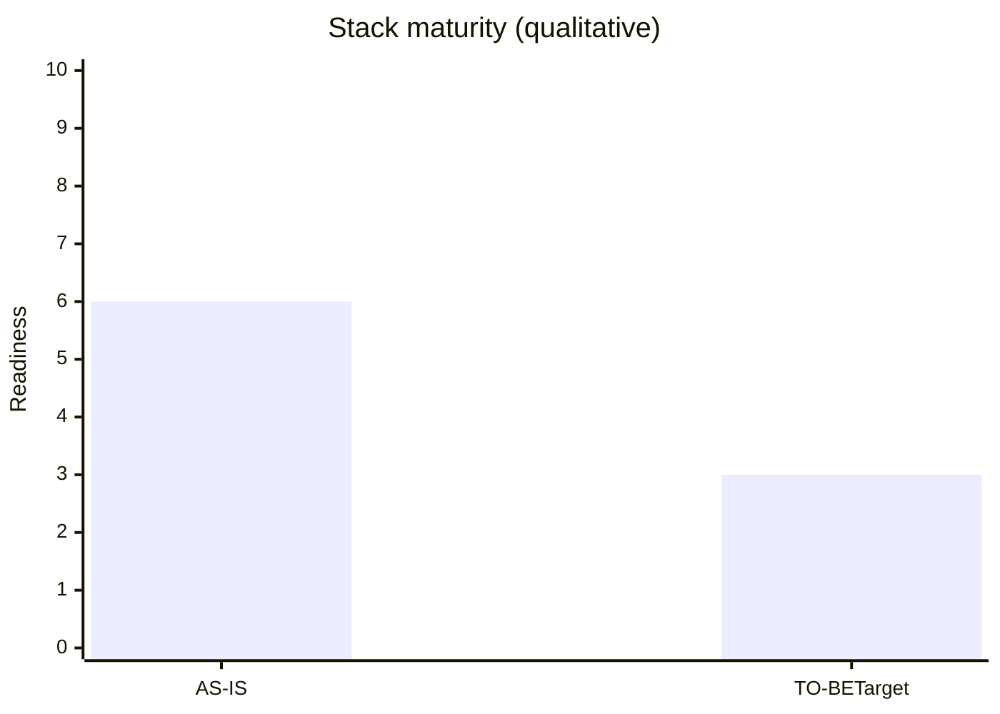

# Technology Baseline

**No upgrade authorized by this documentation task** — matrix for future migration planning only.

## AS-IS stack (verified)

| Component | Version | Source |
|-----------|---------|--------|
| Java | 17 | `pom.xml` |
| Spring Boot | 3.5.16 (parent) | `pom.xml` |
| Spring Security | Boot-managed 6.5.x line | Boot 3.5.16 BOM |
| Hibernate | Boot-managed 6.6.x | JPA starter |
| PostgreSQL driver | Runtime | `pom.xml` |
| MapStruct | 1.6.3 | `pom.xml` |
| jjwt | 0.11.5 | `pom.xml` |
| springdoc | 2.10.0 (`springdoc-openapi-starter-webmvc-ui`) | `pom.xml` |
| Flyway | `flyway-core` + `flyway-database-postgresql` | `pom.xml` |
| Testcontainers | **Not present** | — |
| Maven Wrapper | **Not found** — Docker Maven 3.9 + Java 17 | build procedure |
| Actuator | Boot BOM (no version override) | `pom.xml` |

## TO-BE target directions (official compatibility — SRC-015)

Verified from Spring Boot **system requirements** documentation (4.0.x / 4.1.x line):

| Component | Target direction | Compatibility note |
|-----------|------------------|-------------------|
| Java | **25 LTS** (org target) | Boot 4.x supports Java 17 through **25** (4.0); 4.1.x docs mention up to **27** — confirm at migration time |
| Spring Boot | **4.x** current supported line | Requires Spring Framework **7.x** |
| Spring Framework | **7.0.x+** | Paired with Boot 4 |
| Spring Security | **7.0.x** line with Boot 4 | Not 4.x — **do not assume** |
| Hibernate ORM | Boot 4 managed (**7.x** generation per Boot 4 release notes) | Verify during upgrade spike |
| PostgreSQL | Current supported driver via Boot BOM | — |
| Flyway | Add when schema managed | TO-BE |
| MapStruct | Upgrade to current compatible with Java 25 | TO-BE spike |
| Testcontainers | 2.x with Boot 4 | TO-BE |
| OpenAPI | springdoc version compatible with Boot 4 | TBD vendor matrix |

References (external):

- [Spring Boot system requirements](https://docs.spring.io/spring-boot/system-requirements.html)
- [Spring Boot 4.0 release](https://github.com/spring-projects/spring-boot/releases/tag/v4.0.0)

## Comparison chart

**Figure RE-FIG-TECH-001** — AS-IS production familiarity vs TO-BE migration readiness (qualitative draft).

## Frontend cross-reference (read-only)

| Item | Value |
|------|-------|
| React | 18.2 |
| Build | CRA `react-scripts` 5.0.1 (not Vite in package.json) |
| i18n | i18next; locales en/tr/de |

Strategic prompt mentioned Vite — **discrepancy**: Frontend folder uses CRA (AS-IS).

## Planned README technologies (LEGACY intent)

RabbitMQ, Redis, Elasticsearch, SignalR, Docker — not in Backend `pom.xml` (SRC-001).
