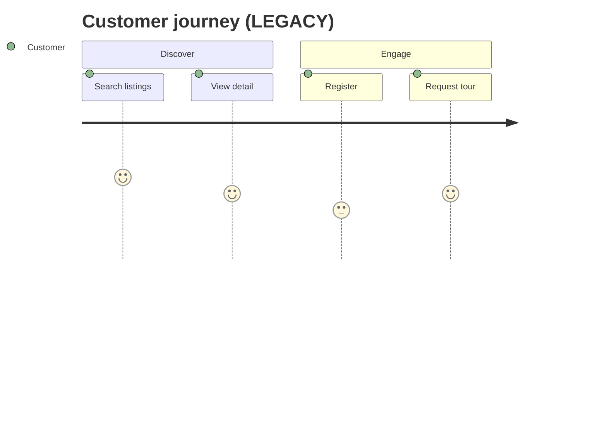

# Level 1 — Business and Software Foundations

## 1. Learning objectives

- Explain the RealEstate business domain and roles.
- Read a BRD/FRD and map requirements to APIs.
- Describe REST basics as used in this project.

## 2. Prerequisites

None.

## 3. Real-world problem

Buyers need trustworthy listing data; sellers need simple publishing; staff need governance tools.

## 4. Concept — business domain

Prettier Homes connects **listings**, **users**, and **engagement** (favorites, tours, contact).

## 5. Visual

See role hierarchy: `assets/architecture/roles-hierarchy-legarcy.jpg` (LEGACY).

**Figure EDU-FIG-L01-001** — Journey map (LEGACY intent).

## 6. Alternatives

Portal-only vs API-first SPA — this product is API-first backend.

## 7. RealEstate example

Registration: `POST /api/v1.0/auth/EN/signUp` (FR-AUTH-001).

## 8. Code reference (read-only)

Inspect `AuthController` in Backend — no changes in learning mode.

## 9. Best practices

- Always label AS-IS vs LEGACY when discussing features.

## 10. Anti-patterns

- Documenting endpoints not present in code (e.g. empty `TourRequestController`).

## 11. Exercise

List three LEGACY capabilities missing REST mappings (hint: tours, advert types, images).

## 12. Knowledge check

1. Name four LEGACY roles.  
2. What does `api/v1.0` signify?  
3. Where is JWT validated?

## 13. References

- [BRD-EN.md](../../01-business/BRD/BRD-EN.md)
- [API-INVENTORY.md](../../03-architecture/api/API-INVENTORY.md)
