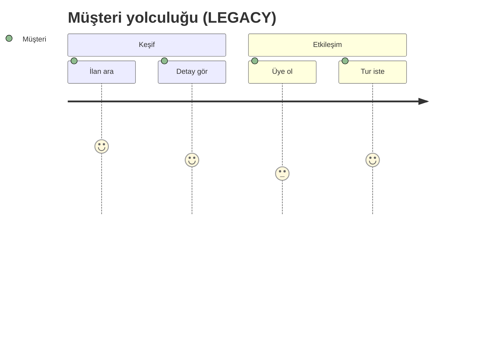

# Seviye 1 — İş ve Yazılım Temelleri

## 1. Öğrenme hedefleri

- RealEstate iş alanını ve rolleri açıklamak.
- BRD/FRD okuyup API’lere eşlemek.
- Bu projedeki REST temellerini anlatmak.

## 2. Ön koşullar

Yok.

## 3. Gerçek dünya problemi

Alıcılar güvenilir ilan verisi ister; satıcılar kolay yayın; operasyon ekibi yönetim araçları ister.

## 4. Kavram — iş alanı

Prettier Homes; **ilan**, **kullanıcı** ve **etkileşim** (favori, tur, iletişim) bileşenlerini birleştirir.

## 5. Görsel

Rol hiyerarşisi: `assets/architecture/roles-hierarchy-legarcy.jpg` (LEGACY).

**Şekil EDU-FIG-L01-001-TR** — Yolculuk haritası (LEGACY niyet).

## 6. Alternatifler

Yalnızca portal vs API öncelikli SPA — bu ürün API önceliklidir.

## 7. RealEstate örneği

Kayıt: `POST /api/v1.0/auth/TR/signUp` (FR-AUTH-001).

## 8. Kod referansı (salt okunur)

`AuthController` incelenir — öğrenme modunda değişiklik yok.

## 9. En iyi uygulamalar

- Özellikleri anlatırken AS-IS / LEGACY etiketini kullanın.

## 10. Anti-pattern’ler

- Kodda olmayan uçları dokümante etmek (`TourRequestController` boş).

## 11. Alıştırma

REST eşlemesi eksik üç LEGACY yeteneği listeleyin (ipucu: tur, ilan tipi, görseller).

## 12. Bilgi kontrolü

1. Dört LEGACY rol adı?  
2. `api/v1.0` ne ifade eder?  
3. JWT nerede doğrulanır?

## 13. Kaynaklar

- [BRD-TR.md](../../01-business/BRD/BRD-TR.md)
- [API-INVENTORY.md](../../03-architecture/api/API-INVENTORY.md)
