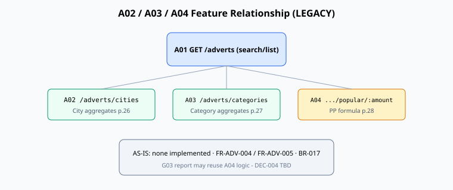
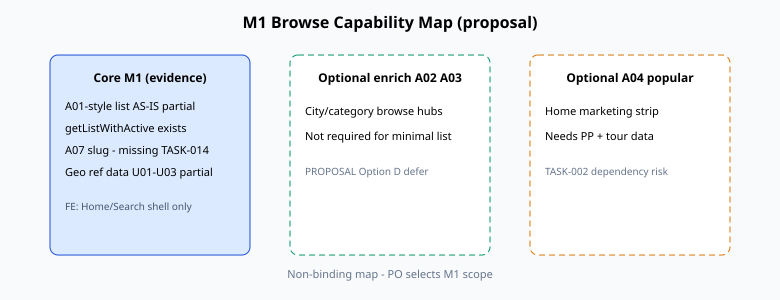
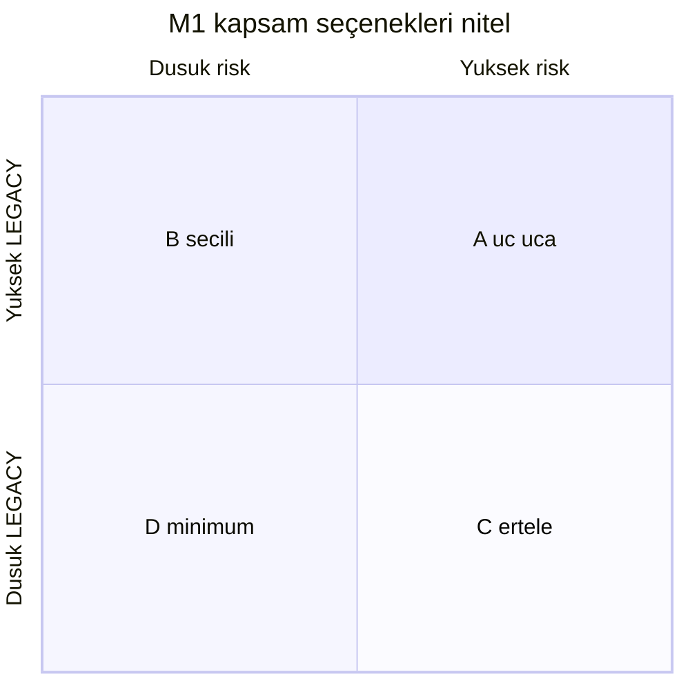
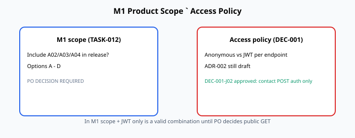

# DEC-001 — A02 / A03 / A04 M1 Ürün Kapsamı İncelemesi (TASK-012)

## 1. Amaç ve kapsam

Bu belge, LEGACY **A02**, **A03** ve **A04** uçlarının **M1** (ilk sürüm dilimi) kapsamına girip girmeyeceğine ilişkin **kanıta dayalı Ürün Sahibi karar paketini** hazırlar.

| Kapsamda | Kapsam dışı |
|----------|-------------|
| Uç başına tarihsel ve AS-IS kanıt | API uygulaması |
| M1 **A–D seçenekleri** | DEC-001, ADR-002 veya anonim GET onayı |
| Erişim politikasını **ayrı** sınıflandırma önerileri | **DEC-001-J02** değişikliği (iletişim POST — **onaylı**, kimlik doğrulamalı) |
| Bağlayıcı olmayan öneri + PO soruları | Uydurma JSON şemaları |

İngilizce eşdeğer: [DEC-001-A02-A04-SCOPE-REVIEW.md](DEC-001-A02-A04-SCOPE-REVIEW.md).

**Karar durumu:** **DEC-001-M1-A02-A04 onaylandı** (Seçenek D, TASK-012-A). **DEC-001** (bütün) ve **ADR-002** **onaylanmadı**.

---

## 2. Kanıt ve kaynak referansları

| Kaynak | Kullanım |
|--------|----------|
| SRC-008-PDF | A02 s.26, A03 s.27, A04 s.28 |
| LEGACY-REQUIREMENTS-ANALYSIS | Uç tablosu, LEG-NFR-006 (PP formülü) |
| LEGACY_API_TO_FR_MATRIX | Durum **Missing** |
| FRD-EN / FRD-TR | FR-ADV-004, FR-ADV-005 |
| BRD | BR-017 |
| `AdvertController` (AS-IS) | Yalnızca `getAll`, `getListWithActive`, CRUD |
| Frontend (salt okunur) | `HomeSlider` + `Search`; A02–A04 API **yok** |

**Şekil RE-FIG-DEC-012-001** — A01 çekirdek listesi ile LEGACY ilişki.

---

## 3. Bireysel analiz — A02

| # | Konu | Bulgu |
|---|------|-------|
| 1 | **LEGACY** | GET `/adverts/cities`, s. **26**, **A02** |
| 2 | **İş amacı** | **LEGACY / çıkarım** — İlanların **şehre göre** gruplanması/özetlenmesi (yanıt gövdesi **TBD**) |
| 3 | **Kullanıcı/rol** | **LEGACY** — **Anonymous +** |
| 4 | **Yolculuk / değer** | **PROPOSAL** — Şehir seçimi ile keşif |
| 5 | **Backend AS-IS** | **Yok** |
| 6 | **Auth AS-IS** | Yok; mevcut advert GET’leri **JWT** |
| 7 | **Frontend AS-IS** | Entegrasyon **yok** |
| 8 | **BR / FR** | **BR-017**; **FR-ADV-004** |
| 9 | **Bağımlılık** | Yayın kuralları **TBD**; U02; DEC-006 |
| 10 | **Güvenlik** | Düşük PII; sayfalama **TBD** |
| 11 | **M1 efor/risk** | **Orta**; sözleşme **TBD** |
| 12 | **Kullanılabilir M1 şart mı?** | **PROPOSAL: Hayır** |

---

## 4. Bireysel analiz — A03

| # | Konu | Bulgu |
|---|------|-------|
| 1 | **LEGACY** | GET `/adverts/categories`, s. **27**, **A03** |
| 2 | **İş amacı** | **LEGACY / çıkarım** — Kategoriye göre ilan grupları |
| 3 | **Kullanıcı/rol** | **Anonymous +** |
| 4 | **Yolculuk** | **PROPOSAL** — Kategori odaklı vitrin |
| 5 | **Backend AS-IS** | **Yok** |
| 6 | **Auth** | Kategori API JWT |
| 7 | **Frontend** | **Yok** |
| 8 | **BR / FR** | **BR-017**; **FR-ADV-004** |
| 9 | **Bağımlılık** | C01–C03; `Advert.category` **AS-IS** |
| 10 | **Güvenlik** | A02 benzeri |
| 11 | **M1 efor** | **Orta** |
| 12 | **M1 şart mı?** | **PROPOSAL: Hayır** |

---

## 5. Bireysel analiz — A04

| # | Konu | Bulgu |
|---|------|-------|
| 1 | **LEGACY** | GET `/adverts/popular/:amount`, s. **28**, **A04** |
| 2 | **İş amacı** | En popüler **N** ilan |
| 3 | **Kullanıcı/rol** | **Anonymous +** |
| 4 | **Yolculuk** | **PROPOSAL** — Popüler ilanlar karuseli |
| 5 | **Backend AS-IS** | **Yok**; `viewCount` var, artırma TODO |
| 6 | **Auth** | Yok |
| 7 | **Frontend** | `Slider` var; API **yok** |
| 8 | **BR / FR** | **BR-017**; **FR-ADV-005** |
| 9 | **Bağımlılık** | **PP = 3×TROA + TVOA**; tur **TASK-002**; G03 **TBD** |
| 10 | **Güvenlik** | Liste ile aynı alan riski |
| 11 | **M1 efor/risk** | **Orta–yüksek** |
| 12 | **M1 şart mı?** | **PROPOSAL: Hayır**; pazarlama isteğe bağlı |

---

## 6. Karşılaştırmalı özellik matrisi

| Boyut | A02 | A03 | A04 |
|-------|-----|-----|-----|
| PDF sayfa | 26 | 27 | 28 |
| AS-IS | Yok | Yok | Yok |
| FR | FR-ADV-004 | FR-ADV-004 | FR-ADV-005 |
| PDF anonim | + | + | + |
| FE | Yok | Yok | Yok |
| Özel mantık | Yanıt **TBD** | Yanıt **TBD** | PP formülü |

---

## 7. M1 alternatifleri ve ödünleşimler

| Seçenek | Açıklama | Değer | Efor | Risk |
|---------|----------|-------|------|------|
| **A — Üçü M1** | A02+A03+A04 | Yüksek keşif | Yüksek | Şema/formül |
| **B — Seçili** | örn. yalnız A04 | Orta | Orta | A04 tur bağı |
| **C — Ertle** | M1 sonrası | Düşük M1 | Düşük | LEGACY uyumu zayıf |
| **D — Minimum** | Liste+slug+geo; A02–A04 yok | Odaklı MVP | En düşük | En düşük teslimat riski |

### Bağlayıcı olmayan öneri

**D veya C:** M1’de A02–A04 **ertelemek**; önce çekirdek gezinme ve DEC-001 erişim politikası. Tek eklenti istenirse **B ile A04** — formül/tur riski PO onayı gerekir.

---

## 8. Ürün kapsamı ve erişim politikası

| Uç | M1 kapsamı | Anonim erişim | Kimlik doğrulamalı | Durum |
|----|------------|---------------|-------------------|--------|
| **A02** | **M1 sonrasına ertelendi** (Seçenek D) | **TBD** | **TBD** | Kapsam **onaylı**; erişim **TBD** |
| **A03** | **M1 sonrasına ertelendi** | **TBD** | **TBD** | Kapsam **onaylı**; erişim **TBD** |
| **A04** | **M1 sonrasına ertelendi** | **TBD** | **TBD** | Kapsam **onaylı**; erişim **TBD** |

**Sabit:** **DEC-001-J02** — iletişim POST **yalnızca kimlik doğrulamalı** (**onaylı**).

---

## 9. Bağımlılıklar ve riskler

DEC-001/ADR-002 yalnızca erişim sütununu etkiler. TASK-014, TASK-002, TASK-019, eksik PDF yanıt şekilleri, `viewCount` artışı **TBD**.

---

## 10. PO karar kaydı (onaylı)

| Alan | Değer |
|------|-------|
| **Karar ID** | DEC-001-M1-A02-A04 |
| **Seçilen seçenek** | **D — Minimum uygulanabilir kullanıcı yolculuğu** |
| **Karar** | **A02**, **A03**, **A04** **M1 dışında**; **sonraki sürüme ertelendi** (sürüm no/tarih yok). |
| **Gerekçe** | Temel **ilan listeleme ve ilan detayı** öncelikli; A02–A04 ilk sürüm kapsamını genişletmemeli. |
| **Onay** | TASK-012-A, 2026-11-13 |

### Kalan PO soruları (kapsam sonrası)

1. **BR-017** M1 sonrası aşamalı teslim kabul edilebilir mi?
2. **A04** formülü — **TBD**
3. Uygulandığında **anonim vs JWT** — **TBD**

---

## 11. Karar durumu ve sonraki adımlar

| Öğe | Durum |
|-----|--------|
| DEC-001 (bütün) | **Onaylanmadı** |
| ADR-002 | **Taslak** |
| DEC-001-J02 | **Onaylı** — değişmedi |
| DEC-001-M1-A02-A04 | **Onaylı** — Seçenek D |

---

## 12. Değişiklik geçmişi

| Sürüm | Tarih | Özet |
|-------|-------|------|
| 0.1.0 | 2026-11-13 | TASK-012 kapsam inceleme paketi |
| 0.1.1 | 2026-11-13 | TASK-012-A: PO Seçenek D kaydı |
