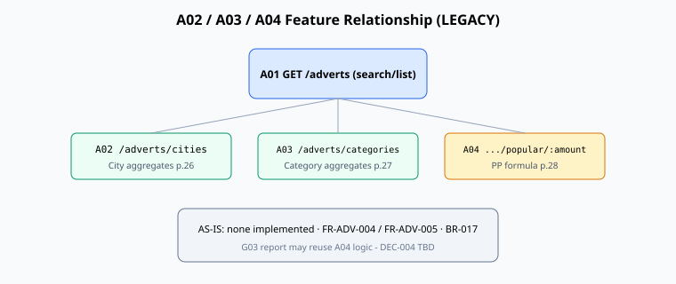
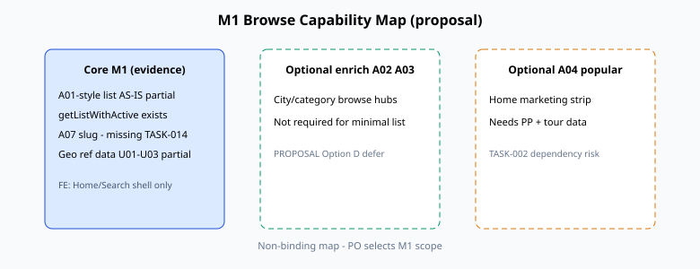
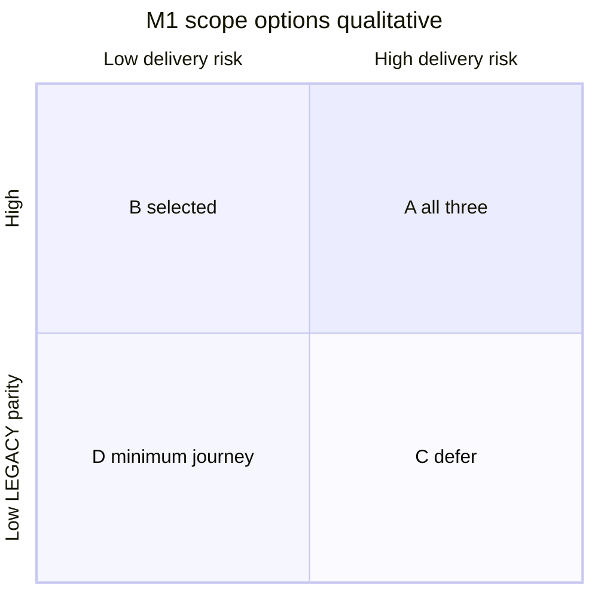
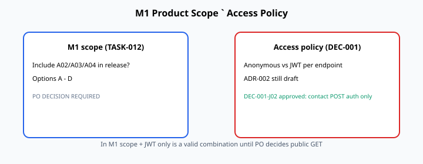

# DEC-001 — A02 / A03 / A04 M1 Product Scope Review (TASK-012)

## 1. Purpose and scope

This document prepares an **evidence-based Product Owner decision package** for whether LEGACY aggregation and popularity endpoints **A02**, **A03**, and **A04** belong in **M1** (initial release slice).

| In scope | Out of scope |
|----------|----------------|
| Historical vs AS-IS evidence per endpoint | API implementation |
| M1 product scope **options** A–D | Approving DEC-001, ADR-002, or anonymous GET |
| **Separate** access-policy classification proposals | Changing **DEC-001-J02** (contact POST authenticated — **approved**) |
| Non-binding recommendation + PO questions | Inventing response JSON schemas |

Turkish equivalent: [DEC-001-A02-A04-SCOPE-REVIEW-TR.md](DEC-001-A02-A04-SCOPE-REVIEW-TR.md).

**Decision status:** **DEC-001-M1-A02-A04 approved** (Option D, TASK-012-A). **DEC-001** (whole) and **ADR-002** remain **not approved**.

---

## 2. Evidence and source references

| Source | Use |
|--------|-----|
| [SRC-008-PDF](../00-governance/SOURCE_REGISTER.md) | A02 p.26, A03 p.27, A04 p.28 |
| [LEGACY-REQUIREMENTS-ANALYSIS.md](../01-business/source-analysis/LEGACY-REQUIREMENTS-ANALYSIS.md) | Endpoint table, LEG-NFR-006 (PP formula) |
| [LEGACY_API_TO_FR_MATRIX.md](../02-requirements/FRD/LEGACY_API_TO_FR_MATRIX.md) | Status **Missing** |
| [FRD-EN.md](../02-requirements/FRD/FRD-EN.md) | FR-ADV-004, FR-ADV-005 |
| [BRD-EN.md](../01-business/BRD/BRD-EN.md) | BR-017 |
| `AdvertController` (AS-IS) | Only `getAll`, `getListWithActive`, CRUD |
| Frontend (read-only) | `HomeSlider` + `Search` UI shell; **no** API calls for A02–A04 |

**Figure RE-FIG-DEC-012-001** — LEGACY relationship to core list (A01).

---

## 3. Individual analysis — A02

| # | Topic | Finding |
|---|--------|---------|
| 1 | **LEGACY requirement** | **LEGACY** GET `/adverts/cities`, p. **26**, code **A02** |
| 2 | **Business purpose** | **LEGACY / inferred** — Surface adverts **grouped or aggregated by city** for discovery/navigation (exact payload **TBD** — not extracted field-by-field from PDF in repo) |
| 3 | **Intended user/role** | **LEGACY** — **Anonymous +** (per matrix) |
| 4 | **User journey / value** | **PROPOSAL** — Home or search: pick city → see listing groups; improves browse vs flat paginated list |
| 5 | **Backend AS-IS** | **AS-IS** — **No** `/adverts/cities` mapping; no service method found (repository grep) |
| 6 | **Auth AS-IS** | N/A (missing); existing advert GETs require **JWT** |
| 7 | **Frontend AS-IS** | **AS-IS** — No integration |
| 8 | **BR / FR** | **BR-017**; **FR-ADV-004** (with A03); TASK-011 (impl backlog) |
| 9 | **Dependencies** | Published adverts (`isActive` / status rules **TBD**); geo **U02** partial; **DEC-006** public filters |
| 10 | **Security** | Aggregates expose counts/metadata — low PII if no owner data; large result sets → **TBD** pagination |
| 11 | **M1 effort/risk** | **Medium** — new query/aggregation; contract **TBD** |
| 12 | **Necessary for usable M1?** | **PROPOSAL: No** — core browse can use list + filters (Option D) without dedicated A02 |

---

## 4. Individual analysis — A03

| # | Topic | Finding |
|---|--------|---------|
| 1 | **LEGACY requirement** | **LEGACY** GET `/adverts/categories`, p. **27**, code **A03** (PDF path note: typo `/adverts/types` on p.27 in analysis) |
| 2 | **Business purpose** | **LEGACY / inferred** — Adverts **grouped by category** for discovery |
| 3 | **Intended user/role** | **LEGACY** — **Anonymous +** |
| 4 | **User journey / value** | **PROPOSAL** — Category-centric landing sections on home/marketing |
| 5 | **Backend AS-IS** | **Missing** — no endpoint |
| 6 | **Auth AS-IS** | N/A; category metadata elsewhere under `CategoryController` (JWT) |
| 7 | **Frontend AS-IS** | **Missing** |
| 8 | **BR / FR** | **BR-017**; **FR-ADV-004** |
| 9 | **Dependencies** | Category tree **C01–C03**; advert–category relation in `Advert` entity **AS-IS** |
| 10 | **Security** | Similar to A02 — aggregation exposure **TBD** |
| 11 | **M1 effort/risk** | **Medium**; possible overlap with client-side grouping from A01 list **PROPOSAL** |
| 12 | **Necessary for usable M1?** | **PROPOSAL: No** for minimal journey |

---

## 5. Individual analysis — A04

| # | Topic | Finding |
|---|--------|---------|
| 1 | **LEGACY requirement** | **LEGACY** GET `/adverts/popular/:amount`, p. **28**, code **A04** |
| 2 | **Business purpose** | **LEGACY** — Return top **N** popular adverts |
| 3 | **Intended user/role** | **LEGACY** — **Anonymous +** |
| 4 | **User journey / value** | **PROPOSAL** — “Popular properties” carousel (`home-slider` placeholder could consume) |
| 5 | **Backend AS-IS** | **Missing**; `Advert.viewCount` exists with TODO to increment on view (**AS-IS partial**) |
| 6 | **Auth AS-IS** | N/A |
| 7 | **Frontend AS-IS** | `Slider` component present; **no** popular API |
| 8 | **BR / FR** | **BR-017**; **FR-ADV-005**; TASK-012 (impl backlog in TODO) |
| 9 | **Dependencies** | **LEG-NFR-006** — **PP = 3×TROA + TVOA** (**LEGACY**); **TROA** likely tour-related → **TASK-002** / empty `TourRequestController`; **G03** report may share formula (**DEC-004 TBD**) |
| 10 | **Security** | Returns same advert fields as list — public DTO rules apply if ever anonymous |
| 11 | **M1 effort/risk** | **Medium–high** — formula + data completeness; misleading rankings if tours missing |
| 12 | **Necessary for usable M1?** | **PROPOSAL: No** for minimal browse; **optional** marketing enhancement |

---

## 6. Comparative feature matrix

| Dimension | A02 | A03 | A04 |
|-----------|-----|-----|-----|
| PDF page | 26 | 27 | 28 |
| LEGACY path | `/adverts/cities` | `/adverts/categories` | `/adverts/popular/:amount` |
| AS-IS implemented | No | No | No |
| FR | FR-ADV-004 | FR-ADV-004 | FR-ADV-005 |
| Anonymous in PDF | + | + | + |
| FE integration | No | No | No |
| Formula / special logic | **TBD** response | **TBD** response | **LEGACY** PP formula |
| Tour dependency | Low | Low | **High** (inferred TROA) |

---

## 7. M1 alternatives and trade-offs

**Figure RE-FIG-DEC-012-002** — Core vs optional capabilities (non-binding).

| Option | Description | Business value | Journey completeness | Effort | Security | FE deps | LEGACY fit | Delivery risk | Extensibility |
|--------|-------------|----------------|----------------------|--------|----------|---------|------------|---------------|---------------|
| **A — All in M1** | Ship A02+A03+A04 | High discovery/marketing | Richest home | High | More public surface **if** anon later | Needs API wiring | Strong | Schema gaps, A04 data | Good |
| **B — Selected** | e.g. A04 only for slider | Medium | Home polish without hubs | Medium | A04 exposure | Slider | Partial | A04 formula | Medium |
| **C — Defer all** | Post-M1 | Lower initial | List/search only | Low | Deferred | Defer | Weak M1 | Low | Add later |
| **D — M1 minimum** | A01/`getListWithActive` + A07 + geo; **no** A02–A04 | Focused | **PROPOSAL** sufficient MVP | Lowest | Smallest | Incremental | Diverges from PDF home | **Lowest** | Add A02–A04 in M1.1 |

**Figure RE-FIG-DEC-012-003** — Qualitative placement (not metric-scored).

### Non-binding recommendation (not a PO decision)

**Option D or C** for M1 product scope: defer **A02**, **A03**, and **A04** until **core browse** (list + slug detail + geo reference data) and **DEC-001** access policy are settled. If PO insists on one enhancement, **A04 alone (Option B)** delivers visible home value but carries **formula/tour dependency risk** — document formula acceptance before implementation planning.

**Reasoning:** All three endpoints are **Missing** in AS-IS; Frontend does not consume them; A04 depends on signals not fully available without tour REST and view-count behavior **TBD**.

---

## 8. Product scope vs access policy

**Figure RE-FIG-DEC-012-004** — Scope decision is independent of anonymous GET approval.

| Endpoint | M1 scope (proposal for PO) | Anonymous access | Authenticated access | Rationale | Status |
|----------|----------------------------|------------------|----------------------|-----------|--------|
| **A02** | **Deferred beyond M1** (Option D approved) | **TBD** — separate PO decision when implemented | **TBD** | M1 focuses listing + detail | **Scope approved**; access **TBD** |
| **A03** | **Deferred beyond M1** | **TBD** | **TBD** | Same | **Scope approved**; access **TBD** |
| **A04** | **Deferred beyond M1** | **TBD** | **TBD** | Same | **Scope approved**; access **TBD** |

**Frozen (unchanged):** **DEC-001-J02** — `POST .../contact-messages/{language}/add` **authenticated only**; anonymous prohibited (**approved**).

---

## 9. Dependencies and risks

| Dependency / risk | Affects |
|-------------------|---------|
| DEC-001 / ADR-002 public GET | Access column only — not scope |
| TASK-014 A07 slug detail | Core M1 journey (Option D) |
| TASK-002 tours | A04 formula accuracy |
| TASK-019 G03 | Shared popularity semantics **TBD** |
| Missing PDF response shapes | Contract risk for all three |
| `viewCount` not incremented AS-IS | A04 quality **TBD** |

---

## 10. PO decision record (approved)

| Field | Value |
|-------|-------|
| **Decision ID** | DEC-001-M1-A02-A04 |
| **Selected option** | **D — Minimum viable user journey** |
| **Decision** | **A02**, **A03**, **A04** **excluded from M1**; deferred to a **later release** (no release number/date). |
| **Reason** | Prioritize fundamental **property listing and property detail**; A02–A04 must not expand initial release scope. |
| **Approval** | TASK-012-A, 2026-11-13 |

### Remaining PO questions (post–scope decision)

1. Is **BR-017** fully satisfied post-M1 when A02–A04 ship, or acceptable phased delivery?
2. For **A04** (when implemented), adopt **LEGACY PP formula** or simplify — **TBD**
3. **Anonymous vs authenticated** for A02–A04 when implemented — **TBD** (not part of scope approval)

---

## 11. Decision status and next steps

| Item | Status |
|------|--------|
| DEC-001 (whole) | **Not approved** |
| ADR-002 | **draft** |
| DEC-001-J02 | **Approved** — unchanged |
| DEC-001-M1-A02-A04 | **Approved** — Option D |

**Next steps:** Implement M1 core browse/detail per roadmap; schedule A02/A03/A04 (TASK-011, TASK-012 backlog) after M1 exit criteria — **no invented release ID**.

---

## 12. Change history

| Version | Date | Summary |
|---------|------|---------|
| 0.1.0 | 2026-11-13 | TASK-012 scope review package |
| 0.1.1 | 2026-11-13 | TASK-012-A: PO Option D recorded |
