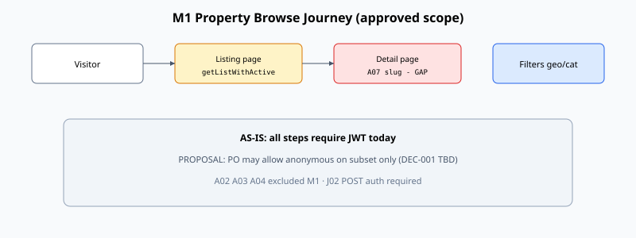
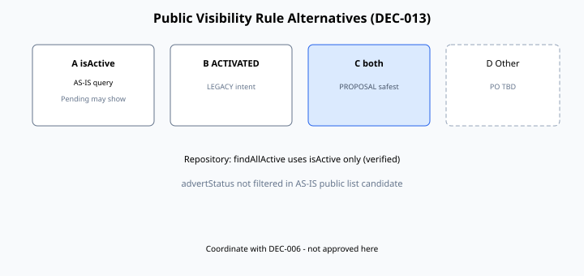
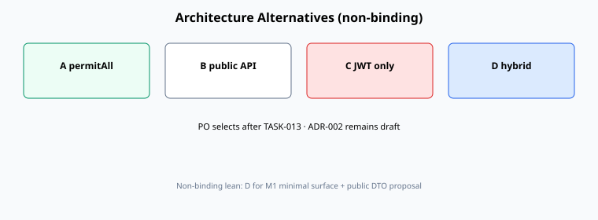

# DEC-001 — M1 Herkese Açık Katalog Erişim Politikası İncelemesi (TASK-013)

## 1. Amaç ve kapsam

M1 **ilan listesi** ve **ilan detayı** (ve filtre için **salt okunur referans veri**) için **kanıta dayalı erişim politikası önerisi** hazırlanır.

| Kapsamda | Kapsam dışı |
|----------|-------------|
| Uç sınıflandırması, DTO sınırı, görünürlük, güvenlik | ADR-002, `permitAll`, whitelist, Public DTO veya tam DEC-001 onayı |
| Mimari A–D (bağlayıcı olmayan öneri) | A02/A03/A04 (PO ile ertelendi) |
| Koda dayalı M1 yolculuğu | Uygulama ve güvenlik yapılandırması |

---

## 2. Onaylı karar sınırları

| ID | Karar |
|----|--------|
| **DEC-001-J02** | `POST .../contact-messages/{language}/add` — **kimlik doğrulama zorunlu**; anonim **yasak** *(değişmedi)* |
| **DEC-001-M1-A02-A04** | **A02, A03, A04 M1 dışı**; ertelendi *(değişmedi)* |
| **DEC-001-ANONYMOUS-CATALOG** | **Ürün gereksinimi (PO, TASK-013-A):** anonim ziyaretçiler **M1 emlak listesine göz atabilmeli** ve **M1 ilan detayını kimlik doğrulaması olmadan görebilmelidir** (salt okunur). ADR-002, `permitAll`, whitelist, Public DTO, görünürlük, görsel yolları, rate limit, anonim yazma veya **A02/A03/A04** anonim erişimini **onaylamaz**. |

---

## 3. Kanıt ve kaynaklar

`SecurityFilterChainConfig`, `AdvertController` / `AdvertManager` / `AdvertRepository`, `AdvertResponse`, [LEGACY_API_TO_FR_MATRIX](../02-requirements/FRD/LEGACY_API_TO_FR_MATRIX.md), [ADR-002](../03-architecture/ADR/ADR-002-public-read-api.md) (**taslak**), Frontend (ilan API **yok**).

---

## 4. M1 kullanıcı yolculuğu

| Adım | Yetenek | LEGACY | AS-IS | Durum |
|------|---------|--------|-------|--------|
| 1 | Aktif ilan listesi | A01 | `GET .../getListWithActive` | JWT; filtre eksik |
| 2 | İlan detayı | A07 slug | **Yok** | **Açık** — **TASK-014** (slug GET) |
| 3 | Coğrafya filtresi | U01–U03 | ülke/şehir/ilçe GET | JWT |
| 4 | Kategori filtresi | C01/C03 | kategori GET | JWT |
| 5 | İlan tipi | T01 | Controller **boş** | **Açık** |

---

## 5. Uç envanteri ve erişim sınıflandırması

**Önerilen erişim** bağlayıcı değildir; **PO durumu** alt kararlar hariç **TBD**.

| Uç | M1 | Güncel erişim | Önerilen erişim | Veri | PO |
|----|-----|---------------|-----------------|------|-----|
| `GET .../getListWithActive` | Liste | JWT | Anonim veya JWT (D/A) | `AdvertResponse` | **TBD** |
| `GET .../getAll` | Admin listesi | JWT | Yalnızca yetkili | Tüm statüler | **TBD** |
| Slug detay (yok) | Detay | — | PO onayına bağlı | DTO riski | **TBD** |
| Kategori/geo GET | Filtre | JWT | **PROPOSAL** anonim okuma | İç içe entity | **TBD** |
| İlan POST/PUT/DELETE | Yazma | JWT | Kimlik doğrulamalı | — | Özel |
| `POST .../contact-messages/.../add` | İletişim | JWT | **Yalnızca kimlik doğrulamalı** | — | **Onaylı** |

---

## 6. Kimlik doğrulama ve yetkilendirme (AS-IS)

Varsayılan **JWT**; `@PreAuthorize` çoğunlukla kapalı. Geo/kategori üzerinde GET ile POST aynı controller — kısmi `permitAll` tasarım riski.

---

## 7. Genel veri sınırı

### `AdvertResponse` (doğrulandı)

| Alan | Yanıtta | Halka açık aday? | Hassas? |
|------|---------|------------------|---------|
| `id`, audit alanları | Evet | id evet; audit **PROPOSAL gizle** | Düşük / dahili |
| `title`, `desc`, `price`, `location` | Evet | Evet | Hayır |
| `isActive` | Evet | **PROPOSAL gizle** | Durum sızıntısı |
| `slug`, `advertStatus`, `viewCount` | **Hayır** | Detay için gerekli / isteğe bağlı | — |
| İç içe tip, coğrafya, kategori, görseller | Evet | Sığ DTO önerisi | `Image.path` **TBD** |
| Sahip `user` | **Hayır** (DTO’da) | **Asla** | **Yüksek** |

**Risk:** Anonim için mevcut `AdvertResponse` tam entity grafiği — **Public DTO** kararı **PO DECISION REQUIRED**.

### DTO alternatifleri

Mevcut DTO yeniden kullanımı / `PublicAdvertResponse` / ayrı okuma modeli — ödünleşimler EN belgede; **onay yok**.

---

## 8. Görünürlük kuralı alternatifleri

**AS-IS:** `findAllActive` → yalnızca `isActive = true` (`AdvertStatus` **filtrelenmiyor**).

| Kural | Görünürlük | Risk |
|-------|------------|------|
| **A** `isActive` | AS-IS | Onaylanmamış ilan sızıntısı mümkün |
| **B** `ACTIVATED` | LEGACY niyet | `isActive` yok sayılır |
| **C** İkisi birlikte | **PROPOSAL en güvenli** | Sorgu değişikliği |
| **D** Diğer | **TBD** | — |

**DEC-006 ile koordine** — burada onaylanmaz.

---

## 9. Güvenlik ve kötüye kullanım

Scraping, sayfalama üst sınırı **TBD**, id numaralandırma, görsel URL’leri, rate limit **öneri** (sayı yok), CAPTCHA **onaylı şart değil**.

---

## 10. Mimari alternatifler

| Seçenek | Özet |
|---------|------|
| **A** Seçili GET `permitAll` | LEGACY uyumu |
| **B** `/public/v1` | Temiz sınır |
| **C** Tamamı JWT | BR-011 ile çatışma riski |
| **D** Hibrit | M1 allow-list + public DTO |

### Bağlayıcı olmayan öneri

PO anonim M1 istiyorsa **D**: `getListWithActive`, gelecek slug detay, salt okunur geo/kategori GET; **C** görünürlük kuralı ve **public DTO**. **ADR-002 onaylanmaz.**

---

## 11. Riskler ve bağımlılıklar

Detay uç eksik, DEC-001-J02, DEC-006, TASK-001/014/004, FE entegrasyonu.

---

## 12. Açık PO soruları

**Ürün düzeyinde çözüldü (teknik değil):** M1 **liste** ve **detay** için anonim erişim **zorunludur** (DEC-001-ANONYMOUS-CATALOG). Bu yolculuklar için **Seçenek C** (yalnızca JWT katalog) **reddedilmiştir**.

**Hâlâ açık (PO DECISION REQUIRED):**

1. Kesin **anonim uç whitelist’i** (liste ve detay hangi yollarla).
2. Uygulama için **A / B / D** (ADR-002 **taslak**).
3. Görünürlük **A/B/C/D**?
4. Zorunlu **Public DTO**?
5. Liste ile birlikte kategori/geo anonim mi (gelecek sürüm değerlendirmesi)?
6. Rate limiting zorunlu mu (evet/hayır)?
7. Detay **slug** (A07) mi?

---

## 13. Karar durumu

| Öğe | Durum |
|-----|--------|
| DEC-001 (bütün) | **Onaylanmadı** |
| ADR-002 | **Taslak** |
| DEC-001-J02 / M1-A02-A04 | **Onaylı** |
| DEC-001-ANONYMOUS-CATALOG | **Onaylı** (ürün gereksinimi — liste + detay) |
| M1 teknik erişim politikası | **PO DECISION REQUIRED** (çalışma sayfası §DEC-001-PUBLIC-CATALOG) |

---

## 14. Değişiklik geçmişi

| Sürüm | Tarih | Özet |
|-------|-------|------|
| 0.1.0 | 2026-11-13 | TASK-013 erişim inceleme paketi |
| 0.1.1 | 2026-11-13 | TASK-013-A: DEC-001-ANONYMOUS-CATALOG referansı; teknik politika açık |
