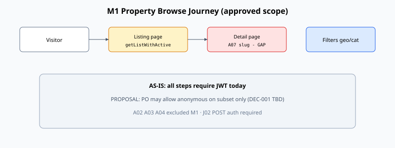
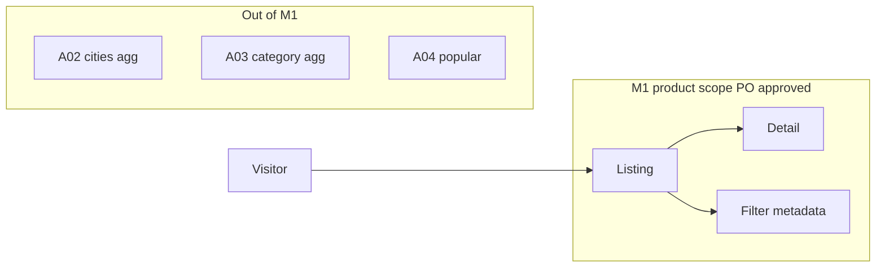
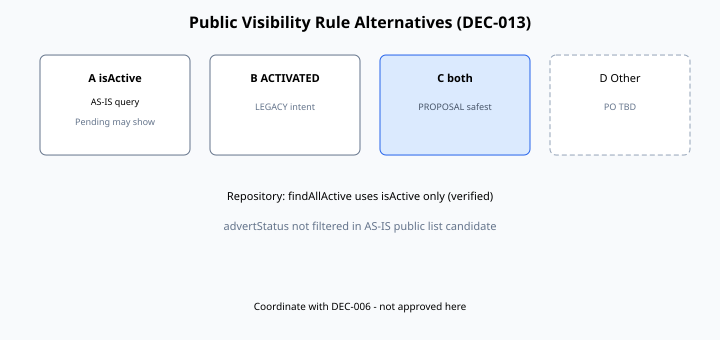
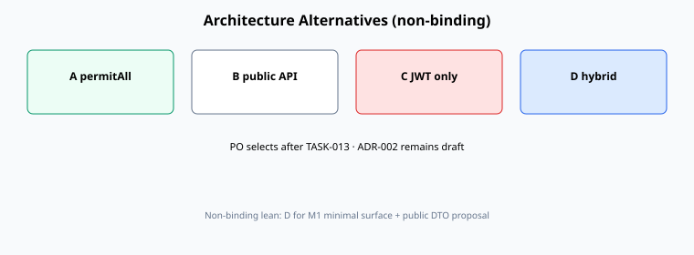
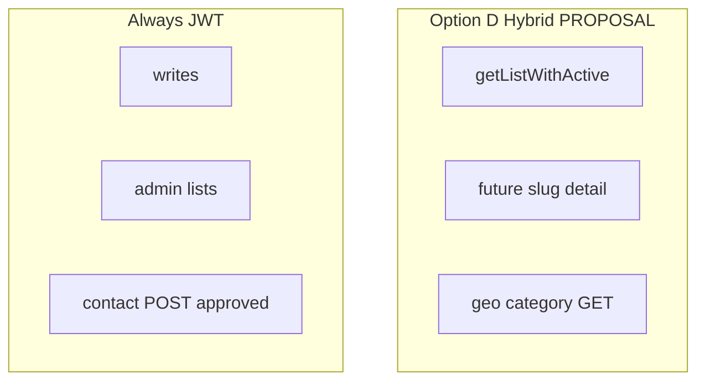

# DEC-001 — M1 Public Catalog Access Policy Review (TASK-013)

## 1. Purpose and scope

Prepare an **evidence-based access policy proposal** for M1 **property listing** and **property detail** (and supporting **read-only reference data** for navigation/filters).

| In scope | Out of scope |
|----------|----------------|
| Endpoint classification, DTO boundary, visibility rules, security | Approving ADR-002, `permitAll`, whitelist, Public DTO, or full DEC-001 |
| Architecture options A–D (non-binding recommendation) | A02/A03/A04 (deferred per PO) |
| M1 journey grounded in code | Implementation, security config changes |

Turkish: [DEC-001-PUBLIC-CATALOG-ACCESS-REVIEW-TR.md](DEC-001-PUBLIC-CATALOG-ACCESS-REVIEW-TR.md).

---

## 2. Approved decision boundaries

| ID | Decision |
|----|----------|
| **DEC-001-J02** | `POST .../contact-messages/{language}/add` — **authentication required**; anonymous **prohibited** *(unchanged)* |
| **DEC-001-M1-A02-A04** | **A02, A03, A04 excluded from M1**; deferred (no release ID/date) *(unchanged)* |
| **DEC-001-ANONYMOUS-CATALOG** | **Product requirement (PO, TASK-013-A):** anonymous visitors **must** browse the **M1 property listing** and **view M1 property details** without authentication (read-only). **Does not** approve ADR-002, `permitAll`, endpoint whitelist, Public DTO, visibility rule, image paths, rate limits, anonymous writes, or anonymous **A02/A03/A04**. |

---

## 3. Evidence and source references

| Source | Use |
|--------|-----|
| `SecurityFilterChainConfig` | JWT default; narrow `permitAll` |
| `AdvertController`, `AdvertManager`, `AdvertRepository` | List queries |
| `AdvertResponse`, `Advert` entity | Field exposure |
| [LEGACY_API_TO_FR_MATRIX](../02-requirements/FRD/LEGACY_API_TO_FR_MATRIX.md) | A01, A07, C01, U01–U03 |
| [ADR-002](../03-architecture/ADR/ADR-002-public-read-api.md) | **draft** — workshop only |
| Frontend (read-only) | `HomeSlider` / `Search` — **no** advert API calls |

---

## 4. M1 user journey

**Figure RE-FIG-DEC-013-001** — Intended M1 browse flow vs AS-IS gaps.

| Step | Capability | LEGACY | AS-IS endpoint | Status |
|------|------------|--------|----------------|--------|
| 1 | Browse active listings | A01 | `GET /api/v1.0/adverts/{language}/getListWithActive` | **AS-IS** — JWT; paging only; **no** LEGACY filters |
| 2 | Property detail | A07 slug | **None** in `AdvertController` | **Gap** — **TASK-014** (slug GET) |
| 3 | Filter by geography | U01–U03 | `GET .../countries| cities| districts/...` | **AS-IS** — JWT; full CRUD also exists |
| 4 | Filter by category | C01/C03 | `GET .../categories/{language}/categories`, `get/{id}` | **AS-IS** — JWT |
| 5 | Advert types (optional filter) | T01 | `AdvertTypeController` **empty** | **Gap** |

**Frontend (AS-IS):** No `axios`/`fetch` to local advert API; external `config.api.baseUrl` — M1 FE wiring **TBD**.

---

## 5. Endpoint inventory and access classification

**Legend — Proposed access:** non-binding; **PO status** = **TBD** unless sub-decision already approved.

| Endpoint | M1 capability | Current access | Proposed access (non-binding) | Data exposure | Evidence | PO status |
|----------|---------------|----------------|-------------------------------|---------------|----------|-----------|
| `GET .../adverts/{lang}/getListWithActive` | Listing | **JWT** (`anyRequest().authenticated`) | **PROPOSAL:** anon **or** JWT per Option D/A | `AdvertResponse` page | `AdvertController` L79; `AdvertRepository.findAllActive` | **TBD** |
| `GET .../adverts/{lang}/getAll` | Admin-style list | JWT | **Authenticated** Manager+ only | All statuses possible | Returns `findAll` — **not** M1 public | **TBD** |
| `GET .../adverts/{lang}/getBySlug` (not implemented) | Detail | — | **PROPOSAL:** anon **or** JWT if PO approves public catalog | Same DTO concerns | Matrix A07 Missing | **TBD** |
| `GET .../adverts/{lang}/get/{id}` (not implemented) | Detail alt | — | **TBD** — prefer slug if A07 | — | No mapping in controller | **TBD** |
| `POST/PUT/DELETE .../adverts/...` | Write | JWT | **Authenticated** | — | `AdvertController` | N/A (private) |
| `GET .../categories/{lang}/categories` | Category picklist | JWT | **PROPOSAL:** anon read if public browse | `CategoryResponse` | `CategoryController` | **TBD** |
| `GET .../categories/{lang}/categories/admin` | Admin categories | JWT | **Authenticated** Manager+ | — | admin path | N/A |
| `GET .../categories/{lang}/get/{categoryId}` | Category detail | JWT | **PROPOSAL:** anon optional | Category fields | — | **TBD** |
| `GET .../countries/{lang}/getAll` | Geo filter | JWT | **PROPOSAL:** anon read | Country entity in response | `CountryController` | **TBD** |
| `GET .../cities/{lang}/cities` | Geo filter | JWT | **PROPOSAL:** anon read | City + nested Country | `CityController` | **TBD** |
| `GET .../districts/{lang}/districts` | Geo filter | JWT | **PROPOSAL:** anon read | District | `DistrictController` | **TBD** |
| Geo/category POST/PUT/DELETE | Admin write | JWT | **Authenticated** | — | CRUD exists | N/A |
| `POST .../contact-messages/{lang}/add` | Contact | JWT | **Authenticated only** | Contact payload | **DEC-001-J02 approved** | **Approved** |
| `GET .../advert-types/...` | Type filter | JWT if existed | **TBD** post TASK-004 | — | Empty controller | **TBD** |

### Access category summary (M1-relevant)

| Category | Endpoints (M1) |
|----------|----------------|
| Anonymous public read (candidate) | `getListWithActive`, future A07, C01/C03, U01–U03 GET lists — **if PO approves** |
| Authenticated user read | Same endpoints under Option C; favorites/tours later |
| Owner-only read | A05/A08-style **not implemented** |
| Manager/Admin read | `getAll`, `categories/admin` |
| Authenticated write | advert/category/geo mutations, contact POST |
| Admin write | role/admin paths |

---

## 6. Current authentication and authorization analysis

| Mechanism | AS-IS evidence |
|-----------|----------------|
| Spring Security | `permitAll`: auth POST, limited users POST, swagger, ping, profile-image GET |
| Default | `anyRequest().authenticated()` |
| Method security | `@PreAuthorize` largely **commented** — role enforcement **weak** |
| Public + admin on same controller | Geo/category **GET and POST** share base path — matcher design risk if `permitAll` partial |

---

## 7. Public data boundary

### 7.1 `AdvertResponse` (verified source)

| Field | Entity source | Current in response | Public candidate? | Sensitive? | Evidence |
|-------|---------------|---------------------|-------------------|------------|----------|
| `id` | BaseEntityResponse | Yes | Yes | Low (enumeration risk) | AS-IS |
| `createAt`, `updateAt`, `deleted` | BaseEntityResponse | Yes | **PROPOSAL:** hide on public DTO | Internal metadata | AS-IS |
| `title`, `desc` | Advert | Yes | Yes | Low | AS-IS |
| `price`, `location` | Advert | Yes | Yes | Low | AS-IS |
| `isActive` | Advert | Yes | **PROPOSAL:** hide or derive | Reveals non-public state | AS-IS |
| `slug` | Advert entity | **No** in `AdvertResponse` | Needed for A07 | — | **Gap** for detail URLs |
| `advertStatus` | Advert entity | **No** | Hide | Moderation | Not in DTO today |
| `viewCount` | Advert entity | **No** | Optional public | Low | Not in DTO |
| `advertType` | Nested entity | Yes (full object) | Shallow DTO | May over-include | AS-IS |
| `country`, `city`, `district` | Nested | Yes | Shallow (id+name) | Low | City may embed Country |
| `category` | Nested | Yes | Shallow | Low | AS-IS |
| `imageSet` | `Image` entities | Yes | **Investigate** `path` URLs | Path leakage / hotlink | AS-IS |
| `categoryPropertyValueSet` | Values | Yes | Yes if non-PII | Low | AS-IS |
| `user` / owner | Advert.`user` | **Not** in AdvertResponse | **Must not** expose | **High** PII if added | Mapper toResponse — verified no user field |

**Risk (AS-IS):** Reusing `AdvertResponse` for anonymous access embeds **full JPA entities** in JSON (not dedicated DTO shapes) — may expose fields beyond intended public contract (**PO DECISION REQUIRED** on DTO strategy).

 (prior DEC-001 figure; still applicable)

### 7.2 DTO alternatives (not approved)

| Approach | Pros | Cons |
|----------|------|------|
| Reuse `AdvertResponse` | Fast | Nested entities; missing slug; `isActive` visible; inconsistent |
| Dedicated `PublicAdvertResponse` | Clear boundary; ADR-002 proposal | Mapper maintenance |
| Separate read model / query | CQRS-style | Higher effort |

---

## 8. Public visibility rule alternatives

**AS-IS code:** `AdvertRepository.findAllActive` → `WHERE a.isActive = true` — **does not** filter `AdvertStatus`.

| Rule | Visible listings | Risk | Evidence |
|------|------------------|------|----------|
| **A** `isActive = true` only | Active flag set; **PENDING/REJECTED possible** if active=true | Moderation bypass | **AS-IS** query |
| **B** `AdvertStatus = ACTIVATED` only | Approved only | Ignores soft `isActive` | Not in AS-IS query |
| **C** `ACTIVATED` **AND** `isActive` | **PROPOSAL** aligned LEGACY+ safety | Requires query change | **Not** AS-IS |
| **D** Other | **TBD** | — | PO |

**Coordinate with DEC-006** — do not approve here.

---

## 9. Security and abuse prevention

| Topic | Assessment |
|-------|------------|
| Scraping | Public GET increases crawl surface — **rate limiting PROPOSAL** (no numeric limit) |
| Volume | Pagination exists (`page`, `size`); max `size` cap **TBD** |
| Enumeration | Sequential `id` in `BaseEntityResponse` — **TBD** policy |
| PII leakage | Owner not in DTO today; guard against future mapper regressions |
| Images | `Image.path` exposed — direct URL access **TBD** |
| Search/filter abuse | M1 list has limited filters AS-IS — LEGACY A01 params **missing** |
| Caching | CDN/cache headers **TBD** |
| Logging | Audit anonymous catalog access **TBD** |
| CAPTCHA | **Not** proposed as approved requirement |

---

## 10. Architecture alternatives (DEC-001)

| Option | Usability | Security | Complexity | FE impact | Recommendation weight |
|--------|-----------|----------|------------|-----------|------------------------|
| **A** `permitAll` on named GETs | High for guests | Path list drift | Medium | Needs anonymous FE | LEGACY-aligned |
| **B** `/public/v1` facade | Clear | Strong boundary | High | New base path | Long-term |
| **C** Authenticated-only M1 | Poor vs LEGACY BR-011 | Simplest | Low | Login gate | Conflicts poster |
| **D** Hybrid | Balanced | Explicit allow-list | Medium | Targeted public routes | Fits M1 minimal surface |

### Non-binding recommendation (not PO approval)

**Option D** for M1 if PO wants anonymous browse: allow-list **only** `getListWithActive`, future **slug detail**, and **read-only** geo/category GET paths; pair with **public DTO** and visibility rule **C** when implemented. **Option C** only if PO explicitly deprioritizes BR-011 anonymous intent.

**Does not approve ADR-002.**

---

## 11. Risks and dependencies

| Risk / dependency | Note |
|-------------------|------|
| Detail endpoint missing | M1 journey blocked without **TASK-014** (slug GET) |
| DEC-001-J02 | Contact remains authenticated |
| DEC-006 visibility | Query rule must align |
| TASK-001 / ADR-002 | Formal sign-off gate |
| TASK-004 advert-types | Optional filters |
| FE not wired | Policy alone insufficient |

---

## 12. Explicit PO questions

**Resolved at product level (not technical):** Anonymous M1 **listing browse** and **property detail** are **required** (DEC-001-ANONYMOUS-CATALOG). **Option C** (authenticated-only M1 catalog) is **rejected** for these journeys.

**Still open (PO DECISION REQUIRED):**

1. Exact **anonymous endpoint whitelist** (e.g. which paths implement listing vs detail).
2. Adopt **Option A**, **B**, or **D** for implementation (ADR-002 **draft**).
3. Visibility rule **A / B / C / D** for list and detail?
4. **Public DTO** mandatory vs reuse `AdvertResponse`?
5. Include **category + geo GET** in anonymous allow-list with listings (future release consideration)?
6. **Rate limiting** required before launch? (yes/no — no numbers)
7. Detail by **slug** (A07) vs id for M1?

---

## 13. Decision status and next steps

| Item | Status |
|------|--------|
| DEC-001 (overall) | **Not approved** |
| ADR-002 | **draft** |
| DEC-001-J02 | **Approved** |
| DEC-001-M1-A02-A04 | **Approved** |
| DEC-001-ANONYMOUS-CATALOG | **Approved** (product requirement — list + detail) |
| M1 technical access policy | **PO DECISION REQUIRED** (worksheet §DEC-001-PUBLIC-CATALOG) |

**Next:** Complete worksheet §DEC-001-PUBLIC-CATALOG (technical fields); field-level analysis in [DEC-001-PUBLIC-DATA-BOUNDARY-REVIEW.md](DEC-001-PUBLIC-DATA-BOUNDARY-REVIEW.md) (TASK-014-DATA); slug detail implementation **TASK-014**; TASK-001 ADR sign-off remains separate.

---

## 14. Change history

| Version | Date | Summary |
|---------|------|---------|
| 0.1.0 | 2026-11-13 | TASK-013 access policy review package |
| 0.1.1 | 2026-11-13 | TASK-013-A: reference DEC-001-ANONYMOUS-CATALOG; technical policy still open |
