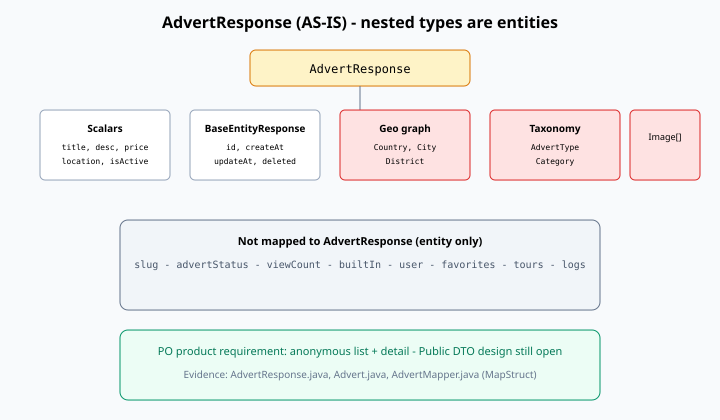
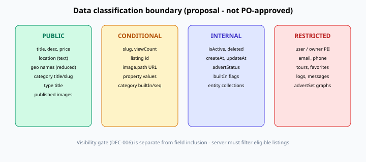
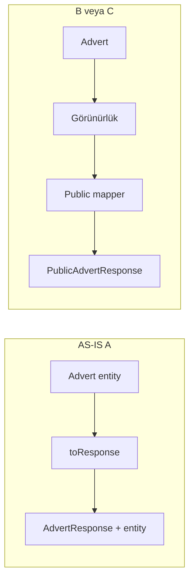
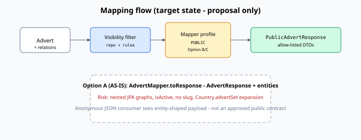
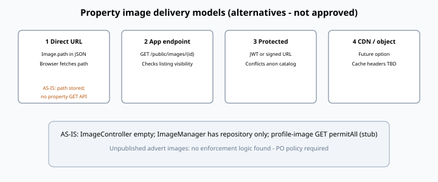
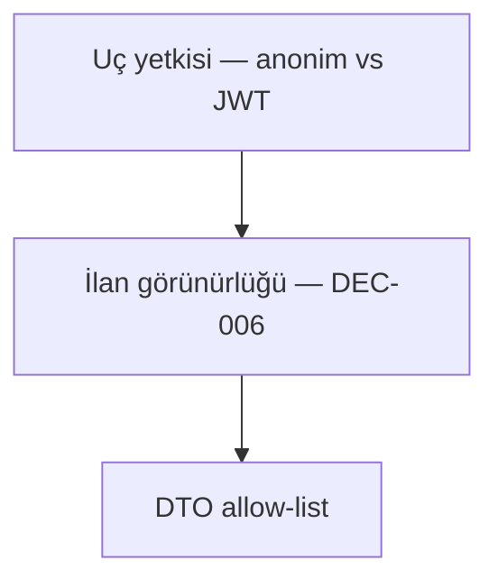
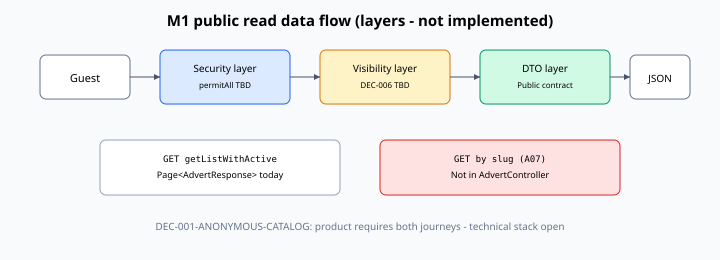

# DEC-001 — Public DTO ve Veri Sızıntısı İncelemesi (TASK-014-DATA)

## 1. Amaç ve kapsam

M1 **ilan listesi** ve **detay** yolculukları için AS-IS **entity, DTO ve JSON sızıntısını** kanıta dayalı analiz etmek; PO’nun **public veri sözleşmesi**, **görsel politikası** ve **mapper stratejisi** kararlarına girdi sağlamak.

| Kapsamda | Kapsam dışı |
|----------|-------------|
| `AdvertResponse` ve iç içe serileştirilen tipler | Public DTO, ADR-002 veya whitelist onayı |
| PUBLIC / INTERNAL / RESTRICTED / CONDITIONAL sınıflandırması | A07 slug GET, mapper veya güvenlik uygulaması |
| Public DTO seçenekleri A–C | Onaylı PO alt kararlarını değiştirme |
| Görsel entity ve dağıtım alternatifleri | Java kaynak değişikliği |

English: [DEC-001-PUBLIC-DATA-BOUNDARY-REVIEW.md](DEC-001-PUBLIC-DATA-BOUNDARY-REVIEW.md).

---

## 2. Onaylı ürün karar sınırları (değişmedi)

| ID | Karar |
|----|--------|
| **DEC-001-J02** | `POST .../contact-messages/{language}/add` — **kimlik doğrulama zorunlu**; anonim **yasak** |
| **DEC-001-M1-A02-A04** | **A02, A03, A04 M1 dışı**; ertelendi |
| **DEC-001-ANONYMOUS-CATALOG** | Anonim ziyaretçiler M1 **liste** ve **detay** görebilmeli (salt okunur). DTO/ADR/uygulama **onayı değildir** |

---

## 3. Kanıt ve uygulama bulguları

| Kanıt | Bulgu |
|-------|--------|
| `AdvertResponse.java` | Ölçü alanları + iç içe **JPA entity** tipleri (`Country`, `City`, …) |
| `AdvertMapper.java` | `toResponse` — hariç tutma yok; eşleşen isimler kopyalanır |
| `Advert.java` | `slug`, `advertStatus`, `viewCount`, `user`; entity `@JsonIgnore` DTO alanlarına uygulanmaz |
| `AdvertManager.getListWithActive` | Yalnızca `isActive = true` — **`AdvertStatus` filtresi yok** |
| `AdvertController` | `getListWithActive`; **slug/detay GET yok** |
| `ImageController` / `ImageManager` | Mülk görseli REST **yok** |
| `SecurityFilterChainConfig` | `permitAll` yalnızca **profil görseli** GET |
| [ADR-002](../03-architecture/ADR/ADR-002-public-read-api.md) | **taslak** |

**Doğrulanan önceki gözlemler:**

| Gözlem | Sonuç | Kanıt |
|--------|-------|--------|
| `user` DTO’da yok | **Doğru** | `AdvertResponse.java` |
| `isActive` yanıtta var | **Doğru** | L21 |
| `slug` yanıtta yok | **Doğru** | `Advert.java` var, DTO yok |
| `advertStatus` yok | **Doğru** | Yalnızca entity |
| `viewCount` yok | **Doğru** | Yalnızca entity |
| `Image.path` açık | **Doğru** | `Set<Image>` L28 |

---

## 4. Tam `AdvertResponse` alan envanteri

| Alan | Tip | Kaynak entity | Mevcut JSON | İlişkili alanlar | Risk | Kanıt |
|------|-----|---------------|-------------|------------------|------|--------|
| `id` | `Long` | `Advert` / `BaseEntity` | Evet | slug (yok) | PK numaralandırma | `BaseEntityResponse` L26 |
| `createAt` | `LocalDateTime` | `BaseEntity` | Evet | — | Operasyonel meta | L27 |
| `updateAt` | `LocalDateTime` | `BaseEntity` | Evet | — | aynı | L28 |
| `deleted` | `boolean` | `BaseEntity` | Evet | soft-delete | Yanlış sorguda sızıntı | L29 |
| `title` | `String` | `Advert` | Evet | `slug` | Düşük | `AdvertResponse` L19 |
| `desc` | `String` | `Advert` | Evet | — | Düşük | L20 |
| `isActive` | `boolean` | `Advert` (mapper) | Evet | `advertStatus` | **Public yüzeyde iç bayrak** | L21 |
| `price` | `Double` | `Advert` | Evet | — | Düşük | L22 |
| `location` | `String` | `Advert` | Evet | geo | Konum metni | L30 |
| `advertType` | `AdvertType` entity | `Advert` | Entity JSON | `advertSet` | **Graf** | L23 |
| `country` | `Country` entity | `Advert` | Entity JSON | `citySet`, `advertSet` | **Yüksek** | L24 |
| `city` | `City` entity | `Advert` | Entity JSON | iç `country` | Orta | L25 |
| `district` | `District` entity | `Advert` | Kısıtlı graf | — | Orta | L26 |
| `category` | `Category` entity | `Advert` | Entity JSON | builtIn, active | Orta | L27 |
| `imageSet` | `Set&lt;Image&gt;` | `Advert` | Evet | `path` | **Yol riski** | L28 |
| `categoryPropertyValueSet` | `Set&lt;CategoryPropertyValue&gt;` | `Advert` | id+value | key yok | Bağlam eksik | L29 |

**DTO’ya map edilmeyen entity alanları:** `slug`, `advertStatus`, `viewCount`, `builtIn`, `user`, favori/tur/log koleksiyonları (sonuncular DTO’da yok — **olumlu**).

---

## 5. İç içe entity analizi

`AdvertResponse`, `CountryResponse` vb. kullanmıyor; Jackson **entity** sınıflarını serileştiriyor.

| İç tip | Kritik risk |
|--------|-------------|
| `AdvertType` | `advertSet` — **`@JsonIgnore` yok** → geri referans |
| `Country` | `citySet`, `advertSet` — **yüksek graf riski** |
| `City` | `country` iç içe; `plateNumber` admin verisi olabilir |
| `District` | `name` genelde uygun |
| `Category` | `builtIn`, `seq`, `active` moderasyon metaverisi |
| `Image` | `path` anlamı kodda tanımsız |
| `CategoryPropertyValue` | `value` var, **anahtar adı yok** (`@JsonIgnore`) |

---

## 6. Alan sınıflandırması (öneri — onaylı değil)

| Alan | Tip | Kaynak | Mevcut JSON | Önerilen | Amaç | Güvenlik | Açık soru | Kanıt |
|------|-----|--------|-------------|----------|------|----------|-----------|--------|
| `title` | String | Advert | Evet | **PUBLIC** | Başlık | Düşük | — | `AdvertResponse` |
| `desc` | String | Advert | Evet | **PUBLIC** | Detay metni | Düşük | HTML? | aynı |
| `price` | Double | Advert | Evet | **PUBLIC** | Fiyat | Düşük | Para birimi | aynı |
| `location` | String | Advert | Evet | **PUBLIC** | Konum metni | Düşük | Hassasiyet | aynı |
| `id` | Long | BaseEntity | Evet | **CONDITIONAL** | FE anahtarı | Numaralandırma | Yalnız slug? | `BaseEntityResponse` |
| `slug` | — | Advert | **Hayır** | **CONDITIONAL** | A07 URL | Düşük | Detay için gerekli | `Advert.java` |
| `viewCount` | — | Advert | **Hayır** | **CONDITIONAL** | Popülerlik | Scraping | Public mi? | `Advert.java` |
| `advertStatus` | — | Advert | **Hayır** | **INTERNAL** | Moderasyon | Sızıntı | DEC-006 | enum |
| `isActive` | boolean | Advert | Evet | **INTERNAL** | Soft delete | Yaşam döngüsü | Gizle? | `AdvertResponse` |
| `createAt` / `updateAt` / `deleted` | — | BaseEntity | Evet | **INTERNAL** | Denetim | Operasyonel | Public map’ten çıkar | `BaseEntityResponse` |
| `advertType.title` | String | AdvertType | Evet | **PUBLIC** | Tip etiketi | Düşük | — | nested |
| `advertType.advertSet` | Set | AdvertType | Olası | **RESTRICTED** | ORM geri ref | **Graf** | Asla public | `AdvertType.java` |
| `country.name` / `code` | String | Country | Evet | **PUBLIC** | Geo | Düşük | — | `Country.java` |
| `country.citySet` / `advertSet` | Set | Country | Olası | **RESTRICTED** | Envanter | **Yüksek** | Asla public | aynı |
| `city.name` | String | City | Evet | **PUBLIC** | Geo | Düşük | — | `City.java` |
| `city.plateNumber` | Integer | City | Evet | **CONDITIONAL** | Plaka | Düşük | Public mi? | L27–28 |
| `district.name` | String | District | Evet | **PUBLIC** | Geo | Düşük | — | `District.java` |
| `category.title` / `slug` / `icon` | String | Category | Evet | **PUBLIC** | Navigasyon | Düşük | Icon yolu | `Category.java` |
| `category.builtIn` / `seq` / `active` | — | Category | Evet | **INTERNAL** | Admin | Sızıntı | Hariç tut | aynı |
| `imageSet.path` | String | Image | Evet | **CONDITIONAL** | Galeri | Yol/altyapı | Model §8 | `Image.java` |
| `imageSet.featured` | boolean | Image | Evet | **PUBLIC** | Öne çıkan | Düşük | — | aynı |
| `categoryPropertyValueSet.value` | String | CPV | Evet | **CONDITIONAL** | Özellik | Anahtarsız | Anahtar adı? | entity |
| `user` | User | Advert | **Yok** | **RESTRICTED** | Sahip PII | **Yüksek** | Hariç kalsın | mapper |

---

## 7. Public DTO alternatifleri

### Seçenek A — `AdvertResponse` yeniden kullanımı

Güvenlik ve sürdürülebilirlik **düşük**; entity grafı, `isActive`, `Country.advertSet` riski.

### Seçenek B — `PublicAdvertResponse` (+ iç DTO’lar)

Açık allow-list; kimlik doğrulamalı API’den ayrışma; orta efor.

### Seçenek C — Ayrı public okuma modeli

Sorgu projeksiyonu; ölçek ve filtre için güçlü; en yüksek efor.

| Ölçüt | A | B | C |
|-------|---|---|---|
| Güvenlik | Düşük | Yüksek | Yüksek |
| Bakım | Düşük | Yüksek | Orta–yüksek |
| Performans | Orta | Orta | Yüksek |
| Efor | Düşük | Orta | Yüksek |

---

## 8. Görsel ve dosya sızıntısı

| Konu | AS-IS |
|------|--------|
| Entity | `name`, `type`, `path`, `featured` |
| REST | **Yok** (`ImageController` boş) |
| `path` anlamı | Kodda **tanımsız** |
| Yetkilendirme | Mülk görseli ucu yok; profil GET `permitAll` ama servis **stub** |
| Silinmiş / yayın dışı görseller | Kontrol **yok** |

**Alternatifler (onaylı değil):** (1) doğrudan URL, (2) uygulama public GET, (3) korumalı/signed, (4) CDN/nesne depolama.

---

## 9. Slug ve detay (A07)

| Soru | Bulgu |
|------|--------|
| Veritabanında slug? | **Evet**, NOT NULL |
| Benzersizlik | Entity’de `unique` **yok** — DB doğrulanmadı |
| DTO’da slug? | **Hayır** (`CategoryResponse`’da kategori için var) |
| A07 ucu | **Yok** — bu görev uygulamaz |

---

## 10. Görünürlük ve erişim ayrımı

DTO alanı **PUBLIC** olması, kaydın görünür olduğu anlamına gelmez.

---

## 11. Riskler ve bağımlılıklar

Entity grafı, eksik slug, `isActive` sızıntısı, `path` politikası, `findAllActive` status filtresi eksikliği, `AdvertType`/`Country` koleksiyonları.

---

## 12. Bağlayıcı olmayan öneri

1. **Seçenek B** — `PublicAdvertResponse` ve küçük iç DTO’lar.
2. `advertSet`, audit üçlüsü, `isActive` — anonim yanıtta **önerilmez** (PO onayı hariç).
3. A07 ile **`slug`** (ve isteğe bağlı `viewCount`) eklenmeli — PO onayı.
4. Görünürlük servisi DTO’dan **bağımsız**.
5. Görsel için **model 2 veya 4** atölye önceliği — AS-IS `path` belirsiz.

**PO kararı değil. ADR-002 onayı değil.**

---

## 13. Açık PO soruları

1. **A, B veya C** mapper stratejisi?
2. `id`, `slug`, `viewCount` allow-list?
3. Anonime `isActive` / `advertStatus`?
4. Geo: yalnızca isimler mi, id’ler mi?
5. Kategori `builtIn/seq/active`?
6. Özellik değerleri: anahtar adı + değer?
7. Görsel modeli 1–4; `path` mutlak URL mü?
8. `plateNumber` public mi?
9. Listede tam `desc` mü, özet mi?

---

## 14. Karar durumu

| Öğe | Durum |
|-----|--------|
| DEC-001 (bütün) | **Onaylanmadı** |
| ADR-002 | **Taslak** |
| J02 / M1-A02-A04 / ANONYMOUS-CATALOG | **Onaylı** |
| Public DTO | **PO DECISION REQUIRED** |
| Çalışma sayfası | §DEC-001-PUBLIC-DATA-BOUNDARY |

---

## 15. Değişiklik geçmişi

| Sürüm | Tarih | Özet |
|-------|-------|------|
| 0.1.0 | 2026-11-13 | TASK-014-DATA public veri sınırı incelemesi |
| 0.1.1 | 2026-11-13 | Görev ID ayrımı: TASK-014-DATA vs TASK-014 (slug) |
