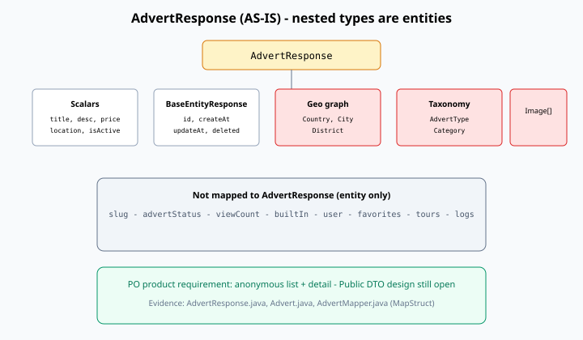
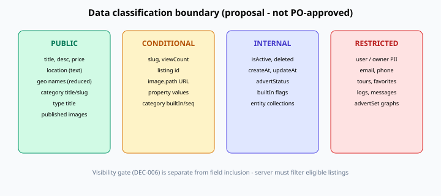
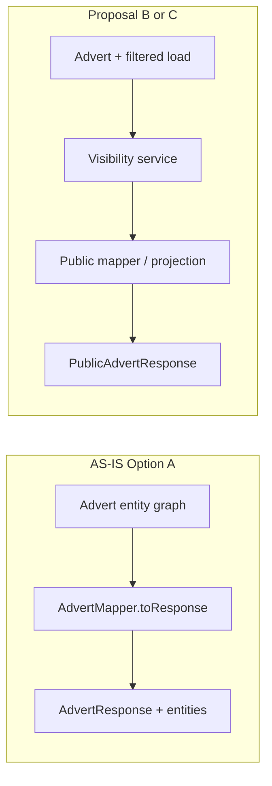
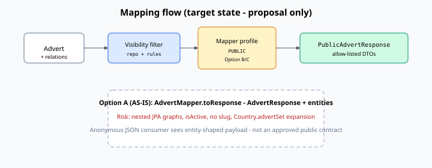
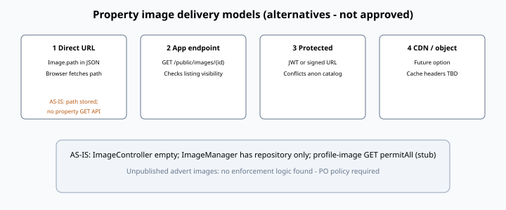
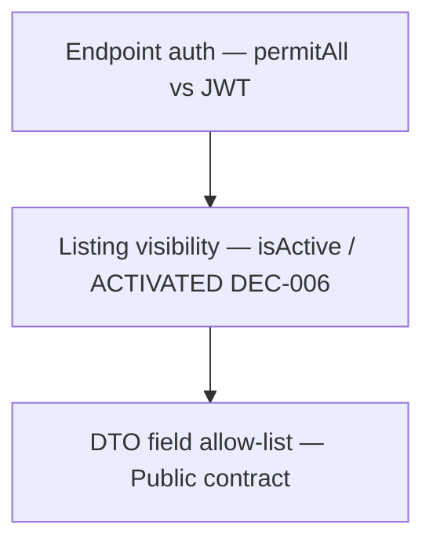
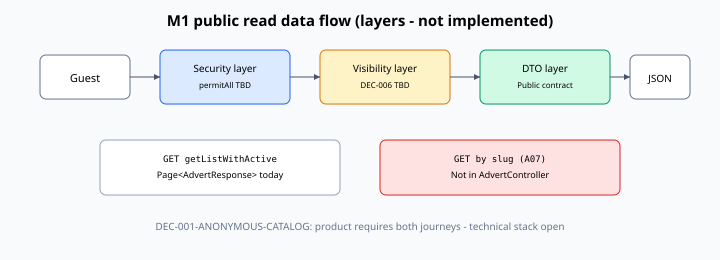

# DEC-001 — Public DTO and Data Exposure Review (TASK-014-DATA)

## 1. Purpose and scope

Produce an **evidence-based** analysis of AS-IS Backend **entity, DTO, and JSON exposure** for the M1 **property listing** and **detail** journeys, in support of PO decisions on **public data contract**, **image policy**, and **mapper strategy**.

| In scope | Out of scope |
|----------|--------------|
| `AdvertResponse` and nested types actually serialized today | Approving Public DTO, ADR-002, or endpoint whitelist |
| Field-level PUBLIC / INTERNAL / RESTRICTED / CONDITIONAL classification | Implementing A07 slug GET, mappers, or `SecurityConfig` |
| Public DTO options A–C with trade-offs | Changing approved PO sub-decisions |
| Image entity and delivery alternatives | Java source changes |

Turkish: [DEC-001-PUBLIC-DATA-BOUNDARY-REVIEW-TR.md](DEC-001-PUBLIC-DATA-BOUNDARY-REVIEW-TR.md).

---

## 2. Approved product decision boundaries (unchanged)

| ID | Decision |
|----|----------|
| **DEC-001-J02** | `POST .../contact-messages/{language}/add` — **authentication required**; anonymous **prohibited** |
| **DEC-001-M1-A02-A04** | **A02, A03, A04 excluded from M1**; deferred |
| **DEC-001-ANONYMOUS-CATALOG** | Anonymous visitors **must** browse M1 **listing** and **detail** (read-only). **Not** implementation, DTO, or ADR approval |

---

## 3. Source evidence and implementation findings

| Evidence | Finding |
|----------|---------|
| `AdvertResponse.java` | Declares **scalar fields** plus **nested JPA entity types** (`Country`, `City`, …), not dedicated response DTOs |
| `AdvertMapper.java` | MapStruct `toResponse(Advert)` — **no** `@Mapping` exclusions; copies matching property names only |
| `Advert.java` | Stores `slug`, `advertStatus`, `viewCount`, `user`, collections; several `@JsonIgnore` on entity **do not apply** to `AdvertResponse` fields |
| `AdvertManager.getListWithActive` | `findAllActive` → `isActive = true` **only** — **no** `AdvertStatus` filter (`AdvertRepository.java` L17–18) |
| `AdvertController.java` | Exposes `getAll`, `getListWithActive` as `Page<AdvertResponse>`; **no** slug/detail GET |
| `ImageController` / `ImageManager` | **No** property image REST; repository-only service |
| `SecurityFilterChainConfig` | `permitAll` for user **profile-image** GET only — **not** property `Image.path` |
| [ADR-002](../03-architecture/ADR/ADR-002-public-read-api.md) | **draft** — proposal tables; **not** binding |

**Verified prior observations (source-corrected):**

| Observation | Verdict | Evidence |
|-------------|---------|----------|
| `user` not in `AdvertResponse` | **Confirmed** | `AdvertResponse.java` — no `user` field; MapStruct maps by name |
| `isActive` in response | **Confirmed** | `AdvertResponse.java` L21 — `boolean isActive` |
| `slug` not in response | **Confirmed** | Present on `Advert.java` L32–34; absent on `AdvertResponse` |
| `advertStatus` not in response | **Confirmed** | Entity field only |
| `viewCount` not in response | **Confirmed** | Entity field only |
| `Image.path` exposed | **Confirmed** | `imageSet` typed as `Set<Image>` on response L28 |

---

## 4. Complete `AdvertResponse` field inventory

Serialization path: HTTP response body ← Jackson ← `AdvertResponse` ← MapStruct ← `Advert` (JPA-loaded graph).

| Field | Type | Source entity | Current exposure | Related fields | Risk | Evidence |
|-------|------|---------------|------------------|----------------|------|----------|
| `id` | `Long` | `Advert` / `BaseEntity` | In JSON when present | slug (not exposed) | Enumeration / coupling to internal PK | `BaseEntityResponse.java` L26 |
| `createAt` | `LocalDateTime` | `BaseEntity` | In JSON | `updateAt`, `deleted` | Operational metadata leak | L27 |
| `updateAt` | `LocalDateTime` | `BaseEntity` | In JSON | — | Same | L28 |
| `deleted` | `boolean` | `BaseEntity` | In JSON | soft-delete semantics | May expose withdrawn listings if query wrong | L29 |
| `title` | `String` | `Advert` | In JSON | `slug` (entity only) | Low for public copy | `AdvertResponse` L19 |
| `desc` | `String` | `Advert` | In JSON | — | Low | L20 |
| `isActive` | `boolean` | `Advert.isActive` via mapper | In JSON | `advertStatus` (entity) | **Internal flag on public surface** | L21; entity `@JsonIgnore` does not apply to DTO field |
| `price` | `Double` | `Advert` | In JSON | — | Low | L22 |
| `location` | `String` | `Advert` | In JSON | geo entities | Free-text location | L30 |
| `advertType` | `AdvertType` **entity** | `Advert.advertType` | Full entity JSON | `advertSet` on type | **Graph expansion** (see §5) | L23 |
| `country` | `Country` **entity** | `Advert.country` | Full entity JSON | `citySet`, `advertSet` unignored | **High** — collection blow-up | L24; `Country.java` |
| `city` | `City` **entity** | `Advert.city` | Full entity JSON | nested `country` | **Medium** — nested country graph | L25; `City.java` |
| `district` | `District` **entity** | `Advert.district` | Partial graph | `city` ignored on district | **Medium** | L26 |
| `category` | `Category` **entity** | `Advert.category` | Full entity JSON | `builtIn`, `active`, `slug` | **Medium** — admin-ish flags | L27 |
| `imageSet` | `Set<Image>` **entities** | `Advert.imageSet` | Image rows in JSON | `path`, `featured` | **Path / infra exposure** | L28 |
| `categoryPropertyValueSet` | `Set<CategoryPropertyValue>` | `Advert` | `id` + `value` only | key `@JsonIgnore` | **Low context** — orphan values | L29; `CategoryPropertyValue.java` |

**Not mapped into `AdvertResponse` (entity-only today):**

| Entity field | In DTO? | Notes |
|--------------|---------|--------|
| `slug` | **No** | Required for LEGACY A07 / FR-ADV-008 — **gap** |
| `advertStatus` | **No** | DEC-006 visibility **open** |
| `viewCount` | **No** | PO may want public metric |
| `builtIn` | **No** | `@JsonIgnore` on entity |
| `user` | **No** | **Positive** for PII |
| `favoriteSet`, `tourRequestSet`, `logSet` | **No** | **Positive** |

**Figure RE-FIG-DEC-014-001** — AS-IS DTO shape vs entity-only fields.

---

## 5. Nested DTO (entity) analysis

`AdvertResponse` does **not** use `CountryResponse`, `CategoryResponse`, etc. Jackson serializes **JPA entity classes** as nested objects.

### 5.1 `AdvertType`

| Field | Serialized? | Risk |
|-------|-------------|------|
| `id`, `createAt`, `updateAt`, `deleted` | Yes | Internal audit on nested object |
| `title` | Yes | Suitable for public label |
| `advertSet` | **Yes** — **no `@JsonIgnore`** | **RESTRICTED** — may pull advert back-references / lazy load |

### 5.2 `Country`

| Field | Serialized? | Risk |
|-------|-------------|------|
| `name`, `code` | Yes | Suitable for filters |
| `citySet`, `advertSet` | **Yes** — **no `@JsonIgnore`** | **RESTRICTED** — large graph, internal inventory |

### 5.3 `City`

| Field | Serialized? | Risk |
|-------|-------------|------|
| `name`, `plateNumber` | Yes | `plateNumber` **CONDITIONAL** (admin datum) |
| `country` | Yes | Re-nests full `Country` |
| `districtSet`, `advertSet` | No (`@JsonIgnore`) | — |

### 5.4 `District`

| Field | Serialized? | Risk |
|-------|-------------|------|
| `name` | Yes | Public label |
| `city` | No (`@JsonIgnore`) | — |

### 5.5 `Category`

| Field | Serialized? | Risk |
|-------|-------------|------|
| `title`, `icon`, `slug` | Yes | Public navigation |
| `builtIn`, `seq`, `active` | Yes | **INTERNAL / CONDITIONAL** moderation metadata |
| `advertSet`, `categoryPropertyKeys` | No | — |

### 5.6 `Image`

| Field | Serialized? | Risk |
|-------|-------------|------|
| `id`, audit fields | Yes | Internal ids on media |
| `name`, `type` | Yes | Low |
| `path` | Yes | **CONDITIONAL** — semantics **not defined** in code |
| `featured` | Yes | UX signal — likely PUBLIC |
| `advert` | No (`@JsonIgnore`) | — |

### 5.7 `CategoryPropertyValue`

| Field | Serialized? | Risk |
|-------|-------------|------|
| `id`, `value` | Yes | **CONDITIONAL** — without `CategoryPropertyKey.name`, values are ambiguous |
| `categoryPropertyKey`, `advert` | No | — |

---

## 6. Field classification (M1 listing / detail)

**Legend:** *Proposed* classification for PO workshop — **not approved**.

### 6.1 `AdvertResponse` and direct children

| Field | Type | Source | Current JSON | Proposed | Business purpose | Security / privacy | Open questions | Evidence |
|-------|------|--------|--------------|----------|------------------|--------------------|----------------|----------|
| `title` | String | Advert | Yes | **PUBLIC** | Listing headline | Low | — | `AdvertResponse` |
| `desc` | String | Advert | Yes | **PUBLIC** | Detail body | Low | Length / HTML | same |
| `price` | Double | Advert | Yes | **PUBLIC** | Search/sort | Low | Currency formatting | same |
| `location` | String | Advert | Yes | **PUBLIC** | Map text | Low | Precision vs privacy | same |
| `id` | Long | BaseEntity | Yes | **CONDITIONAL** | FE keys | Enumeration | Slug-only URLs? | `BaseEntityResponse` |
| `slug` | — | Advert entity | **No** | **CONDITIONAL** | A07 detail URLs | Low | **Must add for public detail** | `Advert.java` |
| `viewCount` | — | Advert entity | **No** | **CONDITIONAL** | Popularity | Scraping | Public metric? | `Advert.java` |
| `advertStatus` | — | Advert entity | **No** | **INTERNAL** | Moderation | Status leak | DEC-006 gate | `AdvertStatus.java` |
| `isActive` | boolean | Advert | Yes | **INTERNAL** | Soft delete | Exposes lifecycle | Hide from public JSON? | `AdvertResponse` |
| `createAt` / `updateAt` / `deleted` | — | BaseEntity | Yes | **INTERNAL** | Audit | Operational | Strip on public map | `BaseEntityResponse` |
| `advertType.title` | String | AdvertType | Yes | **PUBLIC** | Filter label | — | — | nested entity |
| `advertType.advertSet` | Set | AdvertType | Possible | **RESTRICTED** | ORM back-ref | **Graph leak** | Never public | `AdvertType.java` L28–30 |
| `country.name/code` | String | Country | Yes | **PUBLIC** | Geo filter | Low | — | `Country.java` |
| `country.citySet` / `advertSet` | Set | Country | Possible | **RESTRICTED** | Inventory | **High** | Never public | L30–34 |
| `city.name` | String | City | Yes | **PUBLIC** | Geo | Low | — | `City.java` |
| `city.plateNumber` | Integer | City | Yes | **CONDITIONAL** | TR plates | Low admin | Include in public? | L27–28 |
| `district.name` | String | District | Yes | **PUBLIC** | Geo | Low | — | `District.java` |
| `category.title/slug/icon` | String | Category | Yes | **PUBLIC** | Navigation | Low | Icon path policy | `Category.java` |
| `category.builtIn/seq/active` | various | Category | Yes | **INTERNAL** | Admin | Moderation leak | Exclude public DTO | L31–42 |
| `imageSet.path` | String | Image | Yes | **CONDITIONAL** | Gallery | Path traversal / infra | Delivery model §8 | `Image.java` L29–30 |
| `imageSet.featured` | boolean | Image | Yes | **PUBLIC** | Carousel | Low | — | L35–36 |
| `categoryPropertyValueSet.value` | String | CPV | Yes | **CONDITIONAL** | Attributes | Without key name | Pair with key label | `CategoryPropertyValue.java` |
| `user` | User | Advert | **Absent** | **RESTRICTED** | Owner | **PII** | Keep excluded | mapper |

**Figure RE-FIG-DEC-014-002** — Illustrative boundary zones (proposal).

---

## 7. Public DTO alternatives

### Option A — Reuse `AdvertResponse`

| Dimension | Assessment |
|-----------|------------|
| Security | **Poor** — entity graphs, `isActive`, `Country.advertSet`, possible lazy surprises |
| Maintainability | **Poor** — authenticated admin/owner APIs and anonymous catalog share one shape |
| Performance | **Risky** — accidental large graphs in JSON |
| Effort | Lowest short-term |
| API compatibility | Breaks public contract if entities gain fields |
| Extensibility | **Poor** — every entity change becomes public API change |

### Option B — Dedicated `PublicAdvertResponse` (+ nested public DTOs)

| Dimension | Assessment |
|-----------|------------|
| Security | **Strongest** — explicit allow-list; drop `advertSet`, audit fields |
| Maintainability | **Good** — separate evolution from `AdvertResponse` |
| Performance | Tune fetch joins / projections per public query |
| Effort | MapStruct profiles or manual mapper; tests for field deny-list |
| API compatibility | Authenticated endpoints unchanged |
| Extensibility | Add `slug`, `viewCount`, `PublicImageDto` under PO control |

### Option C — Separate public read model (query projection)

| Dimension | Assessment |
|-----------|------------|
| Security | **Good** — DB-level projection avoids loading forbidden associations |
| Maintainability | Extra query layer; clearer for list vs detail |
| Performance | **Best** for paging at scale |
| Effort | Highest — repository DTO interfaces, possible CQRS-lite |
| API compatibility | New service path for public reads |
| Extensibility | Fits future search/filter (FR-ADV-001) |

**Figure RE-FIG-DEC-014-003** — Mapping layers (proposal).

### Comparison matrix

| Criterion | A Reuse | B Dedicated DTO | C Read model |
|-----------|---------|-----------------|--------------|
| Security | Low | High | High |
| Maintainability | Low | High | Medium–High |
| Performance | Medium | Medium | High |
| Implementation effort | Low | Medium | High |
| Auth API compatibility | Coupled | Decoupled | Decoupled |
| Future filters/search | Weak | Medium | Strong |

---

## 8. Image and file exposure review

### AS-IS implementation evidence

| Topic | Finding | Evidence |
|-------|---------|----------|
| Entity | `name`, `type`, `path`, `featured`, FK `advert_id` | `Image.java` |
| Upload / download API | **Not implemented** | `ImageController` empty; `ImageManager` repository only |
| `path` semantics | **Undefined in code** — stored string, no validator for URL vs relative | No service writes found |
| Authorization on binary fetch | **No** property image endpoint; user `profile-image` GET is `permitAll` but `UserManager.getUserProfileImage` returns **null** stub | `SecurityFilterChainConfig` L51–55; `UserManager` L91–94 |
| Deleted / unpublished images | **No** enforcement in image layer | No queries |
| Static files | `/static/**` permitAll | `SecurityFilterChainConfig` L102 |

### Delivery alternatives (not approved)

| Model | Description | Considerations |
|-------|-------------|----------------|
| **1 — Direct public URL** | Return CDN or absolute URL in JSON | Caching easy; path leak if guessable; tie to listing visibility |
| **2 — Application public GET** | e.g. `/api/v1.0/public/images/{imageId}` | Can check advert visibility; more server load |
| **3 — Protected GET** | JWT or signed URL | Conflicts with anonymous catalog unless signed short TTL |
| **4 — Object storage / CDN** | Future | Cache headers (ADR-002 open question) |

**Figure RE-FIG-DEC-014-004** — Image delivery models.

**Privacy / availability:** If `path` is a predictable file name, anonymous listing JSON may enable hot-linking of unpublished assets unless storage is gated.

---

## 9. Slug and detail considerations (A07 — separate API task)

| Question | Finding | Evidence |
|----------|---------|----------|
| Slug in persistence? | **Yes** — `adverts.slug` NOT NULL, 5–200 chars | `Advert.java` L32–34 |
| Uniqueness constraint? | **No** `@Column(unique = true)` in entity — DB uniqueness **not verified** in this task | JPA mapping only |
| Stability | Intended URL-encoded title — **TODO** in source comment | L34 |
| Exposed in any response DTO? | **No** on `AdvertResponse`; **yes** on `CategoryResponse` for categories | Grep / source |
| Public detail endpoint | **Missing** — `getByIdActive` / `getByIdAllType` return null or unused; no slug mapping in `AdvertController` | `AdvertManager` L89–90 |
| Public DTO implication | PO likely needs **`slug`** on public detail (and optionally list cards) | FR-ADV-008, LEGACY A07 |

**This review does not implement A07** — records data contract need only.

---

## 10. Data visibility and access-control separation

Three independent layers:

| Layer | Question | Owner / status |
|-------|----------|----------------|
| **Access control** | May anonymous caller invoke GET? | DEC-001-PUBLIC-CATALOG — **open** |
| **Visibility** | Which adverts are eligible? | DEC-006 — **open**; AS-IS query: `isActive=true` only |
| **DTO exposure** | Which fields appear in JSON? | **This review — open** |

**Rule:** A public DTO must **not** bypass visibility rules. Field **PUBLIC** classification does **not** mean every row is returned.

**Figure RE-FIG-DEC-014-005** — Proposed layered flow.

---

## 11. Risks and dependencies

| Risk | Impact | Dependency |
|------|--------|------------|
| Entity graph in JSON | Payload size, accidental data leak | Option B/C |
| Missing `slug` | Cannot meet A07 UX | **TASK-014** (A07 slug GET — see [TODO.md](TODO.md)) |
| `isActive` on public JSON | Confuses guests vs operators | Public mapper |
| `Image.path` without gateway | Orphan URLs, stale media | Image policy PO + TASK-004 |
| `findAllActive` without status | PENDING adverts if `isActive=true` | DEC-006 + repository filter |
| Hibernate lazy load in serialization | Non-deterministic JSON | `@JsonIgnore` gaps on `AdvertType`, `Country` |

---

## 12. Non-binding recommendation

For M1 anonymous catalog aligned with **DEC-001-ANONYMOUS-CATALOG**:

1. **Prefer Option B** — `PublicAdvertResponse` with small nested DTOs (`PublicGeoDto`, `PublicCategoryDto`, `PublicImageDto`) and MapStruct **PUBLIC** profile.
2. **Do not** expose raw `Country.citySet`, `AdvertType.advertSet`, audit triplet (`createAt`, `updateAt`, `deleted`), or `isActive` on anonymous responses unless PO explicitly chooses otherwise.
3. **Include `slug` (and optionally `viewCount`)** on public detail when A07 is implemented — PO to confirm.
4. Pair DTO allow-list with a **visibility service** (DEC-006) independent of field classification.
5. Treat **image delivery model 2 or 4** as default workshop position until PO selects model 1 — because AS-IS `path` semantics are unknown and `ImageController` is empty.

**Not a PO decision. Not ADR-002 approval.**

---

## 13. Explicit PO questions

1. Approve **Option A, B, or C** for public read mapping?
2. **Allow-list:** include `id`, `slug`, `viewCount` on public list/detail?
3. Expose **`isActive` or `advertStatus`** to anonymous clients? (Recommended: **neither** until policy set.)
4. Nested geo shape: **flat labels only** vs ids for client cache?
5. **Category** fields: include `builtIn`, `seq`, `active` publicly?
6. **CategoryPropertyValue:** expose key name + value pairs? How?
7. **Image model** 1–4 (§8) and whether `path` may be absolute URL?
8. Should **plateNumber** appear in public city object?
9. Listing cards: **full `desc`** or truncated summary field?

---

## 14. Decision status and next steps

| Item | Status |
|------|--------|
| DEC-001 (overall) | **Not approved** |
| ADR-002 | **draft** |
| DEC-001-J02 / M1-A02-A04 / ANONYMOUS-CATALOG | **Approved** (unchanged) |
| Public DTO & field exposure | **PO DECISION REQUIRED** |
| Worksheet | §DEC-001-PUBLIC-DATA-BOUNDARY |

**Next:** Complete worksheet; reconcile with [DEC-001-PUBLIC-CATALOG-ACCESS-REVIEW.md](DEC-001-PUBLIC-CATALOG-ACCESS-REVIEW.md); TASK-001 ADR gate remains separate.

---

## 15. Change history

| Version | Date | Summary |
|---------|------|---------|
| 0.1.0 | 2026-11-13 | TASK-014-DATA public data boundary review EN/TR |
| 0.1.1 | 2026-11-13 | Task ID disambiguation: TASK-014-DATA vs TASK-014 (slug) |
