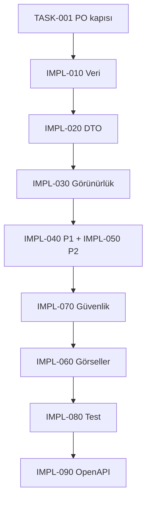

# M1 Public Catalog — Uygulama Planı (TASK-017)

TASK-013 … TASK-016 çıktılarına dayalı **kod öncesi teslimat planı**. Bu görevde **kod değişikliği yok**.

English: [M1-IMPLEMENTATION-PLAN.md](M1-IMPLEMENTATION-PLAN.md).

**Mimari baz çizgisi (onaylı):** [M1-PUBLIC-CATALOG-ARCHITECTURE-DECISIONS-TR.md](M1-PUBLIC-CATALOG-ARCHITECTURE-DECISIONS-TR.md) · **ADR-002** `approved` (TASK-001).

---

## 1. M1 kapsamı

| Kapsam içi | Kapsam dışı |
|------------|-------------|
| Anonim **liste** + **detay** (ürün: DEC-001-ANONYMOUS-CATALOG) | A02, A03, A04 anonim |
| Public DTO, görünürlük, dar whitelist, görseller | Anonim contact POST |
| Sayfalama, doğrulama, hatalar, testler, OpenAPI | Public `getAll` |
| | Stack yükseltme (ayrı hat; §10) |

Onaylı kurallar değişmedi: **DEC-001-J02**, **DEC-001-M1-A02-A04**, **DEC-001-ANONYMOUS-CATALOG**.

---

## 2. AS-IS mimari özeti (doğrulanmış)

| Katman | AS-IS | Kanıt |
|--------|-------|-------|
| **Stack** | Java **17**, Spring Boot **3.0.0** parent (`pom.xml`) | Not: actuator starter **3.2.1** ayrı sürüm |
| **API öneki** | `api/v1.0` | `AdvertController` |
| **Liste** | `GET .../getListWithActive` → `Page<AdvertResponse>` | `AdvertController`, `AdvertManager` |
| **Slug detay** | **Yok** | `AdvertController` içinde slug mapping yok |
| **Görünürlük sorgusu** | `findAllActive`: yalnızca `isActive = true` | `AdvertRepository` |
| **DTO** | `AdvertResponse` iç içe **entity** taşır | `AdvertResponse.java`, `AdvertMapper` |
| **Güvenlik** | `SecurityFilterChainConfig` → `anyRequest().authenticated()` | Dar `permitAll` |
| **Görseller** | `ImageController` **boş** | `ImageManager` yalnızca repository |
| **İstisnalar** | `GlobalExceptionHandler` | `shared.exception.globalExceptionHandling` |
| **Mapper** | MapStruct — `AdvertMapper`, `MapStructConfig` | `config/MapperConfig.java` |
| **Test** | Yalnızca `contextLoads` | **Eksik** |
| **OpenAPI** | springdoc classpath’te | Repo içi Swagger görselleri |

**TO-BE** bileşenleri §8’de **öneri** — uygulamaya kadar yok.

---

## 3. PO karar kapısı

### 3.1 **IMPL-000 — karşılandı (TASK-001, 2026-11-13)**

| # | Karar | Durum |
|---|--------|--------|
| G1 | ADR-002 / M1 baz çizgisi | **Onaylı** |
| G2 | Anonim GET whitelist | **Onaylı** — üç yol |
| G3 | Görünürlük DEC-006 M1 | **Onaylı** — V3 |

Worksheet: §**DEC-001-M1-ARCHITECTURE** kayıtlı.

### 3.2 Yalnız mühendislik

| Konu | Yön |
|------|-----|
| `viewCount` / public `id` | **Hariç** (PO onaylı) |
| `propertyValues` anahtarları | Yalnız allow-list |
| Rate limit sayıları | Mühendislik |
| Slug migration | Mühendislik |
| CDN / Model 4 | M1 sonrası |

---

## 4. İş akışları özeti

---

## 5. İş kırılımı (benzersiz ID)

Efor: **S** / **M** / **L**. Risk: **D** / **O** / **Y** (Düşük/Orta/Yüksek).

### A. Karar kapısı — `IMPL-000`

| Alan | Değer |
|------|-------|
| **Amaç** | TASK-016 baz çizgisinin PO onayı |
| **Bağımlılık** | TASK-016 dokümanları |
| **Çıktı** | **Tamam** — TASK-001 / ADR-002 v0.5.0 `approved` |
| **Test** | Yok |
| **Efor** | S |

### B. Veri ve kalıcılık — `IMPL-010`

| Alan | Değer |
|------|-------|
| **Amaç** | Slug bütünlüğü + görünürlüğe hazır sorgular |
| **AS-IS** | `Advert.slug` sütunu; entity’de unique yok |
| **TO-BE** | Migration: `UNIQUE(adverts.slug)` (silinmemişler); çift slug temizliği denetim sonrası **TBD** |
| **Repository** | `AdvertRepository` yeni metotlar — imza impl’de netleşir |
| **Çift slug** | Yazma: red; okuma: 0→404, >1→500 + ops alarmı |
| **Sayfalama** | `AdvertManager.getListWithActive` `PageRequest` kalıbı |
| **Bağımlılık** | **G3** |
| **Kabul** | Migration; çift tespit raporu; sorgu onaylı predicate ile uyumlu |
| **Test** | `@DataJpaTest` (**yeni altyapı**) |
| **Efor** | M · **Risk** O |

### C. Public DTO ve eşleme — `IMPL-020`

| Alan | Değer |
|------|-------|
| **Amaç** | `PublicAdvertListItem`, `PublicAdvertDetail`, TASK-016 §3 iç içe tipler |
| **TO-BE paket** | `com.prettier.payloads.response.public` (**öneri — yok**) |
| **Mapper** | `PublicAdvertMapper` — `AdvertMapper`’dan ayrı |
| **Alan kabulü** | [M1-PUBLIC-CATALOG-ARCHITECTURE-DECISIONS-TR.md](M1-PUBLIC-CATALOG-ARCHITECTURE-DECISIONS-TR.md) §3.1–3.3; JSON’da **yok:** `isActive`, `user`, `advertSet`, audit; **var:** `slug` |
| **Bağımlılık** | IMPL-000 |
| **Test** | Mapper deny-list birim testleri |
| **Efor** | M · **Risk** O |

### D. Public catalog uçları — `IMPL-040` (P1), `IMPL-050` (P2)

**IMPL-040 — Liste**

| Katman | AS-IS | TO-BE |
|--------|-------|-------|
| Controller | `getListWithActive` | Yeni `catalog` veya `PublicAdvertController` |
| Service | `AdvertManager.getListWithActive` | `PublicCatalogService` veya manager metodu |
| Yanıt | `Page<AdvertResponse>` | `Page<PublicAdvertListItem>` |

Doğrulama: `page`≥0, `size` üst sınır; sort whitelist.

**IMPL-050 — Detay (TASK-014 ile)**

| Katman | TO-BE |
|--------|-------|
| Controller | `GET .../slug/{slug}` |
| Service | Slug + görünürlük predicate |
| Yanıt | `PublicAdvertDetail` veya mevcut `InternalApiResponse` sarmalayıcı — **PO ile hizala** |

404: `AdvertNotFoundException` → `GlobalExceptionHandler`.

| | IMPL-040 | IMPL-050 |
|---|---------|---------|
| **Bağımlılık** | IMPL-030 | IMPL-030 |
| **Güvenlik** | IMPL-070 sonrası permitAll | aynı |
| **Test** | MockMvc | MockMvc slug senaryoları |
| **Efor** | M | M |

### E. Görünürlük ve güvenlik — `IMPL-030`, `IMPL-070`

**IMPL-030:** Merkezi predicate (öneri: `PublicAdvertVisibilitySpec`), onaylı V3 varsayılanı.

**IMPL-070:** `SecurityFilterChainConfig` genişletme — yalnızca onaylı GET kalıpları; `getAll`/yazma/contact anon **yasak**.

**Efor:** görünürlük S · güvenlik M · **Risk** Y

### F. Görsel teslimi — `IMPL-060`

Model 2: `GET /api/v1.0/public/images/{id}` → görsel → ilan → **IMPL-030 ile aynı görünürlük** → bayt akışı.

Sıralı ID tarama riski: IMPL-075 throttle + yetkilendirme; tahmin edilemez ID tek başına güvenlik değil.

**Efor** L · **Risk** Y

### G. Hız sınırlama — `IMPL-075`

IP tabanlı; prod öncesi TASK-016 varsayılanı **evet**. **Efor** S–M

### H. Test — `IMPL-080`

**Altyapı eksikliği:** `@WebMvcTest`, `@DataJpaTest`, Testcontainers — impl fazında eklenecek.

| ID | Senaryo | Katman |
|----|---------|--------|
| T-01 | Public liste 200 | API |
| T-02 | Boş liste | API |
| T-03 | Sayfalama / sıralama | API |
| T-04 | Slug detay 200 | API |
| T-05 | Bilinmeyen slug 404 | API |
| T-06 | Çift slug DB koruması | Repo + API |
| T-07 | `isActive=false` gizli | Repo + API |
| T-08 | PENDING/REJECTED gizli (V3) | Repo + API |
| T-09 | `deleted=true` gizli | Repo + API |
| T-10 | Liste/detay tutarlılığı | API |
| T-11 | Görünür ilan görseli 200 | API |
| T-12 | Gizli ilan görseli 404 | API |
| T-13 | Eksik görsel 404 | API |
| T-14 | JWT’siz POST advert 401 | Güvenlik |
| T-15 | JWT’siz contact 401 | Güvenlik |
| T-16 | JWT’siz `getAll` 401 | Güvenlik |
| T-17 | Manager rolü 403 (**TASK-005**) | Güvenlik (açık ise muafiyet dokümante) |
| T-18 | JSON’da entity sızıntısı yok | Sözleşme |
| T-19 | Kimlikli `getListWithActive` regresyonu | Regresyon |

**Efor** L · **Risk** O

### I. API dokümantasyonu — `IMPL-090`

springdoc; örnek yanıtlar Public DTO tiplerinden. **Efor** S

### J. Gözlemlenebilirlik — `IMPL-085`

İstek/hata logları (mevcut `@Slf4j` + handler); actuator health; opsiyonel metrik sayacı. Redis/Kafka **zorunlu değil**.

---

## 6. Teslim sırası (kritik yol)

| Sıra | ID | Bağımlılık |
|------|-----|------------|
| 1 | **IMPL-000** | TASK-016 |
| 2 | **IMPL-010** | G3 |
| 3 | **IMPL-020** | IMPL-000 |
| 4 | **IMPL-030** | G3, IMPL-010 |
| 5 | **IMPL-040** | IMPL-020, IMPL-030 |
| 6 | **IMPL-050** | IMPL-020, IMPL-030 (**TASK-014**) |
| 7 | **IMPL-070** | G2, rotalar |
| 8 | **IMPL-060** | IMPL-030, IMPL-070 |
| 9 | **IMPL-075** | PO evet ise |
| 10 | **IMPL-080** | 040–070 |
| 11 | **IMPL-090** | 040–060 |

**IMPL-030 sonrası paralel:** veri temizliği, IMPL-085.

---

## 7. Java / Spring modernizasyonu

| Seçenek | Özet | Risk |
|---------|------|------|
| **A — M1 mevcut stack, sonra yükseltme** | Java 17 + Boot 3.0.0 | **En düşük** (**önerilen**) |
| **B — Önce yükselt, sonra M1** | Ürün bloke | Yüksek — actuator 3.2.1 uyumsuzluğu |
| **C — Kademeli** | 3.0→3.2→3.4 kapıları | Orta |

**Migration öncesi doğrulanacak (TBD):** MapStruct, jjwt, springdoc, Hibernate, güvenlik matcher DSL; actuator sürümü parent BOM ile hizalama (AS-IS actuator **3.2.1**, parent **3.0.0**).

**Seçenek C kademeleri (sonra seçilirse):** (1) actuator + 3.0.x yama; (2) 3.2/3.3 + tam test; (3) Java 21 duman; (4) Java 25 / Boot 4 vendor matrisi sonrası.

Java 25 / Boot 4.x ile M1’i tek release’te birleştirmeyin (açık PO onayı olmadan).

---

## 8. Tamamlanma tanımı — M1 Public Catalog

- [ ] Anonim **P1** liste ve **P2** detay uygun ilanlarda JWT’siz **200**.
- [ ] Yanıtlar yalnızca **Public** DTO — entity JSON’da yok (otomatik sözleşme testi).
- [ ] Görünürlük liste/detay/görselde **aynı**.
- [ ] Uygun olmayan ilan listede yok; detay **404**; görsel **404**.
- [ ] Whitelist yalnızca onaylı GET; `getAll`/yazma/contact anon **engelli**.
- [ ] DEC-001-J02 testlerde değişmedi.
- [ ] A02–A04 `permitAll`’a eklenmedi.
- [ ] Test matrisi **T-01…T-19** yeşil (T-17 TASK-005 açıksa muafiyet belgeli).
- [ ] OpenAPI public uçları yansıtır.
- [ ] `mvn test` geçer.

---

## 9. İzlenebilirlik

| Önceki görev | Impl kullanımı |
|--------------|----------------|
| TASK-014 | Slug uç implementasyonu (**IMPL-050**) |
| TASK-014-DATA | DTO deny-list |
| TASK-015 | Sözleşme yolları |
| TASK-016 | Varsayılanlar |
| TASK-001 | PO kapısı |

---

## 10. Değişiklik geçmişi

| Sürüm | Tarih | Özet |
|-------|-------|------|
| 0.1.0 | 2026-11-13 | TASK-017 uygulama planı |
| 0.2.0 | 2026-11-13 | TASK-001; IMPL-000 karşılandı |
