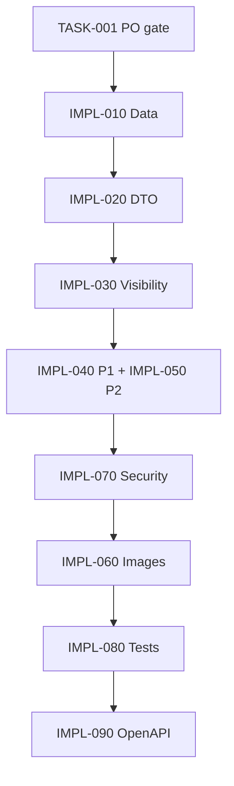

# M1 Public Catalog — Implementation Plan (TASK-017)

**Pre-coding delivery plan** based on TASK-013 … TASK-016. **No code changes** in this task.

Turkish: [M1-IMPLEMENTATION-PLAN-TR.md](M1-IMPLEMENTATION-PLAN-TR.md).

**Architecture baseline (approved):** [M1-PUBLIC-CATALOG-ARCHITECTURE-DECISIONS.md](M1-PUBLIC-CATALOG-ARCHITECTURE-DECISIONS.md) · **ADR-002** `approved` (TASK-001, **v0.6.0** after ARCH-1).

**ARCH-1 alignment (DEC-007):** Multilingual **AdvertTranslation**, Language Registry, and **language-scoped slugs** supersede monolingual `IMPL-010` TO-BE (global `adverts.slug` uniqueness). Execute public P1/P2 against **published translations**; see [PRODUCT_DECISIONS.md](PRODUCT_DECISIONS.md) §8 and [ROADMAP.md](ROADMAP.md) § Product delivery. This plan’s WBS identifiers remain; **technical targets** for IMPL-010+ follow DEC-007.

---

## 1. M1 scope

| In scope | Out of scope |
|----------|--------------|
| Anonymous **listing** + **detail** (product: DEC-001-ANONYMOUS-CATALOG) | A02, A03, A04 anonymous |
| Public DTOs, visibility, narrow whitelist, images | Anonymous contact POST |
| Pagination, validation, errors, tests, OpenAPI | Public `getAll` |
| | Stack upgrade (separate track; §10) |

Approved product rules unchanged: **DEC-001-J02**, **DEC-001-M1-A02-A04**, **DEC-001-ANONYMOUS-CATALOG**.

### 1.1 Language Registry foundation (DEC-007 — separate track)

The **M1 Language Registry slice** (Flyway `languages`, `LanguageRegistryService`, startup load, tests) is **complete** for engineering review. It does **not** satisfy §8 public catalog Definition of Done. Status: [LANGUAGE-REGISTRY-M1-IMPLEMENTATION-STATUS.md](../03-architecture/domain/LANGUAGE-REGISTRY-M1-IMPLEMENTATION-STATUS.md).

---

## 2. AS-IS architecture snapshot (verified)

| Layer | AS-IS | Evidence |
|-------|-------|----------|
| **Stack** | Java **17**, Spring Boot **3.0.0** parent (`pom.xml`) | Note: actuator starter **3.2.1** pinned separately |
| **API prefix** | `api/v1.0` | `AdvertController` `@RequestMapping` |
| **Listing** | `GET .../adverts/{language}/getListWithActive` → `Page<AdvertResponse>` | `AdvertController`, `AdvertManager` |
| **Detail by slug** | **Missing** | No slug mapping in `AdvertController` |
| **Visibility query** | `findAllActive`: `isActive = true` only | `AdvertRepository` |
| **DTO** | `AdvertResponse` embeds **entities** | `AdvertResponse.java`, `AdvertMapper` |
| **Security** | `SecurityFilterChainConfig` → `anyRequest().authenticated()` | Narrow permitAll |
| **Images** | `ImageController` **empty**; `ImageManager` repository-only | |
| **Exceptions** | `GlobalExceptionHandler` | `com.prettier.shared.exception.globalExceptionHandling` |
| **Mappers** | MapStruct — `AdvertMapper`, `MapStructConfig` (Spring component) | `config/MapperConfig.java` |
| **Tests** | `RealEstateApplicationTests.contextLoads` only | **Gap** |
| **OpenAPI** | springdoc on classpath | Swagger UI assets in repo |

**TO-BE** components are **proposed** in §8 — not present until implementation.

---

## 3. PO decision gate

### 3.1 **IMPL-000 — satisfied (TASK-001, 2026-11-13)**

| # | Decision | Status |
|---|----------|--------|
| G1 | ADR-002 / M1 baseline | **Approved** — P1, P2, DTO B, V3, Model 2, whitelist, rate limit |
| G2 | Anonymous GET whitelist | **Approved** — three paths per ADR-002 |
| G3 | Visibility **DEC-006** M1 gate | **Approved** — V3 |

Worksheet: §**DEC-001-M1-ARCHITECTURE** (recorded).

### 3.2 Engineering-only (not PO-gated for M1)

| Topic | Direction |
|-------|-----------|
| `viewCount` / public `id` | **Excluded** (PO approved) |
| `propertyValues` keys | Allow-list only — keys per TASK-014-DATA / §3 tables |
| List teaser `shortDescription` | Omit unless PO opens new gate |
| Rate limit numeric thresholds | Engineering |
| Slug DB migration | Engineering |
| CDN / Model 4 | Post-M1 |
| Geo/category anonymous GET | Out of M1 |

---

## 4. Workstreams overview

---

## 5. Work breakdown (unique IDs)

Effort: **S** / **M** / **L**. Risk: **L** / **M** / **H**.

### A. Decision gate — `IMPL-000`

| Field | Value |
|-------|-------|
| **Objective** | Record PO sign-off on TASK-016 baseline |
| **Dependencies** | TASK-016 docs |
| **Deliverable** | **Done** — TASK-001 / ADR-002 v0.5.0 `approved` |
| **Tests** | N/A |
| **Effort** | S |

### B. Data & persistence — `IMPL-010`

| Field | Value |
|-------|-------|
| **Objective** | Slug integrity + visibility-ready queries |
| **AS-IS** | `Advert.slug` column; no unique in entity mapping |
| **TO-BE** | Flyway/SQL migration: `UNIQUE(adverts.slug)` where not deleted; data cleanup script for duplicates **TBD** after audit query |
| **Repository** | `AdvertRepository` new methods e.g. `findPublicCatalog(Pageable)`, `findPublicBySlugAndLanguage` — **exact signature TBD** at impl |
| **Duplicate slug** | Write path: reject; read: 0 → 404, >1 → 500 + ops alert |
| **Pagination/sort** | Reuse `PageRequest` pattern from `AdvertManager.getListWithActive` |
| **Dependencies** | **G3** visibility rule |
| **Acceptance** | Migration applies; duplicate detection report; queries match approved predicate |
| **Tests** | Repository tests with `@DataJpaTest` (**new infra**) |
| **Effort** | M · **Risk** M |

### C. Public DTO & mapping — `IMPL-020`

| Field | Value |
|-------|-------|
| **Objective** | `PublicAdvertListItem`, `PublicAdvertDetail`, nested refs per TASK-016 §3 |
| **TO-BE package** | `com.prettier.payloads.response.public` (proposed — **does not exist**) |
| **Mapper** | `PublicAdvertMapper` + MapStruct `PUBLIC` or manual — separate from `AdvertMapper` |
| **Field acceptance** | Per [M1-PUBLIC-CATALOG-ARCHITECTURE-DECISIONS.md](M1-PUBLIC-CATALOG-ARCHITECTURE-DECISIONS.md) §3.1–3.3; JSON snapshots: **no** `isActive`, `user`, `advertSet`, audit; **has** `slug` |
| **Dependencies** | IMPL-000 |
| **Tests** | Unit: mapper deny-list assertions |
| **Effort** | M · **Risk** M |

### D. Public catalog endpoints — `IMPL-040` (P1), `IMPL-050` (P2)

**IMPL-040 — Listing**

| Layer | AS-IS | TO-BE |
|-------|-------|-------|
| Controller | `AdvertController.getListWithActive` | **New** `getCatalog` or `PublicAdvertController` |
| Service | `AdvertManager.getListWithActive` | `PublicCatalogService` / method on `AdvertManager` |
| Response | `Page<AdvertResponse>` | `Page<PublicAdvertListItem>` |

Validation: `page` ≥0, `size` capped (e.g. 50); sort whitelist fields.

Errors: invalid sort → 400; empty → 200 [].

**IMPL-050 — Detail (tracks TASK-014)**

| Layer | TO-BE |
|-------|-------|
| Controller | `GET .../slug/{slug}` on `AdvertController` or public controller |
| Service | Load by slug + visibility predicate |
| Response | `PublicAdvertDetail` or wrapped `InternalApiResponse` — **align with existing JSON style PO decision** |

404: `AdvertNotFoundException` via `GlobalExceptionHandler`.

| | IMPL-040 | IMPL-050 |
|---|---------|---------|
| **Dependencies** | IMPL-030 | IMPL-030 |
| **Security** | permitAll after IMPL-070 | same |
| **Tests** | MockMvc API | MockMvc + slug cases |
| **Effort** | M | M |

### E. Visibility & security — `IMPL-030`, `IMPL-070`

**IMPL-030 — Visibility service**

- Central `PublicAdvertVisibilitySpec` (proposed) applying **approved** predicate (default V3 proposal).
- Used by list, detail, image resolver.

**IMPL-070 — Security**

- **AS-IS:** `SecurityFilterChainConfig`
- **TO-BE:** Add `requestMatchers(GET, catalog, slug, public/images).permitAll()` **after PO whitelist approval**
- **Exclude:** `getAll`, writes, contact POST (DEC-001-J02)
- Regression: anonymous **401** on `getAll`; JWT still required on mutations

| **Effort** | S visibility · M security · **Risk** H |

### F. Image delivery — `IMPL-060`

| Field | Value |
|-------|-------|
| **Objective** | Model 2 public image GET |
| **TO-BE** | `PublicImageController` under `/api/v1.0/public/images/{id}` |
| **Flow** | Load `Image` → resolve `Advert` → **same visibility as IMPL-030** → stream bytes |
| **Headers** | `Content-Type` from `Image.type`; `Cache-Control` per TASK-016 |
| **404** | Missing image / ineligible advert (uniform 404) |
| **Enumeration** | Rate limit (IMPL-075) + authz check — **not** security-by-obscurity |
| **Storage** | Read `Image.path` via abstraction interface **TBD** (local file first) |
| **Dependencies** | IMPL-030, IMPL-070 |
| **Effort** | L · **Risk** H |

### G. Rate limiting — `IMPL-075` (optional gate)

- Servlet filter or Spring interceptor; IP-based; config via `application.yaml`
- **PO:** required before prod (TASK-016 default **yes**)
- **Effort** S–M

### H. Testing — `IMPL-080`

**Infrastructure gap:** No `@WebMvcTest`, `@DataJpaTest`, Testcontainers — **add** in impl phase.

| ID | Scenario | Layer |
|----|----------|-------|
| T-01 | Public listing 200 + page shape | API |
| T-02 | Empty listing | API |
| T-03 | Pagination / sort | API |
| T-04 | Detail by slug 200 | API |
| T-05 | Unknown slug 404 | API |
| T-06 | Duplicate slug DB guard | Repo + API |
| T-07 | Inactive `isActive=false` hidden | Repo + API |
| T-08 | `PENDING` / `REJECTED` hidden (if V3) | Repo + API |
| T-09 | `deleted=true` hidden | Repo + API |
| T-10 | List item slug appears in DB but detail 404 **must not occur** | API |
| T-11 | Image 200 for visible advert | API |
| T-12 | Image 404 hidden advert | API |
| T-13 | Image 404 missing id | API |
| T-14 | POST advert without JWT 401 | Security |
| T-15 | Contact POST without JWT 401 | Security |
| T-16 | `getAll` without JWT 401 | Security |
| T-17 | Manager path without role 403 **when RBAC on** | Security (**TASK-005** dep) |
| T-18 | JSON has no `user`, `isActive`, nested `advertSet` | API contract |
| T-19 | Authenticated `getListWithActive` unchanged if P1 separate | Regression |

**Effort** L · **Risk** M

### I. API documentation — `IMPL-090`

- springdoc annotations on new controllers; example responses from `PublicAdvert*` types
- **Effort** S

### J. Observability — `IMPL-085`

| Item | M1 baseline |
|------|-------------|
| Request logging | Existing `@Slf4j` + structured slug/path at INFO |
| Errors | `GlobalExceptionHandler` already logs |
| Security | Log permitAll denials at DEBUG |
| Health | Existing actuator (permitAll GET today) |
| Metrics | Optional: counter `public_catalog_requests` — **S** |

---

## 6. Delivery sequence (critical path)

| Order | ID | Depends on |
|-------|-----|------------|
| 1 | **IMPL-000** | TASK-016 |
| 2 | **IMPL-010** | G3 |
| 3 | **IMPL-020** | IMPL-000 |
| 4 | **IMPL-030** | G3, IMPL-010 |
| 5 | **IMPL-040** | IMPL-020, IMPL-030 |
| 6 | **IMPL-050** | IMPL-020, IMPL-030 (**TASK-014**) |
| 7 | **IMPL-070** | G2, IMPL-040/050 routes stable |
| 8 | **IMPL-060** | IMPL-030, IMPL-070 |
| 9 | **IMPL-075** | IMPL-070 (if PO yes) |
| 10 | **IMPL-080** | 040–070 |
| 11 | **IMPL-090** | 040–060 |

**Parallel after IMPL-030:** IMPL-010 data cleanup, IMPL-085 observability.

---

## 7. Java / Spring modernization (assessment)

| Option | Summary | Risk |
|--------|---------|------|
| **A — M1 on current stack, upgrade later** | Java 17 + Boot 3.0.0 | **Lowest combined risk** (**recommended**) |
| **B — Upgrade first, then M1** | Blocks product until BOM aligned | High — actuator already mismatched 3.2.1 |
| **C — Staged upgrade** | 3.0 → 3.2 → 3.4 gate, then Java 21/25 later | Medium ceremony |

**Verify before any upgrade (TBD):** MapStruct, jjwt, springdoc, Hibernate behavior, security matcher DSL, duplicate `UserController` mappings; align `spring-boot-starter-actuator` version with parent BOM (AS-IS **3.2.1** vs parent **3.0.0**).

**Option C staged gates (if chosen later):** (1) align actuator + patch 3.0.x; (2) jump to supported 3.2/3.3 LTS line with full `mvn test`; (3) Java 21 LTS smoke; (4) defer Java 25 / Boot 4 until vendor matrix published.

**Do not** combine Java 25 / Boot 4.x with M1 catalog in one release without explicit PO approval.

---

## 8. Definition of Done — M1 Public Catalog

- [ ] Anonymous **P1** listing and **P2** detail return **200** for eligible adverts without JWT.
- [ ] Response types are **Public** DTOs only — **no** entity types in JSON (automated contract test).
- [ ] Visibility predicate **identical** on list, detail, image.
- [ ] Ineligible adverts absent from list; detail **404**; image **404**.
- [ ] Whitelist allows **only** approved GET patterns; `getAll`/writes/contact anon **blocked**.
- [ ] DEC-001-J02 unchanged in tests.
- [ ] A02–A04 **not** added to permitAll.
- [ ] Test matrix §5.H **T-01…T-19** green (except T-17 if TASK-005 open — document waiver).
- [ ] OpenAPI documents public endpoints.
- [ ] `mvn test` passes; no secrets in repo.

---

## 9. Traceability

| Prior task | Use in impl |
|------------|-------------|
| TASK-014 | **Slug endpoint** implementation ID (IMPL-050) |
| TASK-014-DATA | DTO deny-list |
| TASK-015 | Contract paths |
| TASK-016 | Baseline defaults |
| TASK-001 | PO gate |

---

## 10. Change history

| Version | Date | Summary |
|---------|------|---------|
| 0.1.0 | 2026-11-13 | TASK-017 implementation plan |
| 0.2.0 | 2026-11-13 | TASK-001 PO gate closed; IMPL-000 satisfied |
| 0.2.1 | 2026-11-15 | Cross-reference Language Registry M1 completion (§1.1) |
