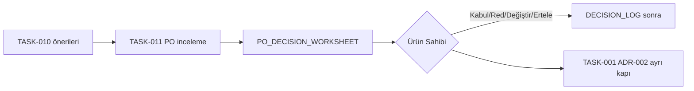
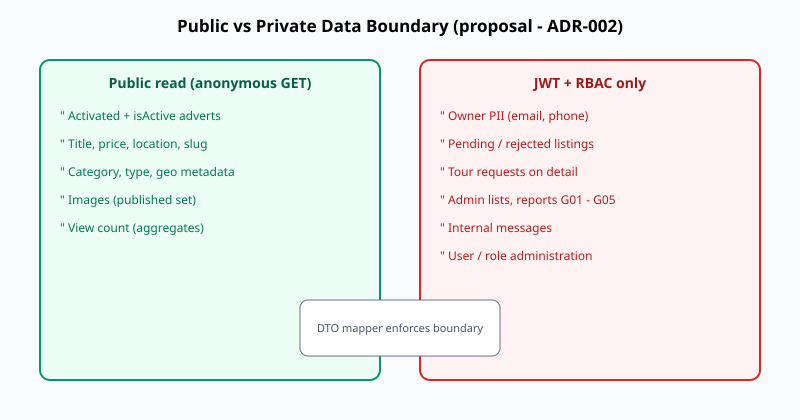
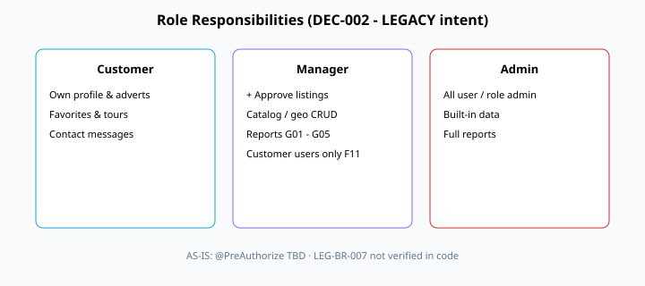
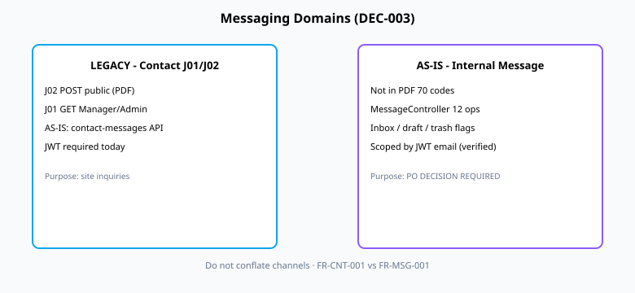
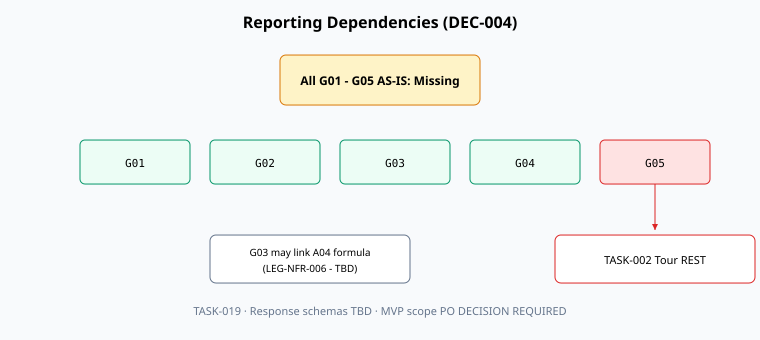
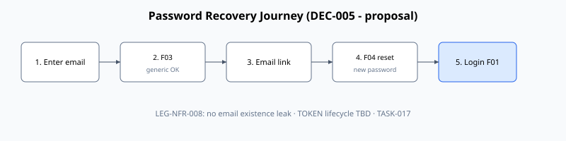
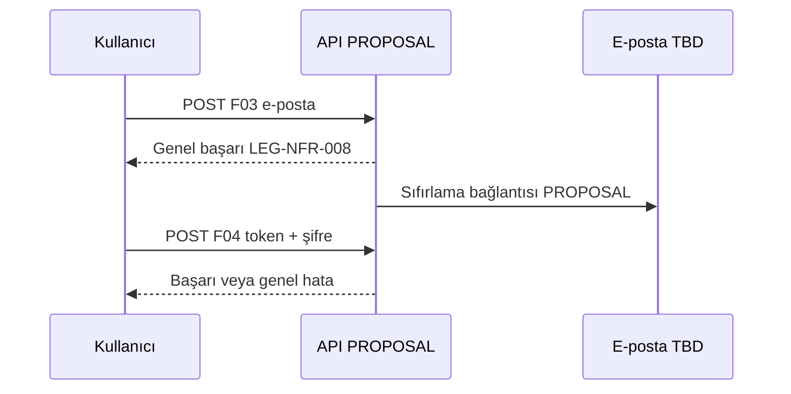
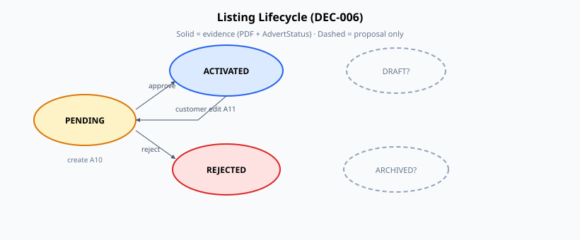
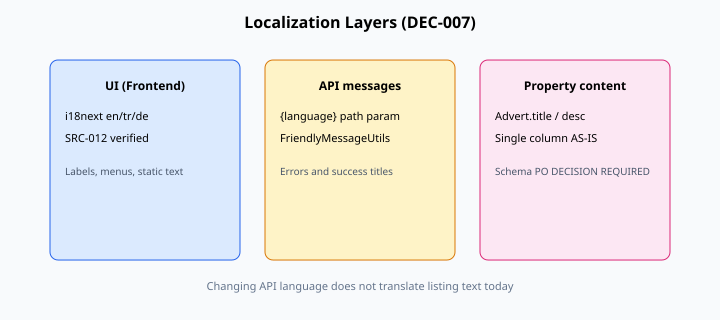
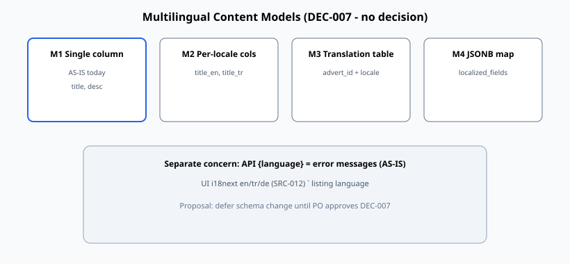

# Ürün Sahibi Karar İncelemesi (TASK-011)

## 1. Amaç ve kapsam

Bu paket **DEC-001 … DEC-007** için Ürün Sahibinin açık eylemini hazırlar: **Kabul**, **Red**, **Değiştir** veya **Ertele**.

| Kural | Açıklama |
|-------|----------|
| Cursor rolü | Yalnızca kanıt analizi ve **bağlayıcı olmayan** öneriler |
| Ürün Sahibi rolü | Tüm ürün kararları |
| ADR-002 | **Taslak** kalır; bu belge onaylamaz |
| Uygulama | Bu görevle **yetkilendirilmez** |

**Çalışma sayfası:** [PO_DECISION_WORKSHEET-TR.md](PO_DECISION_WORKSHEET-TR.md).

İngilizce eşdeğer: [PO_DECISION_REVIEW.md](PO_DECISION_REVIEW.md).

## 2. İnceleme metodolojisi

| Adım | Eylem |
|------|-------|
| 1 | Her DEC’i AS-IS kod, LEGACY PDF, BRD/FRD ve TASK-010 önerisiyle eşle |
| 2 | Kanıt sınıfı: **AS-IS**, **LEGACY**, **PROPOSAL**, **TBD**, **PO DECISION REQUIRED** |
| 3 | Alternatifleri ve ödünleşimleri yaz; öneriler **onay değildir** |
| 4 | Bağımlılıkları (görevler, diğer DEC’ler) belirt |
| 5 | Atölye için açık PO sorularını listele |

## 3. Karar durumu özeti

| Karar ID | Başlık | Güncel durum | TASK-010 önerisi | Onay durumu |
|----------|--------|--------------|------------------|-------------|
| DEC-001 | Herkese açık katalog ve anonim okuma | **Kısmi** — J02, M1 kapsamı, **anonim liste/detay** onaylı | Seçenek A + public DTO (**onaylanmadı**) | **Onaylanmadı** (**DEC-001-J02**, **DEC-001-M1-A02-A04**, **DEC-001-ANONYMOUS-CATALOG** hariç) |
| DEC-002 | Müşteri / Manager / Admin sorumlulukları | **PO incelemesi gerekli** | LEGACY RBAC + TASK-005 | **Onaylanmadı** |
| DEC-003 | Dahili mesajlaşma | **PO incelemesi gerekli** | R1 Tut | **Onaylanmadı** |
| DEC-004 | Raporlama G01–G05 | **PO incelemesi gerekli** | TASK-019 LEGACY paketi | **Onaylanmadı** |
| DEC-005 | Şifre kurtarma F03/F04 | **PO incelemesi gerekli** | TASK-017 + LEG-NFR-008 | **Onaylanmadı** |
| DEC-006 | İlan yaşam döngüsü | **PO incelemesi gerekli** | 3 enum; Draft/Archive erteleme | **Onaylanmadı** |
| DEC-007 | Çok dilli ilan içeriği | **PO incelemesi gerekli** | Kısa vade M1 tek sütun | **Onaylanmadı** |

**Şekil RE-FIG-PO-001** — Karar akışı (otomatik onay yok).

## 4. Önerilen sonraki adımlar (bağlayıcı değil)

1. [PO_DECISION_WORKSHEET-TR.md](PO_DECISION_WORKSHEET-TR.md) üzerinde yedi DEC’i tamamlayın.
2. DEC-001 kabul/değişiklik → **TASK-001** ADR-002 imzası (insan onayı).
3. Uygulama görevlerini bağımlılık sırasına göre planlayın; dokümantasyon tek başına “bitti” sayılmaz.

---

## DEC-001 — Herkese açık katalog ve anonim okuma

| Alan | İçerik |
|------|--------|
| **Karar ID** | DEC-001 |
| **Güncel durum** | PO incelemesi gerekli |
| **Mevcut öneri (TASK-010)** | **Seçenek A**: seçili GET için `permitAll` + **public DTO**; ADR-002 v0.3.0 taslak |
| **AS-IS kanıt** | `SecurityFilterChainConfig`: JWT zorunlu (istisnalar: auth POST, swagger vb.); `contact-Messages/**` whitelist gerçek `contact-messages` yoluyla **eşleşmiyor**. `getAll` (filtre yok), `getListWithActive` (yalnızca `isActive`). İkisi de JWT. FE: ilan API entegrasyonu yok; harici `baseUrl` |
| **LEGACY kanıt** | A01, A07, C01/C03, T01, U01–U03 anonim **+**; J02 anonim POST; A02–A04 anonim (s. 25–28) |
| **Alternatifler** | **A** permitAll; **B** `/public/v1`; **C** guest JWT; **D** gateway |
| **Öneri (bağlayıcı değil)** | Public katalog istenirse M1 için **A**, yalnızca public DTO + servis filtresi ile; `getAll` **hariç** |
| **Riskler** | `getAll` her statüyü sızdırır; iç içe entity grafiği; rate limit yoksa scraping |
| **Bağımlılıklar** | TASK-001, TASK-010, TASK-014, TASK-004, TASK-016, FR-ADV-001 |
| **Onay durumu** | **Kısmi** — aşağıdaki onaylı alt kararlar; teknik erişim politikası **açık** |

### Uç sınıflandırması (AS-IS kimlik doğrulama + LEGACY niyet)

| AS-IS yol | Metot | AS-IS auth | LEGACY anonim | Public aday (PROPOSAL) | PO notu |
|-----------|-------|------------|---------------|------------------------|---------|
| `.../adverts/.../getListWithActive` | GET | JWT | A01 benzeri | **Ürün: anonim zorunlu** (DEC-001-ANONYMOUS-CATALOG); yol/whitelist **TBD** | ACTIVATED filtresi **PROPOSAL** — PO onayı yok |
| `.../getAll` | GET | JWT | A06 benzeri | **Hayır** | Tüm statüler |
| `.../categories` (liste, tek kayıt GET) | GET | JWT | C01/C03 | **Evet** | admin yolu hayır |
| Ülke/şehir/ilçe GET listeleri | GET | JWT | U01–U03 | **Evet** | CRUD mutasyonları JWT |
| `advert-types` | * | JWT | T01 | **TBD** | Controller boş |
| Slug detay | — | — | A07 | **Ürün: anonim zorunlu** (DEC-001-ANONYMOUS-CATALOG); uç tasarımı **TBD** | TASK-014 |
| A02–A04 (yalnız LEGACY) | GET | — | + | **M1 sonrasına ertelendi** | **DEC-001-M1-A02-A04 onaylı** (erişim **TBD**) |
| `contact-messages/.../add` | POST | JWT | J02 (LEGACY anonim) | **Hayır** — **PO: yalnızca kimlik doğrulamalı** | DEC-001-J02 **onaylı** |
| Mesaj, admin, rol, favori | * | JWT | Hayır | Hayır | — |

### Public / private DTO alan sınırı (öneri — uygulanmadı)

| Alan | Public öneri | Özel / kimlik doğrulamalı |
|------|--------------|---------------------------|
| title, desc, price, location, slug, viewCount | İzin | — |
| tip, kategori, coğrafya, görseller | Kısıtlı graf | Tam admin grafı |
| advertStatus (public) | **TBD** | Sahip/yönetici |
| sahip PII | Red | Sahip/admin |
| tur, favori, log | Red | Rol bazlı |

### Güvenlik etkileri

- CSRF kapalı (AS-IS); public GET scraping → rate limit **PROPOSAL**
- Aynı controller’da public GET + korumalı POST için matcher sırası kritik
- İletişim POST (J02) anonim katalog kapsamı **dışında**; aşağıdaki onaylı alt karara bakın.

### Onaylı alt karar — DEC-001-J02

| Alan | Değer |
|------|-------|
| **Alt karar ID** | DEC-001-J02 |
| **PO kararı** | **J02 POST kimlik doğrulaması gerektirir.** Anonim kullanıcılar iletişim mesajı gönderemez (`POST .../contact-messages/{language}/add`). |
| **Onay durumu** | **Onaylandı** (TASK-011-A) |
| **Kapsam sınırı** | Seçenek A, tam DEC-001 veya ADR-002’yi **onaylamaz** |

### Onaylı alt karar — DEC-001-M1-A02-A04

| Alan | Değer |
|------|-------|
| **Alt karar ID** | DEC-001-M1-A02-A04 |
| **PO kararı** | **Seçenek D — minimum uygulanabilir yolculuk.** **A02**, **A03**, **A04** **M1 dışında**; **sonraki sürüme ertelendi** (sürüm numarası/tarih yok). |
| **Gerekçe (PO)** | Temel **ilan listeleme ve ilan detayı** öncelikli; A02–A04 ilk sürüm kapsamını genişletmemeli. |
| **Onay durumu** | **Onaylandı** (TASK-012-A) |
| **Kapsam sınırı** | Yalnızca M1 ürün kapsamı — anonim erişim, A02–A04 gelecek yetkilendirme, Seçenek A, tam DEC-001 veya ADR-002 **onaylamaz** |

### Onaylı alt karar — DEC-001-ANONYMOUS-CATALOG

| Alan | Değer |
|------|-------|
| **Alt karar ID** | DEC-001-ANONYMOUS-CATALOG |
| **PO kararı** | **Anonim ziyaretçiler M1 emlak listesine göz atabilmeli ve M1 ilan detayını kimlik doğrulaması olmadan açabilmelidir** (salt okunur). |
| **Onay durumu** | **Onaylandı** (TASK-013-A) |
| **Kapsam sınırı** | **Yalnızca ürün gereksinimi** — ADR-002, `permitAll`, uç whitelist’i, Public DTO, görünürlük kuralı, görsel yolları, rate limit, anonim yazma, **DEC-001-J02** değişikliği veya **A02/A03/A04** anonim erişimi **onaylamaz** |

*Kanıt: [DEC-001-PUBLIC-CATALOG-ACCESS-REVIEW-TR.md](DEC-001-PUBLIC-CATALOG-ACCESS-REVIEW-TR.md); çalışma sayfası §DEC-001-PUBLIC-CATALOG (teknik alanlar açık).*

### PO soruları (DEC-001 — açık)

1. **Teknik politika:** kesin anonim uç whitelist’i, Public DTO, görünürlük kuralı, görsel yolu politikası, rate limiting, gelecek sürümde geo/kategori anonim — çalışma sayfası §DEC-001-PUBLIC-CATALOG (**PO DECISION REQUIRED**).
2. **Uygulama** mimarisi için **A / B / C / D** (ADR-002 hâlâ **taslak**)?
3. M1 sonrası: A02–A04 için **anonim vs JWT** — **TBD**

---

## DEC-002 — Müşteri, Manager ve Admin sorumlulukları

| Alan | İçerik |
|------|--------|
| **Karar ID** | DEC-002 |
| **Güncel durum** | PO incelemesi gerekli |
| **Mevcut öneri** | LEGACY poster + LEG-BR-007; TASK-005 |
| **AS-IS kanıt** | Roller; `@PreAuthorize` yorum satırı; `AdvertManager.update` otomatik PENDING yok |
| **LEGACY kanıt** | SRC-002; LEG-BR-001–007; F11 s. 86–87 |
| **Alternatifler** | **A** Sıkı LEGACY; **B** Minimal JWT; **C** Özel matris |
| **Öneri (bağlayıcı değil)** | Eğitim spec ile uyum için **A** hedefi |
| **Riskler** | Aşırı yetki; PERSONAL rolü; Manager’ın Admin hesabı düzenlemesi |
| **Bağımlılıklar** | TASK-005, TASK-015, DEC-006 |
| **Onay durumu** | **Onaylanmadı** |

### Rol / sorumluluk matrisi (LEGACY niyet — onaylı izin değil)

| Sorumluluk | Müşteri | Manager | Admin | AS-IS doğrulama |
|------------|---------|---------|-------|-----------------|
| Gezinme (public) | LEGACY + | + | + | Anonim engelli |
| Kendi profili | F05–F08 | + | + | JWT |
| Kendi ilanları | A10–A11 | LEGACY + | + | Onay akışı yok |
| Onay/red | — | LEGACY | + | Uç **doğrulanmadı** |
| Katalog/geo CRUD | — | + | + | RBAC kapalı |
| Raporlar | — | + | + | API yok |
| Kullanıcı yönetimi | — | F11 kısmi | + | AdminController |
| Yalnızca Customer (F11) | — | LEGACY | — | Kod **TBD** |

### PO soruları (DEC-002)

1. Manager müşteri adına ilan oluşturabilir mi?
2. **LEG-BR-007** zorunlu mu?
3. **PERSONAL** rolü production’dan kaldırılsın mı?
4. **REJECTED** vs silme yetkisi kimde?

---

## DEC-003 — Dahili mesajlaşma

| Alan | İçerik |
|------|--------|
| **Karar ID** | DEC-003 |
| **Güncel durum** | PO incelemesi gerekli |
| **Mevcut öneri** | **R1 Tut** |
| **AS-IS kanıt** | `MessageController`; `MessageManager` JWT e-posta kapsamı; PDF’de yok |
| **LEGACY kanıt** | Yalnız J01/J02 iletişim |
| **Alternatifler** | **R1** Tut; **R2** Kaldır; **R3** Birleştir |
| **Öneri (bağlayıcı değil)** | Staff ihtiyacı varsa **R1**, yoksa **R2** |
| **Riskler** | GDPR; çift kanal; controller RBAC |
| **Bağımlılıklar** | TASK-005, BRD BA-04, DEC-002 |
| **Onay durumu** | **Onaylanmadı** |

### PO soruları (DEC-003)

1. **R1 / R2 / R3**?
2. Kim mesaj gönderebilir: yalnız staff mı, müşteri de mi?
3. Saklama ve **silme hakkı**?
4. Tur/e-posta bildirimi entegrasyonu?

---

## DEC-004 — Raporlama G01–G05

| Alan | İçerik |
|------|--------|
| **Karar ID** | DEC-004 |
| **Güncel durum** | PO incelemesi gerekli |
| **Mevcut öneri** | TASK-019 ile LEGACY paketi |
| **AS-IS kanıt** | `/report` yok |
| **LEGACY kanıt** | G01–G05 s. 89–93; Manager/Admin `++` |
| **Alternatifler** | MVP alt küme; erteleme; harici BI |
| **Öneri (bağlayıcı değil)** | MVP örn. G01+G02; **G05 → TASK-002** sonra |
| **Riskler** | Şema **uydurulmamalı**; A04 formül bağı |
| **Bağımlılıklar** | TASK-019, TASK-002, TASK-012 |
| **Onay durumu** | **Onaylanmadı** |

### Beş rapor karşılaştırması (sınırlı kanıt)

| Kod | FR | Amaç (çıkarım) | Kullanıcı | Veri | Filtre | Çıktı | Auth |
|-----|-----|----------------|-----------|------|--------|-------|------|
| G01 | FR-RPT-001 | Operasyon panosu | Mgr/Admin | **TBD** | **TBD** | **TBD** | JWT ++ |
| G02 | FR-RPT-002 | İlan istatistik | Mgr/Admin | Advert | **TBD** | **TBD** | JWT ++ |
| G03 | FR-RPT-003 | Popüler ilanlar | Mgr/Admin | Advert | **TBD** | **TBD** | JWT ++ |
| G04 | FR-RPT-004 | Rol bazlı kullanıcı | Mgr/Admin | User | **TBD** | **TBD** | JWT ++ |
| G05 | FR-RPT-005 | Tur talepleri | Mgr/Admin | Tour | **TBD** | **TBD** | JWT ++ |

### MVP önerisi (onaylı değil)

| Sürüm | Raporlar |
|-------|----------|
| MVP öneri | G01, G02 |
| Faz 2 | G03, G04 |
| Faz 3 | G05 |

### PO soruları (DEC-004)

1. MVP hangi kodlar?
2. CSV/PDF export?
3. G04’te Manager tüm rolleri görür mü?
4. Grafik UI vs yalnız JSON?

---

## DEC-005 — Şifre kurtarma

| Alan | İçerik |
|------|--------|
| **Karar ID** | DEC-005 |
| **Güncel durum** | PO incelemesi gerekli |
| **Mevcut öneri** | TASK-017; LEG-NFR-008 |
| **AS-IS kanıt** | F03/F04 yok; `resetPasswordCode` alanı var; admin DTO’da görünebilir |
| **LEGACY kanıt** | F03 s.78, F04 s.79; LEG-NFR-008 |
| **Alternatifler** | E-posta token; OTP; yalnız admin; erteleme |
| **Öneri (bağlayıcı değil)** | Self-service için F03/F04 |
| **Riskler** | E-posta bağımlılığı; token sızıntısı |
| **Bağımlılıklar** | TASK-017 |
| **Onay durumu** | **Onaylanmadı** |

### PO soruları (DEC-005)

1. Uygula mı ertele mi?
2. E-posta sağlayıcısı?
3. Token ömrü?
4. F03’te CAPTCHA?

---

## DEC-006 — İlan yaşam döngüsü

| Alan | İçerik |
|------|--------|
| **Karar ID** | DEC-006 |
| **Güncel durum** | PO incelemesi gerekli |
| **Mevcut öneri** | 3 enum; Draft/Archive yalnız öneri |
| **AS-IS kanıt** | `findAllActive` **yalnızca `isActive`**; `AdvertStatus` ayrı |
| **LEGACY kanıt** | LEG-BR-001–003; A11 |
| **Alternatifler** | **TO-BE A** LEGACY; **B** yalnız isActive; **C** Draft/Archive ekle |
| **Öneri (bağlayıcı değil)** | DEC-001 ile **ACTIVATED ∧ isActive** public kapısı |
| **Riskler** | ACTIVATED ama isActive=false tutarsızlığı |
| **Bağımlılıklar** | DEC-001, TASK-015, DEC-002 |
| **Onay durumu** | **Onaylanmadı** |

### PO soruları (DEC-006)

1. **Draft** statüsü?
2. **Archive** enum mu `isActive` mi?
3. **REJECTED** sahibe görünsün mü?
4. Public için **status + flag** birleşimi?

---

## DEC-007 — Çok dilli ilan içeriği

| Alan | İçerik |
|------|--------|
| **Karar ID** | DEC-007 |
| **Güncel durum** | PO incelemesi gerekli |
| **Mevcut öneri** | Kısa vade **M1**; şema erteleme |
| **AS-IS kanıt** | Tek `title`/`desc`/`slug`; API dili = mesajlar |
| **LEGACY kanıt** | İçerik i18n tanımsız |
| **UI** | i18next en/tr/de (SRC-012) |
| **Alternatifler** | M1–M4 (PRODUCT_DECISIONS ile uyumlu) |
| **Öneri (bağlayıcı değil)** | İki dilli ilan şartı netleşene kadar **M1** |
| **Riskler** | DE UI + EN ilan; arama; slug |
| **Bağımlılıklar** | Gelecek ERD; DEC-001 arama |
| **Onay durumu** | **Onaylanmadı** |

### PO soruları (DEC-007)

1. İlanlar **EN/TR zorunlu** mu?
2. **Slug** locale başına mı?
3. Eksik çeviride **fallback**?
4. Şema kararı takvimi?

---

## 5. Çapraz bağımlılıklar

DEC-001 → TASK-001; DEC-004 G05 → TASK-002; DEC-002 → TASK-005.

## 6. Program riskleri

| Risk | DEC |
|------|-----|
| JWT vs LEGACY public | 001, 006 |
| RBAC yok | 002, 003, 004 |
| Eksik API | 004, 005 |
| UI vs içerik i18n karışıklığı | 007 |

## 7. Referanslar

[LEGACY-REQUIREMENTS-ANALYSIS](../01-business/source-analysis/LEGACY-REQUIREMENTS-ANALYSIS.md), [API-INVENTORY](../03-architecture/api/API-INVENTORY.md), [PRODUCT_DECISIONS.md](PRODUCT_DECISIONS.md), [ADR-002](../03-architecture/ADR/ADR-002-public-read-api.md) (**taslak**).

## 8. Değişiklik geçmişi

| Sürüm | Tarih | Özet |
|-------|-------|------|
| 0.1.0 | 2026-11-13 | TASK-011 PO inceleme paketi |
| 0.1.1 | 2026-11-13 | TASK-011-A: DEC-001-J02 PO onayı kaydı |
| 0.1.2 | 2026-11-13 | TASK-012-A: DEC-001-M1-A02-A04 Seçenek D kaydı |
| 0.1.3 | 2026-11-13 | TASK-013-A: DEC-001-ANONYMOUS-CATALOG (M1 liste + detay ürün gereksinimi) |
