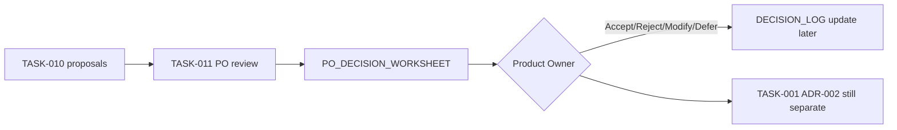
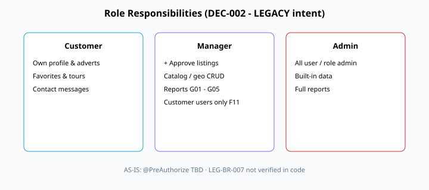
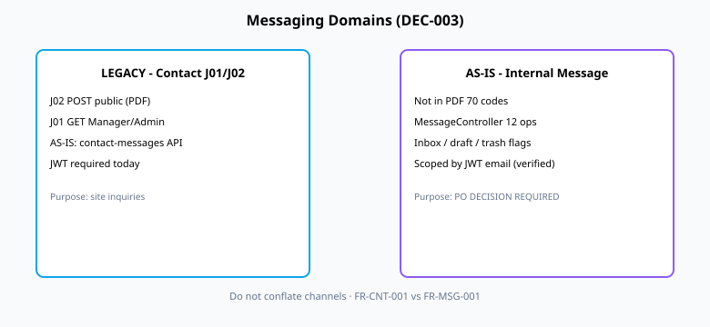
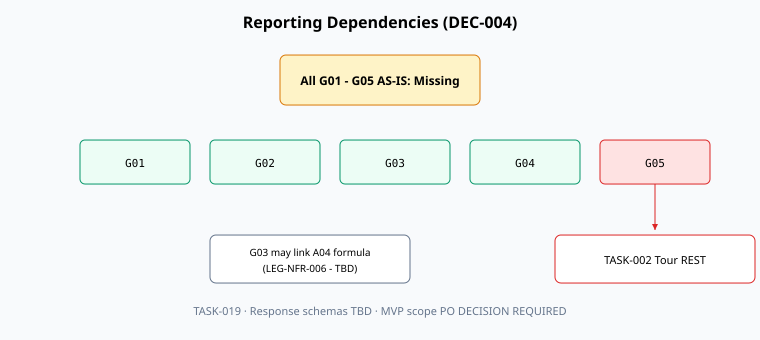
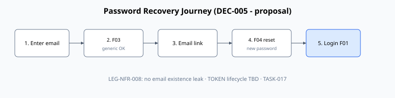
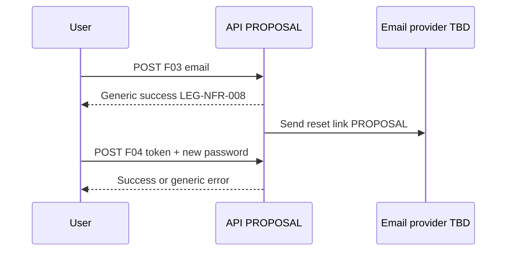
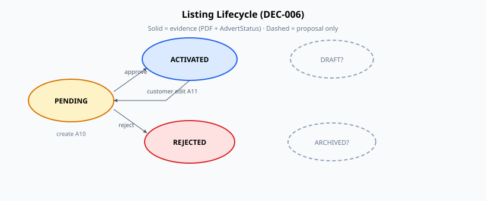
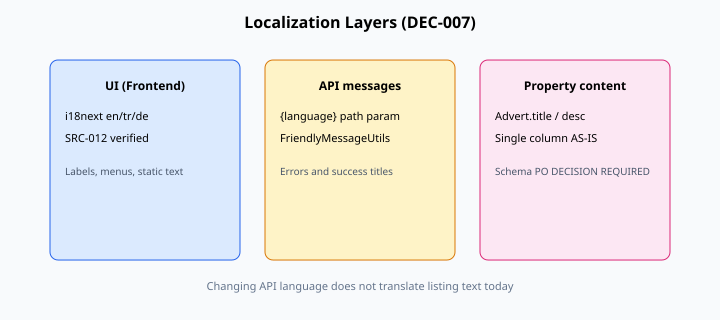
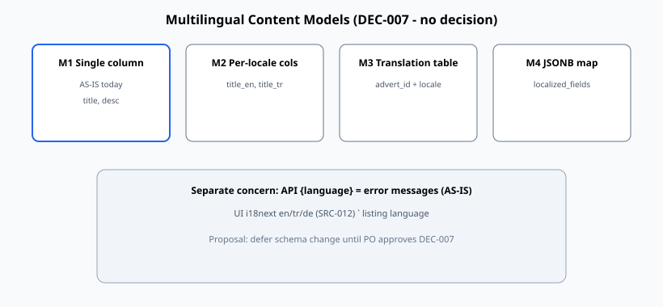

# Product Owner Decision Review (TASK-011)

## Historical status notice (read first)

> **Snapshot document:** This package reflects Product Owner review **status as of 2026-11-13** (TASK-011, baseline [PRODUCT_DECISIONS.md](PRODUCT_DECISIONS.md) v0.1.3). Overview tables and per-DEC sections below are **historical evidence** — they are **not** rewritten to match later approvals.
>
> **DEC-007 follow-up (ARCH-1, 2026-11-14):** **DEC-007 — Multilingual advert content** was **subsequently approved** by the Product Owner. **Authoritative** product record: [PRODUCT_DECISIONS.md](PRODUCT_DECISIONS.md) **§8** (v0.1.5+). **Architecture:** [ADR-002](../03-architecture/ADR/ADR-002-public-read-api.md) **v0.6.0** (multilingual public read). Use those documents for current DEC-007 status; §3 and **DEC-007** in this file still show **Not approved** as at original review time.
>
> **Other post-review approvals** (e.g. DEC-001 via TASK-001, ADR-002 v0.5.0) are also recorded in PRODUCT_DECISIONS and DECISION_LOG — this notice does not replace those registers.

## 1. Purpose and scope

This package prepares **DEC-001 through DEC-007** for explicit Product Owner action: **Accept**, **Reject**, **Modify**, or **Defer**.

| Rule | Statement |
|------|-----------|
| Cursor role | Evidence analysis and **non-binding** recommendations only |
| PO role | All product decisions |
| ADR-002 | Remains **draft**; this document does **not** approve it |
| Implementation | **Not authorized** by this task |

**Companion worksheet:** [PO_DECISION_WORKSHEET.md](PO_DECISION_WORKSHEET.md).

Turkish equivalent: [PO_DECISION_REVIEW-TR.md](PO_DECISION_REVIEW-TR.md).

## 2. Review methodology

| Step | Action |
|------|--------|
| 1 | Map each DEC to AS-IS code, LEGACY PDF, BRD/FRD, TASK-010 proposal |
| 2 | Label evidence class: **AS-IS**, **LEGACY**, **PROPOSAL**, **TBD**, **PO DECISION REQUIRED** |
| 3 | Document alternatives with trade-offs; recommendations are **not approvals** |
| 4 | List dependencies (tasks, other DECs) |
| 5 | Capture explicit PO questions for workshop completion |

Evidence sources read for this review:

- [PRODUCT_DECISIONS.md](PRODUCT_DECISIONS.md), [DECISION_LOG.md](DECISION_LOG.md), [TODO.md](TODO.md)
- [ADR-002](../03-architecture/ADR/ADR-002-public-read-api.md)
- [BRD-EN](../01-business/BRD/BRD-EN.md), [BRD-TR](../01-business/BRD/BRD-TR.md)
- [FRD-EN](../02-requirements/FRD/FRD-EN.md), [LEGACY_API_TO_FR_MATRIX](../02-requirements/FRD/LEGACY_API_TO_FR_MATRIX.md)
- [LEGACY-REQUIREMENTS-ANALYSIS](../01-business/source-analysis/LEGACY-REQUIREMENTS-ANALYSIS.md)
- [API-INVENTORY](../03-architecture/api/API-INVENTORY.md), [ROLE_PERMISSION_MATRIX](../01-business/role-permission-matrix/ROLE_PERMISSION_MATRIX.md)
- Backend `SecurityFilterChainConfig`, controllers (read-only); Frontend `helpers/config` (read-only)

## 3. Decision status overview

| Decision ID | Title | Current status | TASK-010 proposal | Approval status |
|-------------|-------|----------------|---------------------|-----------------|
| DEC-001 | Public catalog & anonymous read | **Partial** — J02, M1 scope, **anonymous list/detail** approved | Option A + public DTO (**not approved**) | **Not approved** (except **DEC-001-J02**, **DEC-001-M1-A02-A04**, **DEC-001-ANONYMOUS-CATALOG**) |
| DEC-002 | Customer / Manager / Admin responsibilities | **PO review required** | LEGACY RBAC + TASK-005 | **Not approved** |
| DEC-003 | Internal messaging | **PO review required** | R1 Retain | **Not approved** |
| DEC-004 | Reporting G01–G05 | **PO review required** | TASK-019 LEGACY suite | **Not approved** |
| DEC-005 | Password recovery F03/F04 | **PO review required** | TASK-017 + LEG-NFR-008 | **Not approved** |
| DEC-006 | Listing lifecycle | **PO review required** | 3 enum states; defer Draft/Archive | **Not approved** |
| DEC-007 | Multilingual property content | **PO review required** | Short-term M1 single column | **Not approved** |

**Figure RE-FIG-PO-001** — Decision flow (no automatic approval).

## 4. Recommended next steps (non-binding)

1. Complete [PO_DECISION_WORKSHEET.md](PO_DECISION_WORKSHEET.md) for all seven DECs.
2. If DEC-001 accepted/modified → schedule **TASK-001** ADR-002 sign-off (still human gate).
3. Sequence implementation tasks per dependency graph (§9); do not mark implementation **done** from documentation alone.

---

## DEC-001 — Public catalog and anonymous read access

| Field | Content |
|-------|---------|
| **Decision ID** | DEC-001 |
| **Current status** | PO review required |
| **Existing proposal (TASK-010)** | Option **A**: `permitAll` on selected GET paths + **public DTO** boundary; ADR-002 v0.3.0 draft |
| **AS-IS evidence** | `SecurityFilterChainConfig`: JWT except auth POST, profile-image GET, swagger/actuator; `contact-Messages/**` whitelist **does not match** `contact-messages` path. `AdvertController`: `getAll` (no status filter), `getListWithActive` (`isActive` only). Both **require JWT today**. Frontend: no listing API integration; external `baseUrl` in config |
| **LEGACY evidence** | A01, A07, C01/C03, T01, U01–U03 anonymous **+**; J02 anonymous POST; A02–A04 anonymous aggregations (pp. 25–28) |
| **Alternatives** | **A** permitAll paths; **B** `/public/v1` facade; **C** guest JWT; **D** API gateway (see ADR-002) |
| **Recommendation (non-binding)** | If PO chooses public catalog: prefer **Option A** for M1 **only with** public DTO + service filters; **exclude** `getAll` from public surface |
| **Risks** | Public `getAll` would expose non-active listings; nested entity graphs in `AdvertResponse` may over-share; scraping without rate limits; path whitelist drift |
| **Dependencies** | TASK-001 (ADR-002), TASK-010 FE alignment, TASK-014 (slug), TASK-004 (T01), TASK-016 (geo policy), FR-ADV-001 |
| **Approval status** | **Partial** — see approved sub-decisions below; technical access policy **open** |

### Endpoint classification (AS-IS auth + LEGACY intent)

| AS-IS path (pattern) | Method | AS-IS auth | LEGACY anonymous | PROPOSAL public candidate | PO notes |
|----------------------|--------|------------|------------------|---------------------------|----------|
| `/api/v1.0/auth/{lang}/signUp`, `login` | POST | Public | F02/F01 | — | Already public |
| `/api/v1.0/adverts/{lang}/getListWithActive` | GET | JWT | A01-like | **Product: anonymous required** (DEC-001-ANONYMOUS-CATALOG); path/whitelist **TBD** | Filter ACTIVATED **PROPOSAL** — not PO-approved |
| `/api/v1.0/adverts/{lang}/getAll` | GET | JWT | Admin-like A06 | **No** | Returns all statuses |
| `/api/v1.0/adverts/{lang}/add`, update, delete | * | JWT | No | No | — |
| `/api/v1.0/categories/{lang}/categories` | GET | JWT | C01 | **Yes** | Active categories only |
| `/api/v1.0/categories/{lang}/categories/admin` | GET | JWT | C02 | **No** | Manager+ |
| `/api/v1.0/categories/{lang}/get/{id}` | GET | JWT | C03 | **Yes** | — |
| `/api/v1.0/countries| cities | districts` GET lists | GET | JWT | U01–U03 | **Yes** | CRUD POST/PUT/DELETE stay JWT |
| `/api/v1.0/advert-types/**` | * | JWT | T01 | **TBD** | Controller **empty** |
| Slug detail (not implemented) | GET | — | A07 | **Product: anonymous required** (DEC-001-ANONYMOUS-CATALOG); endpoint design **TBD** | TASK-014 |
| `/adverts/cities`, `/popular` (LEGACY only) | GET | — | A02–A04 | **Deferred beyond M1** | **DEC-001-M1-A02-A04 approved** (access **TBD**) |
| `/api/v1.0/contact-messages/{lang}/add` | POST | JWT | J02 anonymous (LEGACY) | **No** — **PO: authenticated only** | DEC-001-J02 **approved**; anon not permitted |
| Messages, admins, roles, favorites | * | JWT | No | No | — |

### Public vs private DTO field boundary (proposal — not enforced)

| Field / group | Public read proposal | Private / authenticated |
|---------------|----------------------|-------------------------|
| title, desc, price, location, slug, viewCount | Allow | — |
| advertType, category, geo, images | Allow reduced graph | Full admin graphs |
| advertStatus visible to public | **TBD** | Owner/manager views |
| owner user, email, phone | Deny | Owner/admin |
| tour requests, favorites, logs | Deny | Role-based |

### Security implications

- CSRF disabled (AS-IS); public GET increases scraping surface → rate limiting **PROPOSAL**.
- Making geo GET public while keeping POST/DELETE on same controllers requires careful `requestMatchers` ordering.
- Contact POST (J02) is **out of scope** for anonymous/public catalog; see approved sub-decision below.

### PO approved sub-decision — DEC-001-J02

| Field | Value |
|-------|-------|
| **Sub-decision ID** | DEC-001-J02 |
| **PO decision** | **J02 POST requires authentication.** Anonymous users must not submit contact messages (`POST .../contact-messages/{language}/add`). |
| **Approval status** | **Approved** (TASK-011-A) |
| **Scope limit** | Does **not** approve Option A, full DEC-001, or ADR-002 |

### PO approved sub-decision — DEC-001-M1-A02-A04

| Field | Value |
|-------|-------|
| **Sub-decision ID** | DEC-001-M1-A02-A04 |
| **PO decision** | **Option D — minimum viable user journey.** **A02** (Cities), **A03** (Categories), **A04** (Popular Advertisements) **excluded from M1**; deferred to a **later release** (no release number/date). |
| **Reason (PO)** | Prioritize fundamental **property listing and property detail**; A02–A04 must not expand initial release scope. |
| **Approval status** | **Approved** (TASK-012-A) |
| **Scope limit** | M1 product scope only — does **not** approve anonymous access, future auth for A02–A04, Option A, full DEC-001, or ADR-002 |

### PO approved sub-decision — DEC-001-ANONYMOUS-CATALOG

| Field | Value |
|-------|-------|
| **Sub-decision ID** | DEC-001-ANONYMOUS-CATALOG |
| **PO decision** | **Anonymous visitors must be able to browse the M1 property listing and open M1 property details** without authentication (read-only). |
| **Approval status** | **Approved** (TASK-013-A) |
| **Scope limit** | **Product requirement only** — does **not** approve ADR-002, `permitAll`, endpoint whitelist, Public DTO, visibility rule (`isActive` / status), image paths, rate limits, anonymous writes, **DEC-001-J02** change, or anonymous **A02/A03/A04** |

*Evidence: [DEC-001-PUBLIC-CATALOG-ACCESS-REVIEW.md](DEC-001-PUBLIC-CATALOG-ACCESS-REVIEW.md); worksheet §DEC-001-PUBLIC-CATALOG (technical fields remain open).*

### PO questions (DEC-001 — unresolved)

1. **Technical policy:** exact anonymous endpoint whitelist, Public DTO, visibility rule, image path policy, rate limiting, geo/category anonymous in future release — see worksheet §DEC-001-PUBLIC-CATALOG (**PO DECISION REQUIRED**).
2. Accept **Option A**, **B**, **C**, or **D** for **implementation** architecture (ADR-002 still **draft**)?
3. Post-M1: **anonymous vs authenticated** for A02–A04 when implemented — **TBD**

---

## DEC-002 — Customer, Manager and Admin responsibilities

| Field | Content |
|-------|---------|
| **Decision ID** | DEC-002 |
| **Current status** | PO review required |
| **Existing proposal** | Align to LEGACY poster + LEG-BR-007; enforce via TASK-005 |
| **AS-IS evidence** | Roles ADMIN/MANAGER/CUSTOMER/PERSONAL; `@PreAuthorize` commented; `Advert.user_id`; `AdvertManager.update` no auto-PENDING; `AdminController` user lists/mutations |
| **LEGACY evidence** | Poster SRC-002; LEG-BR-001–007; F11 manager scope pp. 86–87; manager approval p. 6 |
| **Alternatives** | **A** Strict LEGACY matrix; **B** Minimal JWT-only; **C** Custom product matrix (must be documented) |
| **Recommendation (non-binding)** | **A** as target TO-BE if marketplace matches training spec; implement incrementally via TASK-005 |
| **Risks** | Over-permission today; PERSONAL role in production; manager editing Manager accounts |
| **Dependencies** | TASK-005, TASK-015, DEC-006 (status rules) |
| **Approval status** | **Not approved** |

### Role / responsibility matrix (LEGACY intent — not approved permissions)

| Responsibility | Customer | Manager | Admin | AS-IS verified |
|----------------|----------|---------|-------|----------------|
| Browse (public) | LEGACY + | + | + | JWT blocks anonymous |
| Own profile | F05–F08 | + | + | UserController JWT |
| CRUD own adverts | A10–A11 | LEGACY + | + | JWT; no approval workflow |
| Approve/reject adverts | — | LEGACY | + | **Not verified** endpoint |
| Catalog/geo CRUD | — | LEGACY + | + | Endpoints exist; RBAC off |
| Reports G01–G05 | — | LEGACY + | + | Missing API |
| User admin F09–F12 | — | Partial F11 | + | AdminController |
| Manage only Customer users (F11) | — | LEGACY | — | **TBD** code |

### Business rule alternatives (listing approval)

| Rule | LEGACY | AS-IS | PROPOSAL if PO accepts LEGACY |
|------|--------|-------|-------------------------------|
| Create → PENDING | A10 | Default enum | Keep |
| Staff → ACTIVATED | p. 6 | **TBD** | Manager/admin endpoint |
| Customer edit → PENDING | A11 / LEG-BR-002 | Not in service | Enforce in TASK-015 |
| `isActive` toggle | **TBD** PDF | Separate flag | PO defines combined rule |

### PO questions (DEC-002)

1. May **Manager** create listings on behalf of customers?
2. Enforce **LEG-BR-007** (Manager edits Customer users only)?
3. Remove **PERSONAL** role from production policy?
4. Who may set **REJECTED** vs delete listing?

---

## DEC-003 — Internal messaging

| Field | Content |
|-------|---------|
| **Decision ID** | DEC-003 |
| **Current status** | PO review required |
| **Existing proposal** | **R1 Retain** internal mailbox; formalize in BRD |
| **AS-IS evidence** | `MessageController` (12 operations); `Message` entity; `MessageManager` uses `SecurityContext` email for mailbox queries; not in PDF 70 codes |
| **LEGACY evidence** | J01/J02 contact messages only |
| **Alternatives** | **R1** Retain + govern; **R2** Deprecate; **R3** Merge with contact (high scope) |
| **Recommendation (non-binding)** | **R1** if staff ops need in-app mail; else **R2** to reduce scope |
| **Risks** | Privacy/GDPR retention; duplicate comms channels; RBAC not enforced at controller |
| **Dependencies** | TASK-005, BRD BA-04, DEC-002 (who may message whom) |
| **Approval status** | **Not approved** |

### AS-IS capability summary

| Capability | Evidence |
|------------|----------|
| Inbox/outbox/read/unread/draft/trash/spam/important | Controller mappings verified |
| Send by receiver email | `MessageManager` + `userService.getUserByEmail` |
| PDF equivalent | **None** |

### PO questions (DEC-003)

1. **R1**, **R2**, or **R3**?
2. Allowed actors: **Staff only** vs Customer-to-Manager?
3. Retention period and **right to erasure**?
4. Future link to **tour/email notifications**?

---

## DEC-004 — Reporting G01–G05

| Field | Content |
|-------|---------|
| **Decision ID** | DEC-004 |
| **Current status** | PO review required |
| **Existing proposal** | Implement LEGACY suite under TASK-019 |
| **AS-IS evidence** | No `/report` controllers; codebase grep **Missing** |
| **LEGACY evidence** | G01–G05 pp. 89–93; Manager/Admin `++` |
| **Alternatives** | **MVP** subset vs full five; **Defer** reporting; **BI external** tool |
| **Recommendation (non-binding)** | PO prioritizes **MVP** (e.g. G01+G02); **G05 after TASK-002** |
| **Risks** | Unknown response schemas; duplicate of public A04 formula |
| **Dependencies** | TASK-019, TASK-002 (G05), optional TASK-012 (G03/A04) |
| **Approval status** | **Not approved** |

### Five-report comparison (evidence-limited)

| Code | FR | Purpose (inferred) | User | Data (TBD) | Filters (TBD) | Output (TBD) | Auth LEGACY |
|------|-----|-------------------|------|------------|---------------|--------------|-------------|
| G01 | FR-RPT-001 | Operations dashboard | Mgr/Admin | Aggregates | **TBD** | JSON **TBD** | JWT ++ |
| G02 | FR-RPT-002 | Advert statistics | Mgr/Admin | Advert | **TBD** | **TBD** | JWT ++ |
| G03 | FR-RPT-003 | Popular properties | Mgr/Admin | Advert views/tours | **TBD** | **TBD** | JWT ++ |
| G04 | FR-RPT-004 | Users by role | Mgr/Admin | User/Role | **TBD** | **TBD** | JWT ++ |
| G05 | FR-RPT-005 | Tour requests | Mgr/Admin | TourRequest | **TBD** | **TBD** | JWT ++ |

**Do not invent JSON schemas** — PO must accept discovery task or provide samples.

### MVP vs later (proposal only)

| Release | Reports | Rationale |
|---------|---------|-----------|
| MVP proposal | G01, G02 | Operational visibility |
| Phase 2 | G03, G04 | Needs A04 formula + user policy |
| Phase 3 | G05 | Blocked on tour REST |

### PO questions (DEC-004)

1. **MVP** which codes?
2. **Export** CSV/PDF required?
3. May **Manager** see G04 for all roles or customers only?
4. Budget for **embedded charts** vs JSON-only API?

---

## DEC-005 — Password recovery

| Field | Content |
|-------|---------|
| **Decision ID** | DEC-005 |
| **Current status** | PO review required |
| **Existing proposal** | F03/F04 via TASK-017; LEG-NFR-008 anti-enumeration |
| **AS-IS evidence** | No `/forgot-password` endpoints; `User.resetPasswordCode` field exists; exposed in **admin** DTOs — not public flow |
| **LEGACY evidence** | F03 p.78, F04 p.79; LEG-NFR-008 p.78 |
| **Alternatives** | Email link token; OTP SMS; admin-only reset; **Defer** feature |
| **Recommendation (non-binding)** | Email token flow matching F03/F04 if product needs self-service |
| **Risks** | Email dependency; token leakage; admin DTO exposing `resetPasswordCode` |
| **Dependencies** | TASK-017, email integration, NFR-SEC review |
| **Approval status** | **Not approved** |

**Figure RE-FIG-PO-005** — Proposed sequence (not implemented).

### Security requirements table

| Requirement | Source | AS-IS |
|-------------|--------|-------|
| No email enumeration | LEG-NFR-008 | Missing |
| Token expiry + single use | **TBD** | Missing |
| Rate limit / CAPTCHA | **PROPOSAL** | Missing |
| Audit trail | **TBD** | Missing |
| Password complexity on reset | Align F02 rules | **TBD** |

### PO questions (DEC-005)

1. **Implement** or **defer** F03/F04?
2. Email provider choice?
3. Token TTL?
4. CAPTCHA on F03?

---

## DEC-006 — Listing lifecycle

| Field | Content |
|-------|---------|
| **Decision ID** | DEC-006 |
| **Current status** | PO review required |
| **Existing proposal** | Keep PENDING/ACTIVATED/REJECTED; Draft/Archive **proposal only** |
| **AS-IS evidence** | `AdvertStatus` enum (3 values); `isActive` default true; `findAllActive` uses **`isActive` only** — not `AdvertStatus`; no approval API verified |
| **LEGACY evidence** | LEG-BR-001–003; state diagram p.6, A11 |
| **Alternatives** | **TO-BE A** LEGACY strict; **TO-BE B** `isActive` only; **TO-BE C** add Draft/Archived states |
| **Recommendation (non-binding)** | **TO-BE A** with public gate **ACTIVATED ∧ isActive** if DEC-001 proceeds |
| **Risks** | Inactive but ACTIVATED listings public today if only `isActive` checked |
| **Dependencies** | DEC-001, TASK-015, DEC-002 approval roles |
| **Approval status** | **Not approved** |

### Transition rules table

| Transition | LEGACY | AS-IS verified | PROPOSAL |
|------------|--------|----------------|----------|
| Create | → PENDING | Default PENDING | Keep |
| Approve | → ACTIVATED | **TBD** | Manager/Admin action |
| Reject | → REJECTED | **TBD** | — |
| Customer edit | → PENDING | Not enforced | TASK-015 |
| Soft hide | **TBD** | `isActive=false` | Define vs REJECTED |

### PO questions (DEC-006)

1. Add **Draft** state?
2. Use **Archive** via `isActive` or new enum?
3. Show **REJECTED** to owner in UI?
4. Single public rule: **status + flag** combination?

---

## DEC-007 — Multilingual property content

**Historical section (2026-11-13 review):** The **Approval status** and recommendations below reflect the workshop snapshot only. **Current authority:** [PRODUCT_DECISIONS.md](PRODUCT_DECISIONS.md) §8 (DEC-007 **approved**, ARCH-1); [ADR-002](../03-architecture/ADR/ADR-002-public-read-api.md) v0.6.0.

| Field | Content |
|-------|---------|
| **Decision ID** | DEC-007 |
| **Current status** | PO review required |
| **Existing proposal** | Short-term **M1** single column; defer schema |
| **AS-IS evidence** | `Advert.title`, `desc`, `slug` single string; API `{language}` for **messages** not content |
| **LEGACY evidence** | PDF silent on content i18n |
| **LEGACY/AS-IS UI** | Frontend i18next en/tr/de (SRC-012) |
| **Alternatives** | M1 single; M2 parallel columns; M3 translation table; M4 JSONB |
| **Recommendation (non-binding)** | **M1** until PO defines bilingual listing requirement; then workshop M3 vs M4 |
| **Risks** | DE UI with EN-only listings; search across locales; slug uniqueness |
| **Dependencies** | Future ERD/migration; DEC-001 search endpoints |
| **Approval status** | **Not approved** |

### Model comparison (abbreviated)

| Model | Migration risk | Search | PO fit |
|-------|----------------|--------|--------|
| M1 single | None | Simple | Single-language market |
| M2 columns | Medium | Per column | Fixed locales |
| M3 table | Medium–high | JOIN filters | Many locales |
| M4 JSONB | Medium | GIN **TBD** | Flexible |

### PO questions (DEC-007)

1. Must listings be **bilingual EN/TR**?
2. **Slug** per locale?
3. Fallback locale when translation missing?
4. Target timeline for schema decision?

---

## 5. Cross-decision dependencies

See [PRODUCT_DECISIONS.md](PRODUCT_DECISIONS.md) §9 and reporting dependency figure. Critical path: **DEC-001 → TASK-001**; **DEC-004 G05 → TASK-002**; **DEC-002 → TASK-005**.

## 6. Risks summary (program level)

| Risk | DECs affected |
|------|----------------|
| Security gap (JWT vs LEGACY public) | DEC-001, DEC-006 |
| RBAC not enforced | DEC-002, DEC-003, DEC-004 |
| Missing APIs assumed in training | DEC-004, DEC-005 |
| i18n confusion (UI vs content) | DEC-007 |

## 7. References

| ID | Document |
|----|----------|
| SRC-008-PDF | [LEGACY-REQUIREMENTS-ANALYSIS](../01-business/source-analysis/LEGACY-REQUIREMENTS-ANALYSIS.md) |
| SRC-005 | Backend controllers / [API-INVENTORY](../03-architecture/api/API-INVENTORY.md) |
| TASK-010 | [PRODUCT_DECISIONS.md](PRODUCT_DECISIONS.md) |
| ADR-002 | [ADR-002](../03-architecture/ADR/ADR-002-public-read-api.md) (**draft**) |

## 8. Change history

| Version | Date | Summary |
|---------|------|---------|
| 0.1.0 | 2026-11-13 | TASK-011 PO review package |
| 0.1.1 | 2026-11-13 | TASK-011-A: recorded PO approval DEC-001-J02 |
| 0.1.2 | 2026-11-13 | TASK-012-A: recorded DEC-001-M1-A02-A04 Option D |
| 0.1.3 | 2026-11-13 | TASK-013-A: recorded DEC-001-ANONYMOUS-CATALOG (M1 list + detail product requirement) |
