# Product & Architecture Decision Workshop (TASK-010)

**Purpose:** Structured **discovery and decision proposals** for the Product Owner. Sections marked **approved** are PO-authorized; unmarked or **TBD** items remain proposals. Implementation follows approved ADRs and implementation plans only.

**Evidence baseline:** BRD/FRD v0.2.0, [LEGACY-REQUIREMENTS-ANALYSIS.md](../01-business/source-analysis/LEGACY-REQUIREMENTS-ANALYSIS.md), [LEGACY_API_TO_FR_MATRIX.md](../02-requirements/FRD/LEGACY_API_TO_FR_MATRIX.md), [ROLE_PERMISSION_MATRIX.md](../01-business/role-permission-matrix/ROLE_PERMISSION_MATRIX.md), [TRACEABILITY_MATRIX.md](../00-governance/TRACEABILITY_MATRIX.md), read-only Backend/Frontend code.

---

## 1. Decision register

| ID | Title | Related BR/FR | Primary ADR | Recommendation (proposal) | PO status |
|----|-------|---------------|-------------|---------------------------|-----------|
| **DEC-001** | Public catalog & anonymous read | BR-011, FR-ADV-001, FR-GEO-001, FR-CNT-001 | ADR-002 | M1 baseline **Option A** + Public DTO B + V3 + Model 2 (§2.5.1) | **Partial** — J02, M1 scope, anonymous catalog, **M1 technical baseline** approved (TASK-001); geo/category anon **TBD** |
| **DEC-002** | Customer & manager responsibilities | BR-003–006, FR-USER-*, FR-ADV-002 | — | Align RBAC to LEGACY poster + LEG-BR-007 when TASK-005 | **TBD** |
| **DEC-003** | Internal messaging | BR (contact vs mailbox), FR-MSG-001 | — | **Retain** as authenticated staff capability; formalize scope | **TBD** |
| **DEC-004** | Reporting G01–G05 | BR-009, FR-RPT-001 … 005 | — | **Implement LEGACY suite** under TASK-019 after PO prioritization | **TBD** |
| **DEC-005** | Password recovery F03/F04 | BR-015, FR-AUTH-003/004 | — | **Implement** with LEG-NFR-008 anti-enumeration (TASK-017) | **TBD** |
| **DEC-006** | Listing lifecycle states | BR-013, FR-ADV-002 | ADR-002 | LEGACY enum; **M1 public gate V3 approved** (§7.5); Draft/Archive **TBD** | **Partial** — M1 public visibility (TASK-001) |
| **DEC-007** | Multilingual advert content | BR-001, FR-I18N-001 | ADR-002 (public read, amended) | **Language Registry** + **Advert** / **AdvertTranslation**; `de`/`tr`/`en`; language-scoped slugs; manual lifecycle in M1 | **Approved** (ARCH-1, PO 2026-11-14) |

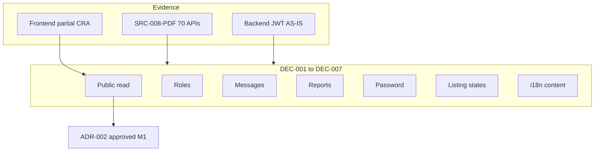

**Figure RE-FIG-DEC-WS-001** — Workshop input/output map.

### 1.1 Non-DEC product decisions (separate ID namespace)

Workshop register **§1** uses **DEC-001 … DEC-007**. The following IDs are **product decisions outside that numeric series** — do not conflate **D-06** with **DEC-006** (listing lifecycle).

| ID | Title | Domain | Related FR | Scope | PO status |
|----|-------|--------|------------|-------|-----------|
| **D-06** | Favorite and Following Independence | Advert Engagement | [FR-FAV-001](../02-requirements/FRD/FRD-EN.md), [FR-FOLLOW-001](../02-requirements/FRD/FRD-EN.md) | Later / Post-M1 / Release TBD | **Owner-confirmed** — not formal workshop **Approved**; no approval date in repository |

Full record: **§11**.

---

## 2. DEC-001 — Public catalog and anonymous read access

### 2.1 Evidence

| Source | Finding |
|--------|---------|
| SRC-008-PDF | **47+** GET codes marked **ANONYMOUS +** (A01, A07, C01, T01, U01–U03, etc.) |
| AS-IS `SecurityFilterChainConfig` | `anyRequest().authenticated()` except auth signup, ping, profile-image GET, swagger |
| Commented code | Historical `//.requestMatchers(HttpMethod.GET,"/api/**").permitAll()` — never active |
| `AdvertController.getListWithActive` | Exists but **401** without JWT |
| `AdvertResponse` | No `user`, slug, or `tourRequest` in response today — lower immediate PII risk than LEGACY A07 |
| Frontend `config.api.baseUrl` | Points to `https://mycampusmates.com/app` — **not** local RealEstate API; browse not wired |
| BRD BA-01, ADR-002 | M1 narrow whitelist **approved** (TASK-001); broader LEGACY anon **out of M1** |

### 2.2 Sensitive vs public data boundary


**Figure RE-FIG-DEC-001** — Proposed read-model boundary (not enforced until ADR approved).

| Data element | Public catalog (proposal) | Authenticated only |
|--------------|---------------------------|-------------------|
| Title, price, location, geo, category, images | Yes (ACTIVATED + `isActive`) | — |
| Slug, view count | Yes | — |
| Owner email / phone | No | Owner profile, admin |
| Pending/rejected adverts | No | Owner, manager, admin |
| Tour requests on detail | No (LEGACY A07 included — **do not copy**) | Owner, requester |
| Admin advert lists A06 | No | Manager+ |

### 2.3 Option comparison

| Option | LEGACY fidelity | Effort | Security notes | FE impact |
|--------|-----------------|--------|----------------|-----------|
| **A — `permitAll` on named GET paths** | High | Low–medium | Path list maintenance; filter status in service | Home/search work without login |
| **B — `/public/v1` facade** | High | Medium–high | Cleanest DTO boundary | New client base path |
| **C — Guest JWT** | Low | Medium | Violates PDF anonymous intent | Poor UX |
| **D — API gateway** | High | High (ops) | Edge policy | Infra dependency |

### 2.4 Proposed recommendation (not approved)

Adopt **Option A** for M1, paired with a **PublicAdvertResponse** (or mapper flag) that never exposes owner PII or non-published adverts. Revisit **Option B** if path list becomes unmaintainable.

**ADR:** [ADR-002-public-read-api.md](../03-architecture/ADR/ADR-002-public-read-api.md) v0.3.0.

### 2.5 PO approved sub-decisions (DEC-001)

| Sub-ID | Topic | PO decision | Status | Task ref |
|--------|-------|-------------|--------|----------|
| **DEC-001-J02** | Contact message **POST** (LEGACY J02, `POST .../contact-messages/{language}/add`) | **Authentication required.** Anonymous users must **not** submit contact messages. | **Approved** (PO, TASK-011-A) | Does **not** approve Option A, full DEC-001, or ADR-002 |
| **DEC-001-M1-A02-A04** | M1 scope for **A02** (cities), **A03** (categories), **A04** (popular adverts) | **Option D — minimum viable journey.** A02, A03 and A04 **excluded from M1**; deferred to a **later release** (no release ID/date). | **Approved** (PO, TASK-012-A) | M1 scope only — **not** anonymous access, **not** ADR-002, **not** full DEC-001 |
| **DEC-001-ANONYMOUS-CATALOG** | M1 **listing browse** and **property detail** read journeys | **Anonymous access required** for these two read-only journeys (authentication **not** required). | **Approved** (PO, TASK-013-A) | Product requirement only — **not** ADR-002, **not** `permitAll`, whitelist, Public DTO, visibility rule, rate limits, geo/category anon, or **A02/A03/A04** |

**Effect (anonymous catalog):** BR-011 product intent partially satisfied for M1 list + detail. Implementation mechanics remain **open** (see §2.6).

**Effect (J02):** Target policy aligns with AS-IS JWT on this path; LEGACY anonymous J02 is **superseded** for product direction. No role-specific policy recorded beyond “authenticated.”

**Effect (M1 A02–A04):** Initial release prioritizes fundamental **property listing and property detail** experience; aggregations and popularity endpoints do not expand M1. **Future access policy** for A02–A04 when implemented remains **PO DECISION REQUIRED** (separate from this scope decision).

### 2.5.1 PO approved — M1 public catalog technical baseline (TASK-001)

| # | Topic | PO decision | Status | Doc |
|---|--------|-------------|--------|-----|
| 1 | Listing | **P1** `GET /api/v1.0/adverts/{language}/catalog` | **Approved** | ADR-002 §1 |
| 2 | Public DTO | **Option B** — no JPA on public JSON | **Approved** | ADR-002 §2 |
| 3 | Visibility | **V3** (see DEC-006 §7.5) | **Approved** | ADR-002 §3 |
| 4 | Images | **Model 2** public image GET + V3 | **Approved** | ADR-002 §4 |
| 5 | Identifiers | No public `id` / `viewCount`; slug; allow-listed `propertyValues` only | **Approved** | ADR-002 §5 |
| 6 | Whitelist | Three GET paths only; exclusions per ADR-002 | **Approved** | ADR-002 §6 |
| 7 | Rate limiting | Mandatory IP-based before prod; Redis optional | **Approved** | ADR-002 §7 |

**ADR-002:** [approved](../03-architecture/ADR/ADR-002-public-read-api.md) v0.5.0. Does **not** approve per-field DTO tables, numeric limits, or slug migration mechanics.

### 2.6 PO open questions (DEC-001 — remaining)

1. **Geo/category anonymous GET** in future releases — **TBD** (out of M1 per DEC-001-M1-A02-A04 and TASK-001 whitelist).
2. **Per-field public DTO tuning** beyond TASK-001 policies (e.g. optional list teaser) — engineering defaults unless PO opens new gate.
3. When A02–A04 are implemented (post-M1), **anonymous vs authenticated** access — **TBD**.

---

## 3. DEC-002 — Customer and manager responsibilities

### 3.1 Evidence — LEGACY (SRC-008-PDF, SRC-002)

| Topic | LEGACY evidence |
|-------|-----------------|
| Customer | Register F02; own profile F05–F08; create/update adverts A10–A11; favorites K*; tour S05–S07 |
| Manager | Poster: all Customer capabilities **plus** catalog/customer/message/report ops; **not** Manager/Admin user governance |
| Admin | Full user admin F09–F12; built-in data |
| LEG-BR-007 | Manager may only manage **Customer** users (pp. 86–87) |
| Listing approval | Pending → Activated by staff (p. 6, LEG-BR-001) |
| Property ownership | `Advert.user_id` in ERD; customer creates listing |

### 3.2 Evidence — AS-IS code

| Topic | AS-IS behavior |
|-------|----------------|
| Roles | `RoleType`: ADMIN, MANAGER, CUSTOMER, **PERSONAL** (test) |
| `@PreAuthorize` | Commented out on several controllers |
| `AdvertManager.update` | Persists request payload; **no auto-reset to PENDING** verified |
| `builtIn` on `Advert` | Field exists; **no guard** in `AdvertManager` grep |
| `AdminController` / `UserController` | Exist; scope rules **not** verified in services |
| Assignment | No separate “assign listing to manager” entity in `Advert` |

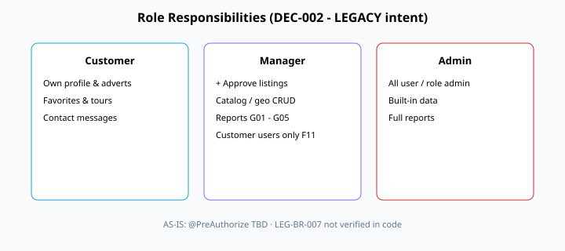

**Figure RE-FIG-DEC-002-SVG** — LEGACY role split (complements flow below).

### 3.3 Responsibility matrix (historical intent vs AS-IS)

| Responsibility | LEGACY | AS-IS | Gap |
|----------------|--------|-------|-----|
| Customer owns listings | Yes | `user_id` on advert | Aligned structurally |
| Staff approves listing | Yes | Enum exists; workflow **not** enforced | **Partial** |
| Customer edit → Pending | LEG-BR-002 / A11 | Not in `AdvertManager` | **Missing** |
| Manager user admin scope | Customers only | **TBD** | **TBD** |
| Admin manages all users | F09–F12 | Partial endpoints | Contract drift |
| Manager reports | G01–G05 | Missing API | **Missing** |

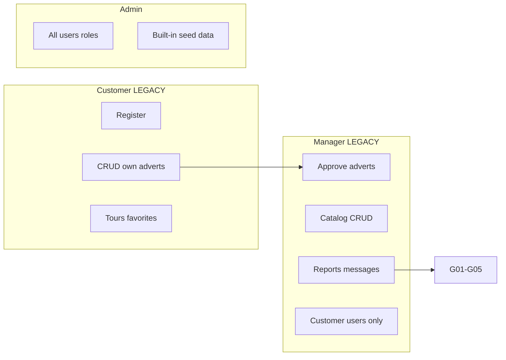

**Figure RE-FIG-DEC-002** — LEGACY responsibility flow (approval and reports).

### 3.4 Proposed recommendation (not approved)

1. Treat **SRC-002 poster + PDF role columns** as target RBAC (TASK-005).
2. Implement **LEG-BR-002** in advert update service when customer (non-admin) edits.
3. **Remove or isolate PERSONAL** role from production policy document.
4. Do **not** invent “listing assignment to manager” without SRC evidence — **TBD** if product needs it.

### 3.5 PO open questions

1. Can **Manager** create adverts on behalf of customers (PDF allows Manager+ on A10)?
2. Should **Customer** see pending/rejected own listings on public site?
3. Formal rule for **`isActive` vs `AdvertStatus.ACTIVATED`** — single gate or two flags?

---

## 4. DEC-003 — Internal messaging

### 4.1 Evidence

| Source | Finding |
|--------|---------|
| SRC-008-PDF | **No** mailbox/message API codes — domain absent from 70-code set |
| AS-IS | `MessageController` + `Message` entity; inbox/outbox/draft/trash/read flags |
| Postman collection | Message endpoints documented |
| BRD BA-04 | “Remains though absent from PDF” — **TBD** sign-off |
| FR-MSG-001 | AS-IS classification |
| ROLE matrix | Manager + Admin; JWT required |
| Contact messages J01–J02 | Separate **public-facing** contact channel in LEGACY |

### 4.2 Capability assessment

| Criterion | Assessment |
|-----------|------------|
| Legitimate product capability? | **Plausible** for staff coordination; **not** LEGACY-validated |
| Relation to historical scope | **AS-IS extension** / training artifact |
| Target product inclusion? | **Proposal: retain** if ops need internal mail; else deprecate in roadmap |
| Security / privacy | JWT-only; need receiver scoping audit; spam/trash flags; no encryption at rest stated |

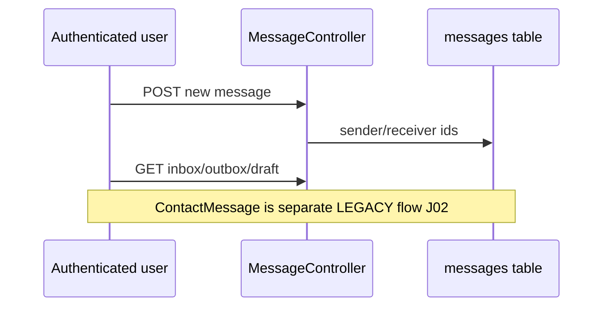

**Figure RE-FIG-DEC-003** — AS-IS messaging vs LEGACY contact messages.

### 4.3 Options (proposal)

| Option | Description |
|--------|-------------|
| **R1 — Retain & govern** | Keep FR-MSG-001; add BRD business rule; RBAC Manager+; privacy review |
| **R2 — Deprecate** | Freeze API; remove from FE roadmap; migrate to external mail |
| **R3 — Merge with contact** | Single “communications” module — **high scope**; not evidence-based |

**Recommended proposal:** **R1** unless PO explicitly cuts scope.

### 4.4 PO open questions

1. Should **Customers** send internal messages or **staff only**?
2. Retention / GDPR deletion policy for `messages`?
3. Relationship to **tour request notifications** (email vs in-app)?

---

## 5. DEC-004 — Reporting requirements (G01–G05)

### 5.1 Summary table

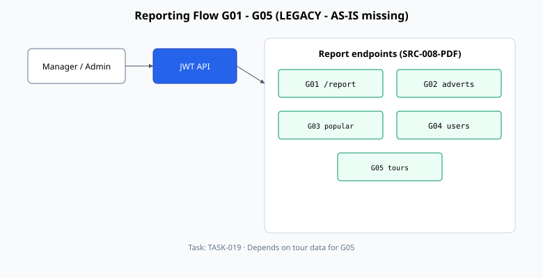

**Figure RE-FIG-DEC-004** — LEGACY reporting flow (endpoints missing in AS-IS).

| Code | FR | Page | Method | LEGACY path | Auth (PDF) | Business purpose (inferred) | Data / output (evidence level) | Open questions |
|------|-----|------|--------|-------------|------------|-------------------------------|-------------------------------|----------------|
| **G01** | FR-RPT-001 | 89 | GET | `/report` | Manager/Admin `++` | Operations **dashboard** | Aggregate KPIs — **payload not extracted** | JSON shape? filters? |
| **G02** | FR-RPT-002 | 90 | GET | `/report/adverts` | Manager/Admin | Advert **analytics** | Advert counts/status — **TBD** | Date range? export? |
| **G03** | FR-RPT-003 | 91 | GET | `/report/most-popular-properties` | Manager/Admin | **Popularity** report | Related to A04 formula PP — **TBD** | Same formula as public A04? |
| **G04** | FR-RPT-004 | 92 | GET | `/report/users` | Manager/Admin | Users **by role** | User/role stats — **TBD** | Manager sees all roles or customers only? |
| **G05** | FR-RPT-005 | 93 | GET | `/report/tour-requests` | Manager/Admin | **Tour** pipeline report | TourRequest status — **TBD** | Depends on TASK-002 REST |

### 5.2 User journey (proposal)

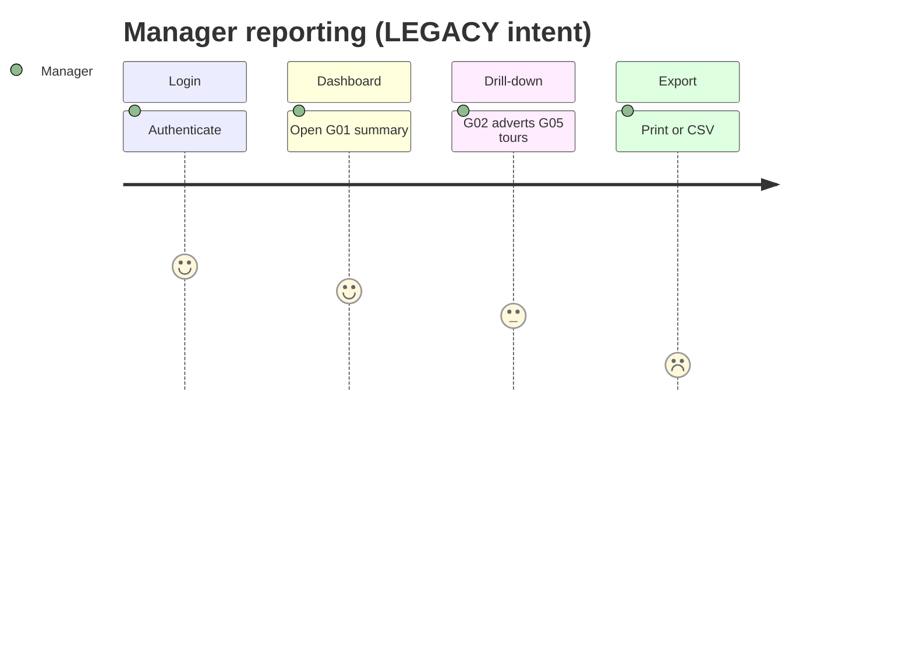

**Figure RE-FIG-DEC-005** — Journey quality qualitative (export **not** in PDF evidence).

### 5.3 Proposed recommendation (not approved)

1. Prioritize **G01 + G05** after tour REST (TASK-002) for operational value.
2. Map response DTOs from PDF extraction pass **before** implementation (sub-task of TASK-019).
3. **Do not** expose reports anonymously.

### 5.4 PO open questions

1. Minimum **MVP dashboard** widgets for G01?
2. **Manager vs Admin** row-level difference for G04?
3. **CSV/PDF export** required or JSON-only acceptable?

---

## 6. DEC-005 — Password recovery (F03 / F04)

### 6.1 Evidence

| Item | LEGACY (SRC-008-PDF) | AS-IS |
|------|----------------------|-------|
| F03 | POST `/forgot-password` p. **78**, Anonymous **+** | **Not found** |
| F04 | POST `/reset-password` p. **79** | **Not found** |
| LEG-NFR-008 | Must **not reveal** whether email exists | Not implemented |
| Register rules | Complexity on F02 p. 77 | **TBD** in `AuthManager` |

### 6.2 User journey (proposal)

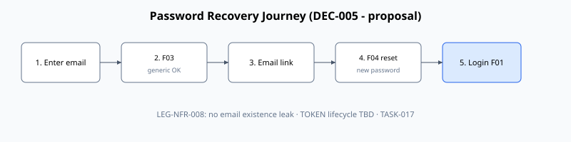

**Figure RE-FIG-DEC-006** — Proposed F03/F04 flow (details **TBD** from PDF field spec).

| Step | Actor | Action |
|------|-------|--------|
| 1 | User | Submits email on forgot form |
| 2 | API | Always returns generic success (LEG-NFR-008) |
| 3 | System | Issues **time-limited token** (email channel — **dependency TBD**) |
| 4 | User | Opens link, submits new password F04 |
| 5 | API | Validates token, complexity, invalidates token |

### 6.3 Security requirements (from evidence + standard practice — proposal)

| Requirement | Source |
|-------------|--------|
| Anti-enumeration response | LEG-NFR-008 |
| Token single-use + expiry | **TBD** — PO sets TTL |
| Rate limit per IP/email | **Proposal** — not in PDF |
| No password in email | **Proposal** |
| Audit log of reset | **TBD** |

### 6.4 Proposed recommendation (not approved)

Implement **F03/F04** in TASK-017 with **email provider ADR** (or explicit out-of-band for dev). Block production until LEG-NFR-008 tests exist.

### 6.5 PO open questions

1. **Email provider** (SMTP vs SaaS)?
2. Token TTL and link base URL (FE route)?
3. Require **captcha** on F03?

---

## 7. DEC-006 — Listing lifecycle

### 7.1 Evidence-supported states

| State | LEGACY | AS-IS `AdvertStatus` | Notes |
|-------|--------|----------------------|-------|
| Pending | Status 0, p. 6 | `PENDING` | Default on create |
| Published / Active | Activated 1 | `ACTIVATED` | Plus `isActive=true` flag |
| Rejected | 2 | `REJECTED` | |
| **Draft** | **Not in PDF advert enum** | — | **Proposal only** if PO wants save-draft |
| **Archived** | **Not in PDF** | `isActive=false`? | **Proposal** — soft-delete via flag, not enum |

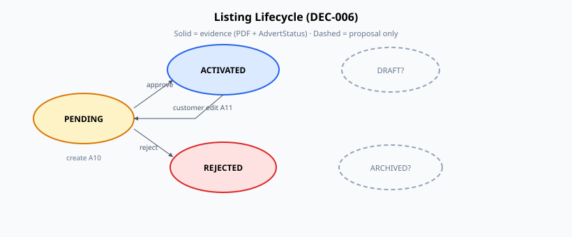

**Figure RE-FIG-DEC-007** — LEGACY states solid; Draft/Archived dashed (proposal).

### 7.2 AS-IS vs LEGACY behavior gaps

| Rule | LEGACY | AS-IS |
|------|--------|-------|
| Create → Pending | A10 | Default enum OK |
| Staff approval | Manager/Admin | **No dedicated endpoint verified** |
| Customer update → Pending | A11 / LEG-BR-002 | **Not enforced** in service |
| Built-in immutability | LEG-BR-003 | Field present; guards **TBD** |
| Public visibility | Active/Activated only | `getListWithActive` uses `isActive` only |

### 7.3 Proposed recommendation (not approved)

1. **Do not add** Draft/Archived enum values until PO requests.
2. ~~Define publication rule~~ → **superseded for M1 public catalog by §7.5 (approved).**
3. Implement approval transitions via **manager endpoints** (new or existing PUT) — design in TASK-015.

### 7.4 PO open questions

1. Separate **Draft** from **Pending**?
2. Is **Rejected** visible to owner only?
3. **Archive** vs **delete** for customer self-service?

### 7.5 PO approved — M1 public catalog visibility (TASK-001)

For **anonymous public catalog** listing, detail, and image delivery:

```text
AdvertStatus = ACTIVATED AND isActive = true AND deleted = false
```

**Approved** (PO, TASK-001). Recorded in [ADR-002](../03-architecture/ADR/ADR-002-public-read-api.md). Owner workflows, Draft/Archive, and rejection visibility remain **§7.4**.

---

## 8. DEC-007 — Multilingual advert content

**Status:** **approved** (Product Owner, **ARCH-1**, 2026-11-14). Recorded in [ADR-002](../03-architecture/ADR/ADR-002-public-read-api.md) v0.6.0 (multilingual public read policies). Supersedes §8.3 workshop proposal (defer single-column AS-IS).

### 8.1 Terminology (keep separate)

| Term | Meaning |
|------|---------|
| **UI language** | Frontend i18next strings and user interface locale — **not** advert content language |
| **API / friendly-message language** | Legacy `Language` enum on many routes — localized errors and success messages |
| **Advert content language** | Language of `title`, `description`, `slug`, and related published listing text |
| **Source language** | Original language in which the advert owner created content (`Advert.sourceLanguage` → Language Registry, **TO-BE**) |
| **Target language** | Language into which a translation is created (manual or AI suggestion) |
| **Language Registry** | Central catalogue of supported languages and capability flags (`de`, `tr`, `en` initially; extensible without per-language schema columns) |
| **AdvertTranslation** | One row per advert per content language (translatable fields + publication lifecycle) |
| **Translation lifecycle** | Review, approval, publication, and outdated marking — independent per language |

**Rule:** Application **UI language must never implicitly determine** the advert's original or requested **content language**.

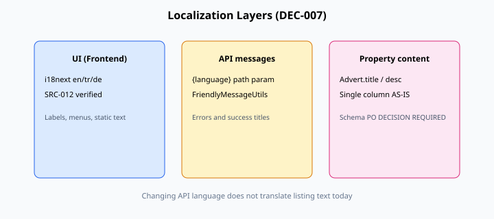

**Figure RE-FIG-DEC-007-LAY** — UI, API messages, and advert content (reference diagram).

### 8.2 Approved product decisions

| # | Topic | Decision |
|---|--------|----------|
| 1 | **Initial content languages** | German (`de`), Turkish (`tr`), English (`en`) |
| 2 | **Extensibility** | Add languages via **Language Registry** data/configuration; no new DB columns per language |
| 3 | **Content model** | **Advert** — shared, language-independent data + **source language** reference; **AdvertTranslation** — per-language `title`, `description`, `slug`, SEO fields (**TO-BE**), lifecycle metadata |
| 4 | **Slug uniqueness** | **Language-scoped:** `UNIQUE(language_code, lower(slug))` — same slug allowed across different content languages; not twice within one language |
| 5 | **Public missing translation** | HTTP **404** when the requested content-language translation is missing or not publicly available — **no automatic fallback** to another language |
| 6 | **Published translation preservation** | When source content changes: published translations **remain public**; marked **outdated** pending review; replacement becomes public only after approval/publication; implementation uses **versioning or published-snapshot** (**TO-BE** engineering) |
| 7 | **Public visibility (with DEC-006 / ADR-002)** | Anonymous catalog/detail still require advert **V3** gate **and** a **published** translation for the requested content language |
| 8 | **AI translations** | **Never** auto-publish; owner review and explicit approval required (**M2** scope) |

### 8.3 Delivery scope — product M1 vs M2

| Scope | Includes |
|-------|----------|
| **M1 (multilingual foundation)** | Dynamic Language Registry; `de`/`tr`/`en`; Advert + AdvertTranslation; manual create/edit; review and publication lifecycle; language-specific slugs; localized public catalog and slug detail; supersedes single-column slug-on-`Advert` as **target** architecture |
| **M2 (AI-assisted translation)** | Provider abstraction; AI suggestions; owner review/approval; provider metadata and operational handling |

**Note:** [M1-IMPLEMENTATION-PLAN.md](M1-IMPLEMENTATION-PLAN.md) `IMPL-010` slug guidance assumed a **global** `adverts.slug` unique index (Flyway V2). DEC-007 **supersedes** that target: engineering must migrate slug ownership to **AdvertTranslation** with language-scoped uniqueness — see [ROADMAP.md](ROADMAP.md) § Product delivery.

### 8.4 Historical evidence (workshop baseline)

| Topic | Finding |
|-------|---------|
| PDF | No multi-language content model; mixed TR/EN examples |
| AS-IS API | `{language}` path used for **friendly messages**, not content |
| `Advert` | Single `title`, `desc`, `slug` columns today |
| Frontend | i18next `en`/`tr`/`de` for **UI** only (SRC-012) |

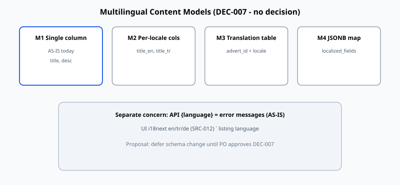

**Figure RE-FIG-DEC-008** — Workshop comparison; **chosen direction: normalized translation table (former M3)**, not M1 single column.

### 8.5 Superseded proposals (do not implement)

| Prior proposal | Disposition |
|----------------|-------------|
| §8.3 (v0.1.4) defer DB; keep single `title`/`desc` | **Superseded** by §8.2 |
| Public content fallback to EN ([I18N_STRATEGY.md](../04-development/I18N_STRATEGY.md) draft) | **Rejected** for public advert content under DEC-007 |
| Global slug unique on `adverts` (IMPL-010 TO-BE before ARCH-1) | **Superseded** by language-scoped slug on translations |

### 8.6 Open decisions (not approved — explicit PO follow-up)

1. **Existing advert source-language backfill** strategy for migrated data
2. **Category** and **CategoryPropertyValue** translation scope
3. **Shared structured location** vs translatable free-text `location`
4. **Language deactivation** behavior for already-published translations
5. **Source-language change** policy after translations exist
6. **Public `{language}` route** migration and backward compatibility (UI vs content language disambiguation)
7. **`Accept-Language`** handling outside public advert content
8. **SEO metadata** and **image alt-text** multilingual scope

---

## 9. Cross-decision dependencies

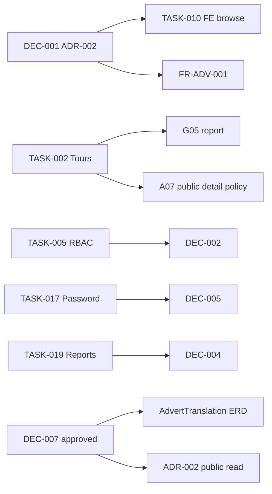

**Figure RE-FIG-DEC-WS-002** — Dependency graph (draft).

---

## 10. Workshop validation

| Check | Result |
|-------|--------|
| No implementation performed | Pass |
| No invented business rules | Pass — proposals labeled |
| BRD/FRD/matrix consistency | Pass with documented conflicts |
| ADR-002 status | **approved** (v0.5.0+); v0.6.0 multilingual amendment |
| PO approval | **Partial** — per-decision; DEC-007 approved ARCH-1 |

---

## 11. D-06 — Favorite and Following Independence

| Field | Value |
|-------|--------|
| **Decision ID** | **D-06** (not DEC-006) |
| **Title** | Favorite and Following Independence |
| **Domain** | Advert Engagement |
| **Scope** | Later / Post-M1 / Release TBD |
| **Related FR** | [FR-FAV-001](../02-requirements/FRD/FRD-EN.md), [FR-FOLLOW-001](../02-requirements/FRD/FRD-EN.md) |
| **PO status** | **Owner-confirmed** — preferences recorded in documentation; **not** labeled **Approved** like TASK-001 / ARCH-1 entries; **no formal approval date** in this repository |
| **Implementation** | **Not complete** — AS-IS `Favorite` partial only; **Following** not in schema or API |

**Cross-reference:** Listing visibility and status rules remain under **DEC-006** and **ADR-002**; D-06 governs **engagement relationships**, not public catalog gates.

### 11.1 Confirmed product rules

1. A user may **Favorite** an advert without **Following** it.
2. A user may **Follow** an advert without **Favoriting** it.
3. A user may both **Favorite** and **Follow** the same advert.
4. **Unfollowing** an advert must **never** remove its **Favorite** relationship.
5. **Inactivation** of an advert must **not** automatically remove **Favorite** or **Following** relationships.
6. **Soft deletion** of an advert must **not** automatically remove **Favorite** or **Following** relationships.
7. **Following eligibility** for different advert statuses remains **unresolved**.
8. **Physical hard-delete** behavior remains subject to **technical clarification**.
9. **Following notifications** are **not** part of the current D-06 scope (deferred; separate decision later).

**Note:** Retaining a relationship does **not** imply that the advert remains **visible** or **accessible** in the UI; UI behavior is **separate** and **open** (OQ-4).

### 11.2 Open questions (unresolved — do not implement as decided)

| ID | Topic |
|----|--------|
| **OQ-1** | **Following eligibility** by advert status and visibility (coordinate with **DEC-006** / V3 only by cross-reference; do not merge decisions). |
| **OQ-2** | **Physical hard-delete** — relationship retention, orphan handling, or blocking delete (product intent + technical design). |
| **OQ-3** | **Following notifications** — deferred; **outside** current D-06 scope. |
| **OQ-4** | **UI representation** of Favorite/Following for inactive or soft-deleted adverts (distinct from relationship persistence). |

---

## 12. Change history

| Version | Date | Summary |
|---------|------|---------|
| 0.1.0 | 2026-11-13 | TASK-010 workshop package DEC-001 … DEC-007 |
| 0.1.1 | 2026-11-13 | TASK-011-A: PO approved DEC-001-J02 authenticated-only |
| 0.1.2 | 2026-11-13 | TASK-012-A: PO approved DEC-001-M1-A02-A04 Option D defer beyond M1 |
| 0.1.3 | 2026-11-13 | TASK-013-A: PO approved DEC-001-ANONYMOUS-CATALOG (M1 list + detail) |
| 0.1.4 | 2026-11-13 | TASK-001: DEC-001 M1 baseline §2.5.1; DEC-006 M1 public gate §7.5 |
| 0.1.5 | 2026-11-14 | **ARCH-1:** DEC-007 multilingual advert content **approved**; slug per language; public 404 no fallback; M1/M2 scope |
| 0.1.6 | 2026-11-18 | **D-06** Favorite and Following Independence — **owner-confirmed**; §1.1 register; FR-FAV-001 / FR-FOLLOW-001 traceability |
