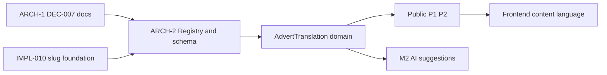
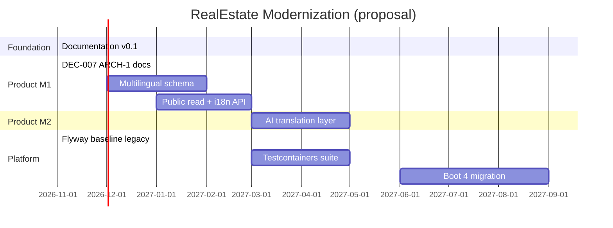
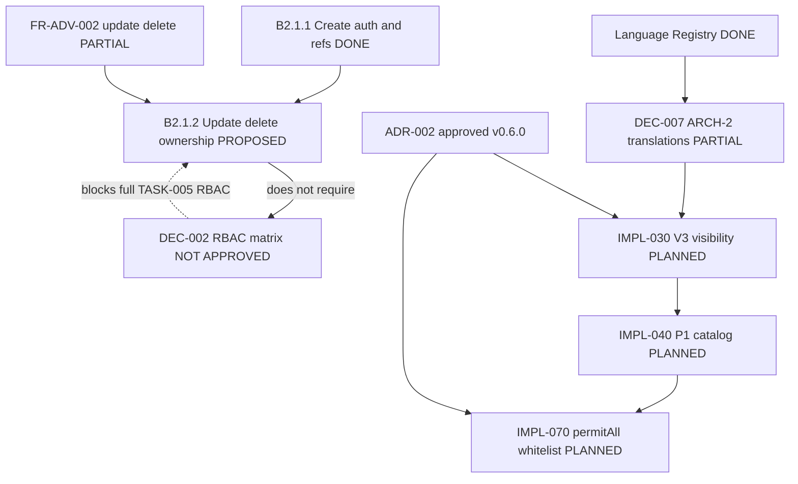

# ROADMAP

This document combines **product delivery phases** (DEC-007 multilingual advert content) with the **engineering modernization** timeline (stack, tests, security).

## Product delivery — multilingual adverts (DEC-007)

**Approved:** [PRODUCT_DECISIONS.md](PRODUCT_DECISIONS.md) §8 · **Public read:** [ADR-002](../03-architecture/ADR/ADR-002-public-read-api.md) v0.6.0

### M1 — Multilingual foundation (manual content)

| Track | Deliverables | Depends on |
|-------|----------------|------------|
| **ARCH-2+** | Language Registry (DB); `Advert` + **AdvertTranslation**; Flyway migrations; language-scoped slug index; migrate legacy `adverts` columns without data loss | ARCH-1 docs |
| **Domain** | Source language; translation lifecycle (draft → review → published → outdated); published-snapshot/versioning strategy | ARCH-2 schema |
| **Services** | Manual translation CRUD; publication gates; **SlugNormalizer** + registry (`de`/`tr`/`en`) | IMPL-010-2A+ |
| **Public API** | P1 catalog + P2 slug detail join **published** translation + **V3**; **404** if missing/unpublished; **no language fallback** | IMPL-040/050 + DEC-007 |
| **Security / DTO** | Public DTO from translations; ADR-002 whitelist unchanged (read-only GET) | IMPL-020, IMPL-060 |
| **Tests** | Migration tests; translation lifecycle; public 404 matrix | TEST matrix |

**Out of product M1:** AI translation, auto-publish, category/property bulk localization (unless PO closes open items in §8.6).

### M2 — AI-assisted translation

| Track | Deliverables |
|-------|----------------|
| **Provider port** | Replaceable AI translation adapter |
| **Workflow** | User-triggered suggest → owner edit → approve → publish (never auto-publish) |
| **Operations** | Provider metadata, retries, cost/audit fields (authenticated APIs only) |

### Architectural dependencies (critical path)

**Note:** [M1-IMPLEMENTATION-PLAN.md](M1-IMPLEMENTATION-PLAN.md) predates DEC-007. `IMPL-010` global-slug TO-BE is **superseded** by translation-scoped slugs; sequencing updated here — implementation plan revision **recommended** in a follow-up doc task.

---

## Engineering modernization (historical gantt)

## Milestones

| ID | Goal | Exit criteria |
|----|------|---------------|
| M0 | Documentation foundation | Governance docs baseline |
| **PM1** | **Multilingual advert M1** | Registry + AdvertTranslation; manual publish; localized P1/P2 per ADR-002 v0.6 |
| **PM2** | **AI translation M2** | Provider abstraction; suggest/review/approve; no auto-publish |
| M1 (eng) | LEGACY API parity gaps closed | FR-TOUR, FR-FAV, FR-MED AS-IS |
| M2 (eng) | Schema + tests | Flyway + coverage goals |
| M3 (eng) | Hardening security | RBAC enforced, CORS fixed |
| M4 (eng) | Stack upgrade | Boot 4 on Java 25 in CI |

**Naming:** **PM1/PM2** = product multilingual phases (DEC-007). **M1–M4** = legacy engineering milestone IDs in [MILESTONES.md](MILESTONES.md) — avoid conflating with product M1/M2.

Dependencies: [MILESTONES.md](MILESTONES.md). Risks: [RISKS.md](RISKS.md).

## Listing module — B2.x sequencing (post B2.1.1)

**B2.1.1 (done):** PR #12 merge `c4efa88` — advert create CUSTOMER-only + reference validation. Evidence: [SECURITY-ARCHITECTURE.md](../03-architecture/security/SECURITY-ARCHITECTURE.md) §5.7.

**Not complete:** DEC-002 business RBAC matrix, public catalog (ADR-002), full FR-ADV-002 update/delete security. **Proposed next engineering package:** **B2.1.2** — update/delete **ownership** authorization (does **not** require DEC-002 PO approval for owner-only rules).

**Figure RE-FIG-ROADMAP-B2** — Post–B2.1.1 dependency sketch (engineering recommendation; package IDs not in TODO until scheduled).

| Path | Rationale |
|------|-----------|
| **B2.1.2 first** | AS-IS gap: `AdvertManager` update/delete lack ownership checks ([SECURITY-ARCHITECTURE.md](../03-architecture/security/SECURITY-ARCHITECTURE.md) §5.6). Reuses B2.1.1 defense-in-depth pattern. |
| **IMPL-030 → 040/050 → 070** | Product M1 public catalog per [M1-IMPLEMENTATION-PLAN.md](M1-IMPLEMENTATION-PLAN.md); requires visibility + DTO before safe anonymous GET. |

## Change history

| Version | Date | Summary |
|---------|------|---------|
| 0.1.0 | 2026-11-13 | Initial modernization gantt |
| 0.2.0 | 2026-11-14 | **ARCH-1:** DEC-007 product M1/M2 scope, dependencies, IMPL-010 supersession note |
| 0.2.1 | 2026-11-26 | Post–B2.1.1 listing track diagram; B2.1.2 vs M1 public IMPL sequencing |