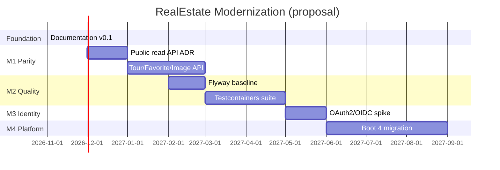

# ROADMAP

## Milestones

| ID | Goal | Exit criteria |
|----|------|---------------|
| M0 | Documentation foundation | This deliverable |
| M1 | LEGACY API parity gaps closed | FR-TOUR, FR-FAV, FR-MED AS-IS |
| M2 | Schema + tests | Flyway + 60% coverage goal |
| M3 | Hardening security | RBAC enforced, CORS fixed |
| M4 | Stack upgrade | Boot 4 on Java 25 in CI |

Dependencies: [MILESTONES.md](MILESTONES.md). Risks: [RISKS.md](RISKS.md).
