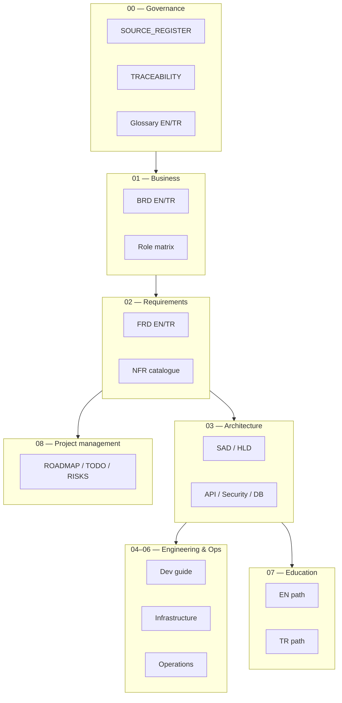

# RealEstate (Prettier Homes) — Documentation & Engineering Foundation

Welcome to the official documentation workspace for the **RealEstate** product. This tree is the single engineering and product knowledge base for backend-led modernization while preserving existing business intent.

## Purpose

| Audience | What you find here |
|----------|-------------------|
| Product & business | BRD, processes, role model |
| Engineers & architects | SAD/HLD, API, security, database |
| Operations | Runbooks, deployment, monitoring (proposals) |
| Learners (EN/TR) | Progressive curriculum under `07-education/` |

## Navigation map

**Figure RE-FIG-NAV-001** — Documentation information architecture (TO-BE organization; content status: draft).

## Current application baseline (AS-IS snapshot)

| Item | Value | Evidence |
|------|-------|----------|
| Backend artifact | `com.prettier:real-estate:1.0.0` | `pom.xml` (SRC-003) |
| Java | 17 | `pom.xml` |
| Spring Boot parent | 4.1.2 | `pom.xml` |
| Database | PostgreSQL via JPA/Hibernate | `application.yaml` (SRC-004) |
| API prefix | `api/v1.0` | Controllers (SRC-005) |
| Auth | JWT, stateless | `SecurityFilterChainConfig` (SRC-006) |
| OpenAPI | springdoc 3.2.0 | `pom.xml`, Swagger UI screenshots |
| Automated tests | Context load + PostgreSQL integration tests (`test` profile) | `RealEstateApplicationTests`, `PostgresIntegrationTestSupport` and related tests (SRC-007); see [TESTING-ARCHITECTURE.md](03-architecture/testing/TESTING-ARCHITECTURE.md) |

**Historical git snapshot (Stage 0, 2026-11-13):** Documentation foundation verification recorded branch `Fatih` and a clean working tree ([SOURCE_REGISTER.md](00-governance/SOURCE_REGISTER.md) v0.1.0). That state is **LEGACY context only** — not current branch or working tree.

## Evidence legend

- **AS-IS** — Verified in current code or configuration.
- **LEGACY** — Historical design (e.g. `files/Roles.JPG`, project PDF).
- **TO-BE** — Proposed target; not implemented.
- **TBD** — Needs decision or further verification.

## Quick links

| Document | Path |
|----------|------|
| Documentation guide | [00-governance/DOCUMENTATION_GUIDE.md](00-governance/DOCUMENTATION_GUIDE.md) |
| Source register | [00-governance/SOURCE_REGISTER.md](00-governance/SOURCE_REGISTER.md) |
| BRD (EN) | [01-business/BRD/BRD-EN.md](01-business/BRD/BRD-EN.md) |
| BRD (TR) | [01-business/BRD/BRD-TR.md](01-business/BRD/BRD-TR.md) |
| FRD (EN) | [02-requirements/FRD/FRD-EN.md](02-requirements/FRD/FRD-EN.md) |
| FRD (TR) | [02-requirements/FRD/FRD-TR.md](02-requirements/FRD/FRD-TR.md) |
| LEGACY ↔ FR matrix | [02-requirements/FRD/LEGACY_API_TO_FR_MATRIX.md](02-requirements/FRD/LEGACY_API_TO_FR_MATRIX.md) |
| LEGACY PDF analysis | [01-business/source-analysis/LEGACY-REQUIREMENTS-ANALYSIS.md](01-business/source-analysis/LEGACY-REQUIREMENTS-ANALYSIS.md) |
| Solution architecture | [03-architecture/SAD/SAD-001-system-context.md](03-architecture/SAD/SAD-001-system-context.md) |
| API inventory | [03-architecture/api/API-INVENTORY.md](03-architecture/api/API-INVENTORY.md) |
| M1 public catalog API (proposal) | [03-architecture/api/PUBLIC-CATALOG-API-DESIGN.md](03-architecture/api/PUBLIC-CATALOG-API-DESIGN.md) |
| M1 architecture decisions (TASK-016) | [08-project-management/M1-PUBLIC-CATALOG-ARCHITECTURE-DECISIONS.md](08-project-management/M1-PUBLIC-CATALOG-ARCHITECTURE-DECISIONS.md) |
| M1 implementation plan (TASK-017-M1) | [08-project-management/M1-IMPLEMENTATION-PLAN.md](08-project-management/M1-IMPLEMENTATION-PLAN.md) |
| ADR-002 public read (approved M1) | [03-architecture/ADR/ADR-002-public-read-api.md](03-architecture/ADR/ADR-002-public-read-api.md) |
| Technology baseline | [05-infrastructure/TECHNOLOGY_BASELINE.md](05-infrastructure/TECHNOLOGY_BASELINE.md) |
| Roadmap | [08-project-management/ROADMAP.md](08-project-management/ROADMAP.md) |
| Education | [07-education/README.md](07-education/README.md) |

## Visual assets

Screenshots from the existing backend README and Swagger are under `assets/screenshots/`. The historical role hierarchy image is at `assets/architecture/roles-hierarchy-legarcy.jpg` (copied from `files/Roles.JPG`; original unchanged).

## Repository boundaries

- **Writable:** `Backend/docs/` only (this task).
- **Read-only:** Backend source (except docs), Frontend, AIOS, original archives under `files/`.

## Change history

| Version | Date | Summary |
|---------|------|---------|
| 0.1.0 | 2026-11-13 | Initial documentation foundation (Stages 0–5 initial delivery) |
| 0.2.1 | 2026-11-18 | AS-IS baseline table: Spring Boot **4.1.2**, springdoc **3.2.0**, integration test snapshot aligned with `pom.xml`; Stage 0 git row moved to historical note |
